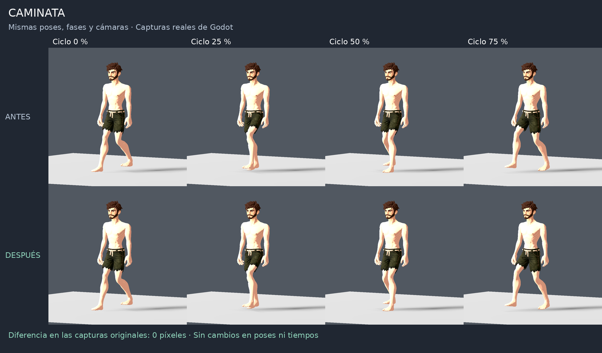
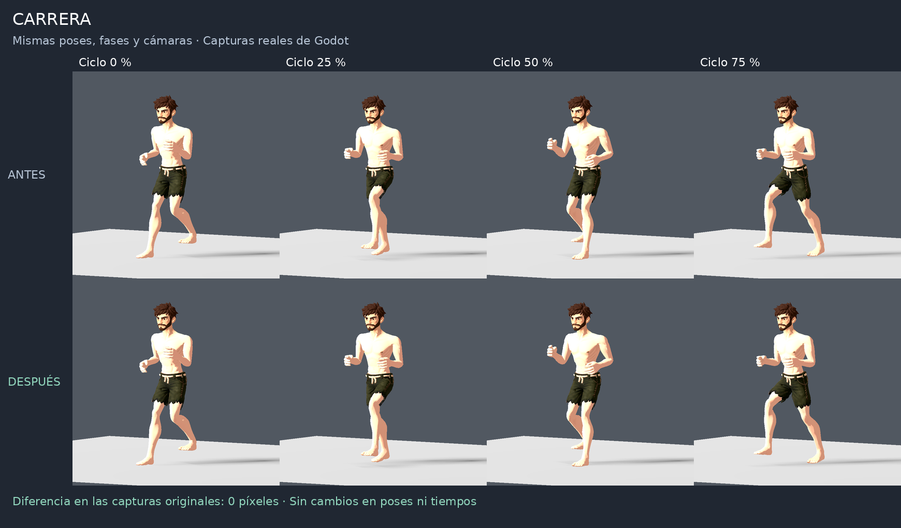
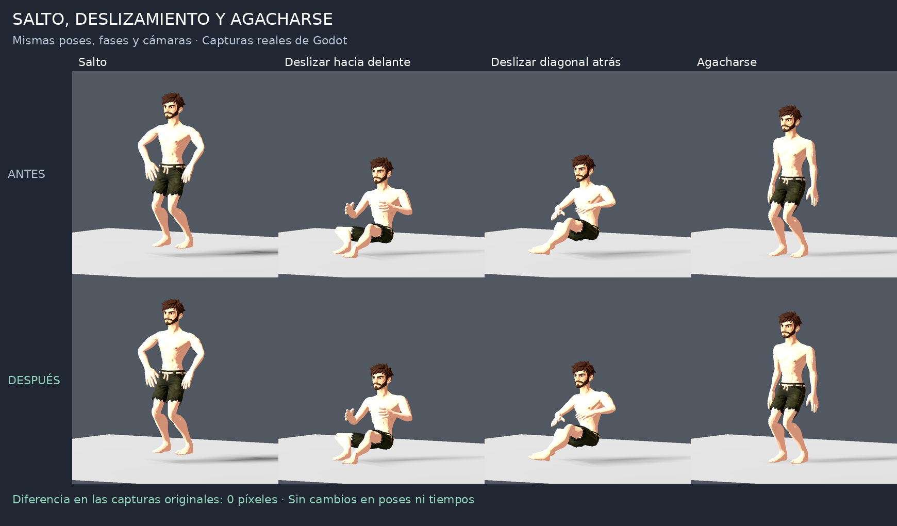
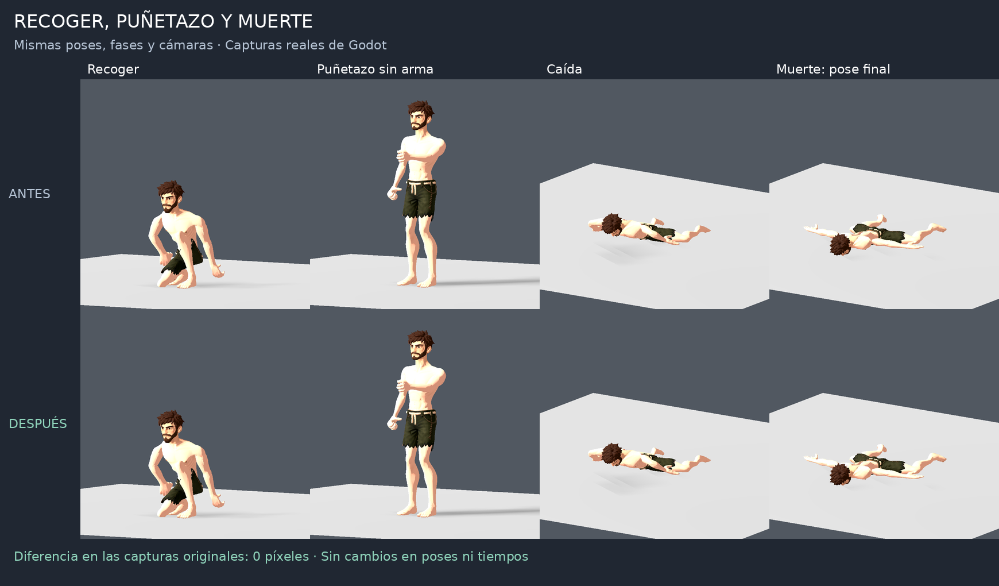

# Comparativa de animaciones: antes y después

Antes arriba; después abajo en cada panel. Capturas de la optimización aplicada sobre `dfdd4e5`.

## Caminata

## Carrera

## Salto, deslizamiento y agacharse

## Recoger, puñetazo y muerte

