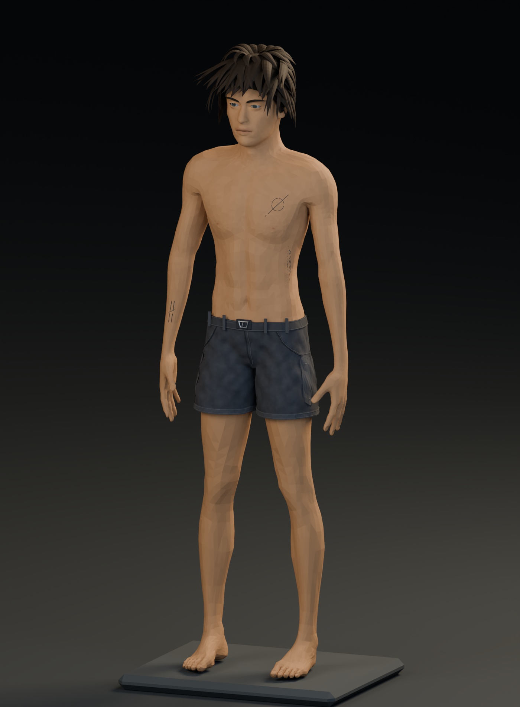
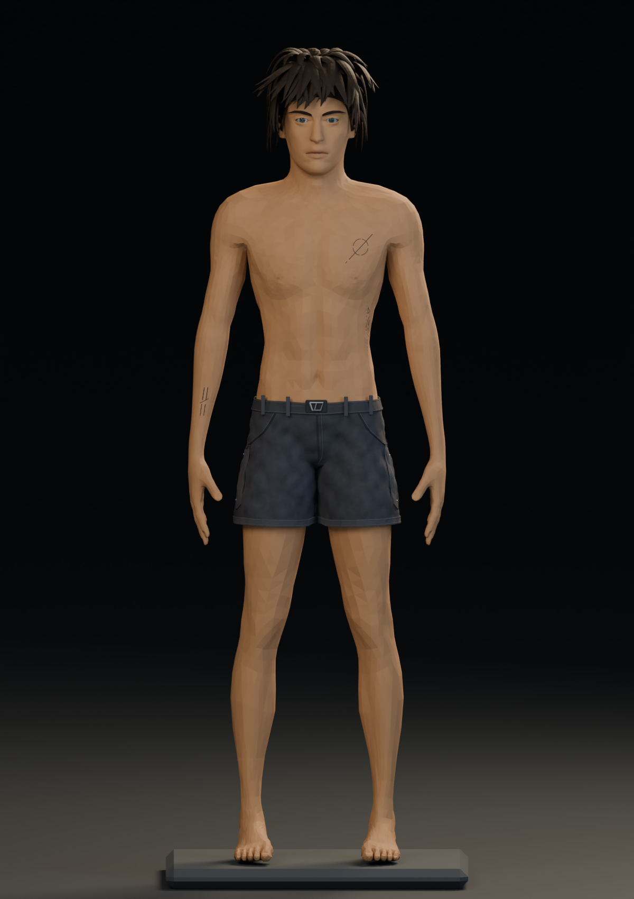
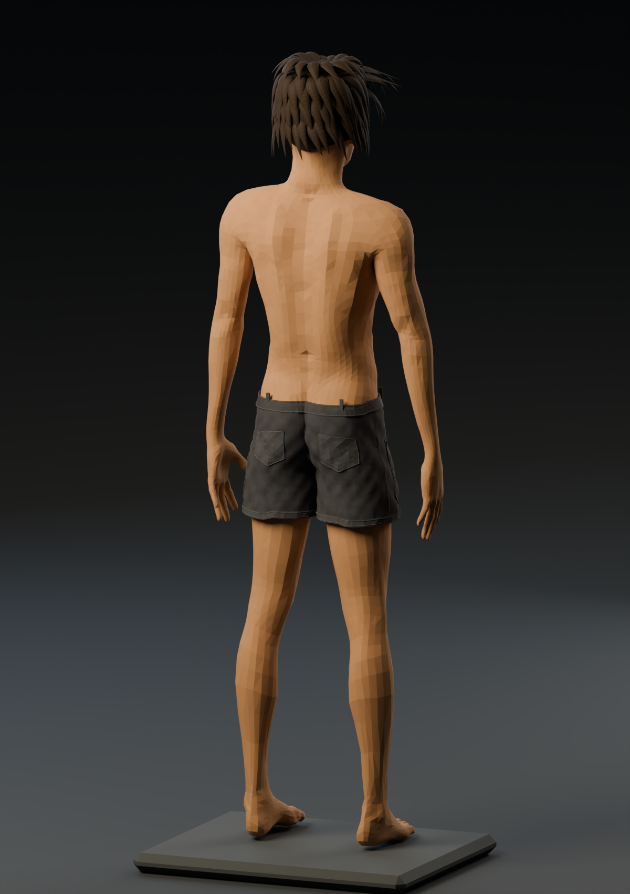
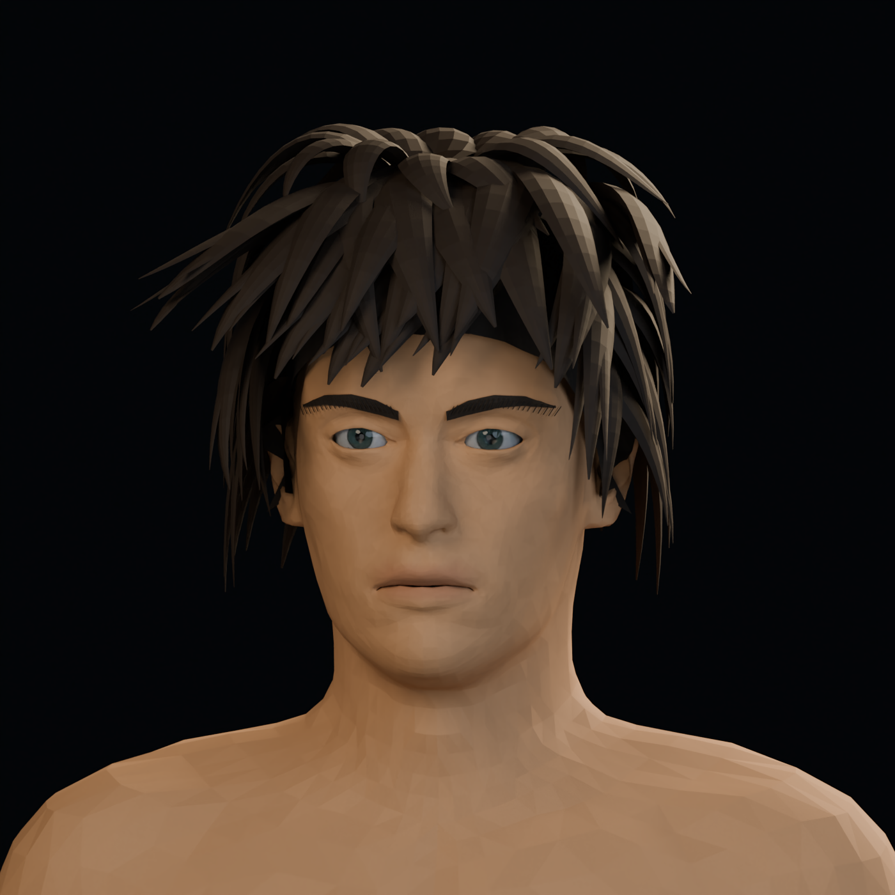
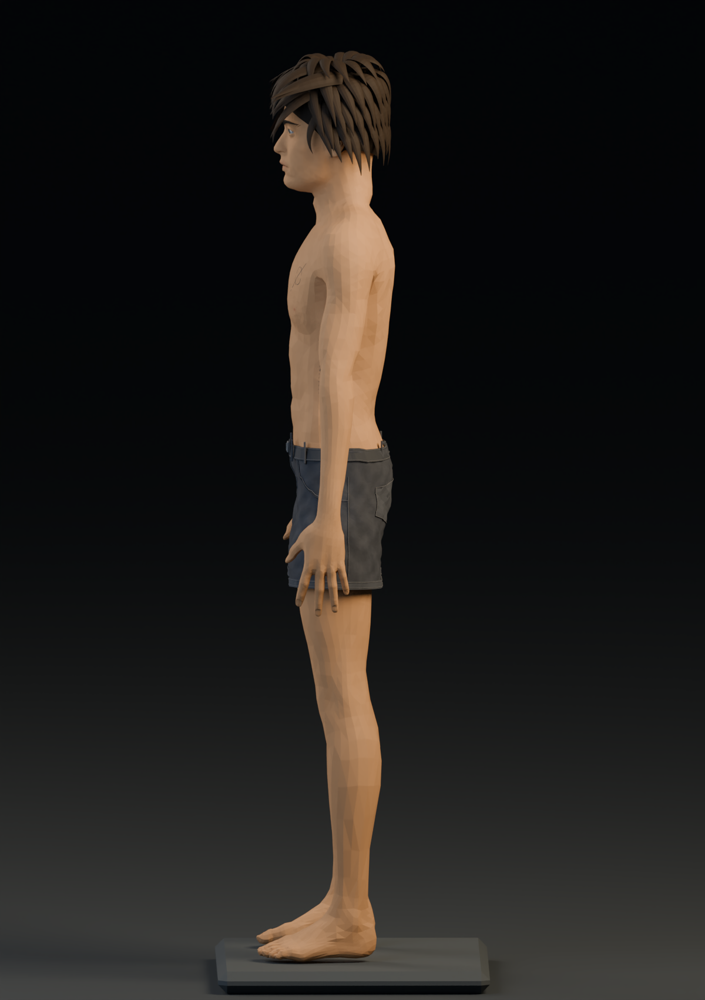
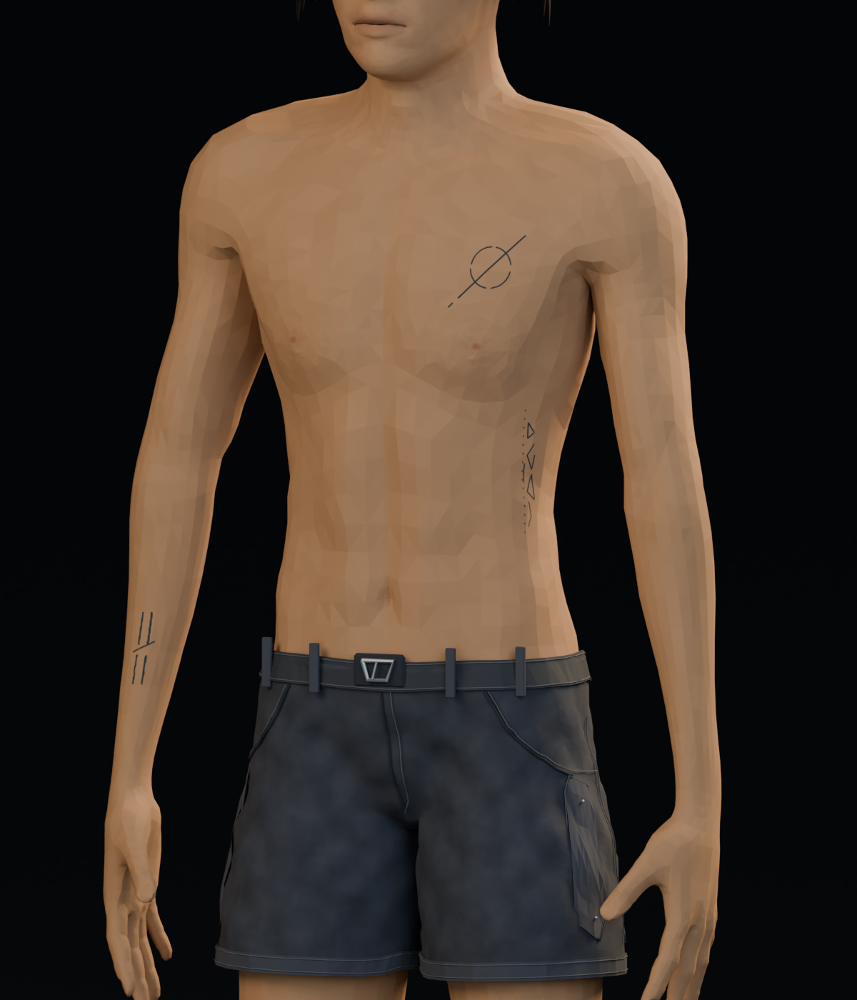

# Capturas del modelo 3D

## Rostro v18 · última revisión

[Ver contorno facial, perfil y ambos tres cuartos; comparación neutra incluida](rostro_v18/README.md)

## Rostro v17 · revisión anterior

[Ver análisis previo y correcciones comparadas con v16](rostro_v17/README.md)

## Rostro v16 · revisión anterior

[Ver cuello y proporciones faciales, comparados con v15](rostro_v16/README.md)

## Rostro v15 · revisión anterior

[Ver proporciones, peinado y cuello revisados, con comparaciones completas frente a v14](rostro_v15/README.md)

## Rostro v14 · revisión anterior

[Ver detalle facial y pintura revisados, con comparaciones frente a v13](rostro_v14/README.md)

## Rostro v13 · revisión anterior

[Ver forma facial y rasgos revisados, con comparaciones frente a v12](rostro_v13/README.md)

## Rostro v12 · revisión anterior

[Ver base nasal, comisuras y lagrimales revisados y comparaciones con v11](rostro_v12/README.md)

## Rostro v11 · revisión anterior

[Ver párpados, nariz, labios y cuello revisados y comparaciones con v10](rostro_v11/README.md)

## Rostro v10 · revisión anterior

[Ver ojos, nariz y boca revisados y las comparaciones con v9](rostro_v10/README.md)

## Rostro y cuello v9 · revisión anterior

[Ver las capturas actuales, los detalles y la comparación con la v8](rostro_v9/README.md)

## Rostro y cuello v8 · revisión anterior

[Ver las capturas actuales y la comparación con la v7](rostro_v8/README.md)

## Rostro y cuello v7 · revisión anterior

[Ver las capturas actuales y la comparación con la v6](rostro_v7/README.md)

## Rostro v6 · revisión anterior

[Ver la revisión de formas: frente, perfil, tres cuartos y comparación con la v5](rostro_v6/README.md)

## Rostro v5 · revisión anterior

[Ver las capturas actuales de frente, tres cuartos y perfil, y la comparación con la v4](rostro_v5/README.md)

## Rostro v3 · revisión anterior

[Ver las nuevas capturas de frente, tres cuartos y perfil, y la comparación antes/después](rostro_v3/README.md)

## Nueva revisión de la cabeza

[Ver ojos, nariz, boca y peinado revisados](cabeza_refinada/README.md)

Las imágenes que siguen corresponden a la versión anterior del modelo.

Revisión del 25 de octubre de 2026. Vistas renderizadas del modelo editable creado a partir de la referencia del usuario. El rostro y el acabado pictórico siguen siendo aproximaciones a la referencia.

Esta rama contiene solamente las capturas y su procedencia.

## Perspectiva

## Frontal

## Espalda

## Rostro

## Perfil

## Ropa y tatuajes

[Procedencia de los recursos](LICENCIAS.md)
