# Capturas de animación — superviviente

Versión del juego: [`81bd3d2`](https://github.com/LikoKriko/Godotgame1/commit/81bd3d28eef14db983163dc1077818f327008a33). Capturas del 19 de octubre de 2026, generadas con el modelo y las poses del juego en Godot 4.6.3.

## Caminar: rango del movimiento

Cuatro fases del ciclo: **0 %, 25 %, 50 % y 75 %**, de izquierda a derecha. Cada fila permite comparar el recorrido de piernas, brazos, torso y cabeza.

### Frente
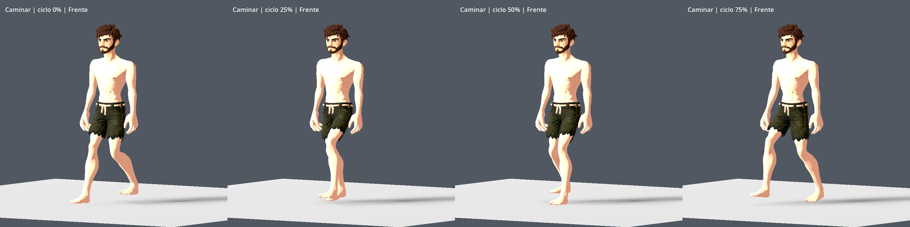

### Perfil
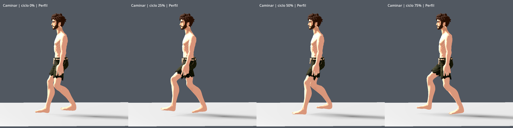

### Espalda
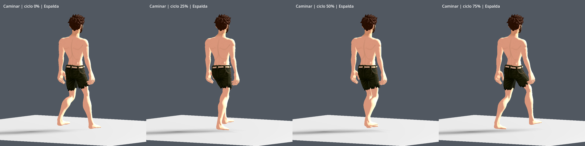

### Todas las direcciones

Adelante, diagonal delantera derecha, derecha, diagonal trasera derecha, atrás, diagonal trasera izquierda, izquierda y diagonal delantera izquierda. Vista desde la cámara del jugador, fase 25 %.

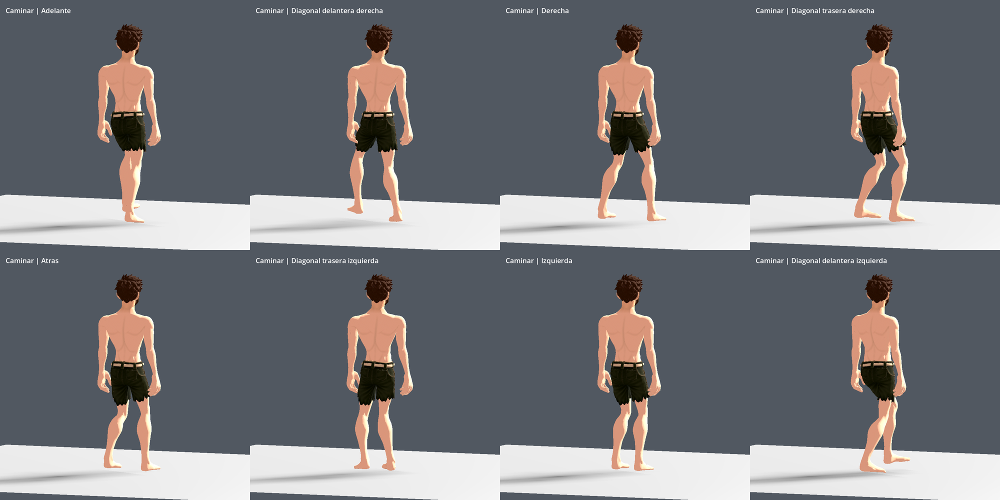

## Correr: rango del movimiento

Cuatro fases del ciclo: **0 %, 25 %, 50 % y 75 %**, de izquierda a derecha.

### Frente
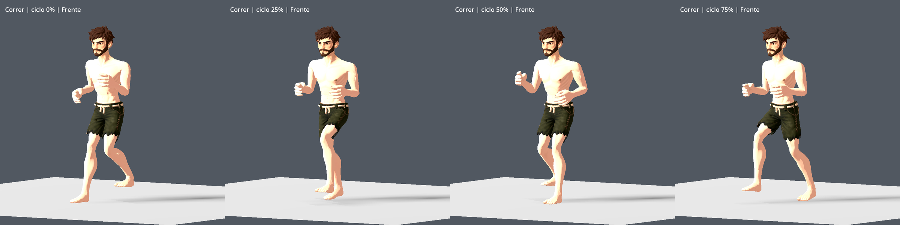

### Perfil
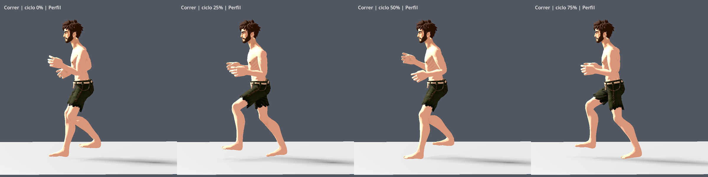

### Espalda
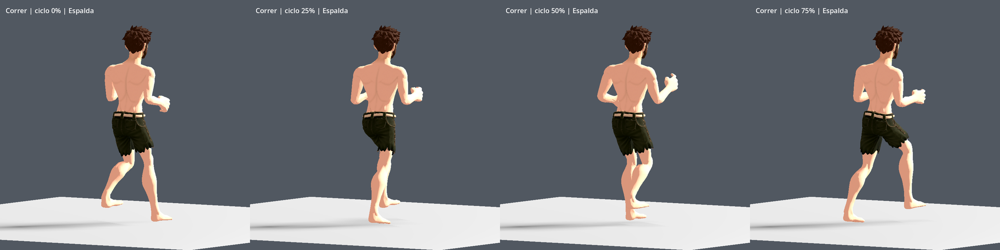

### Todas las direcciones
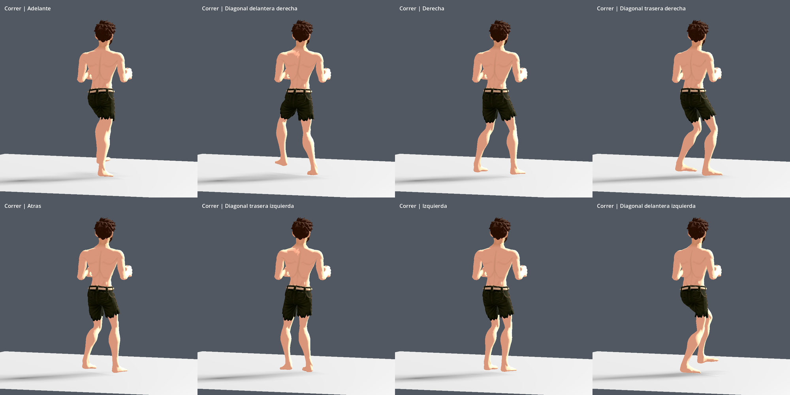

## Dedos en diferentes acciones

Cada fila muestra una acción. Columnas: **mano derecha, segunda vista derecha, mano izquierda, segunda vista izquierda**. Los objetos y el resto del personaje se mantienen visibles para mostrar el contexto real del agarre.

### Manos libres: reposo, caminar y correr
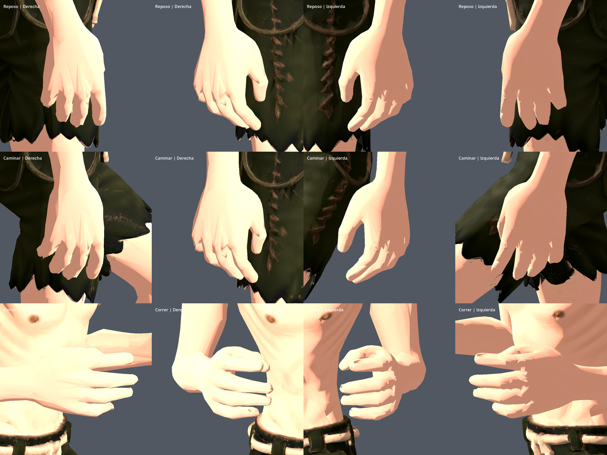

### Espada: agarre y golpe
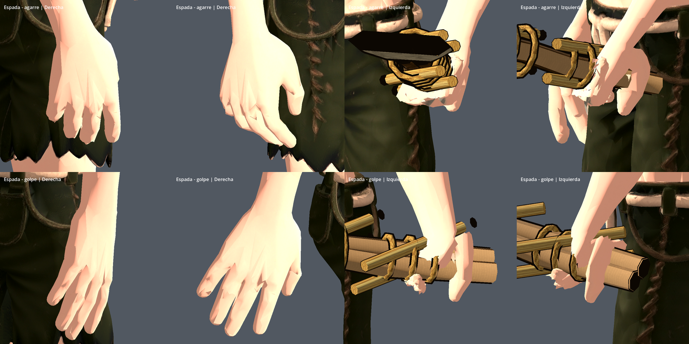

### Hacha: agarre y golpe
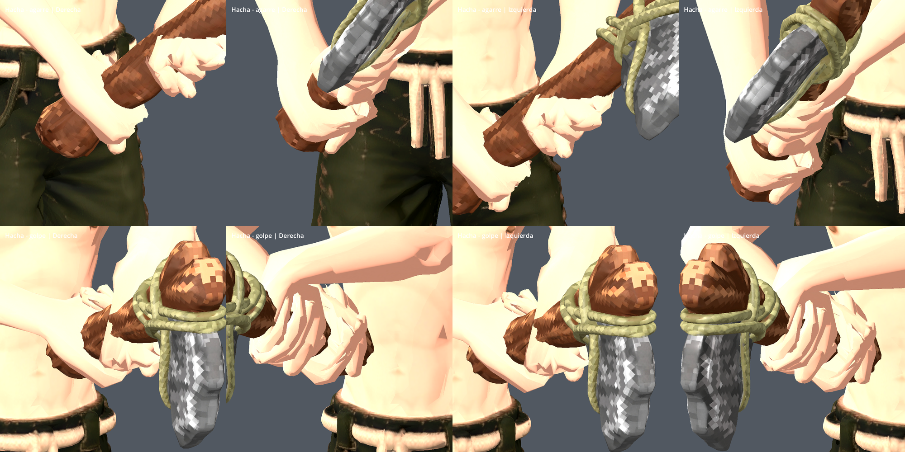

### Pico: agarre y golpe
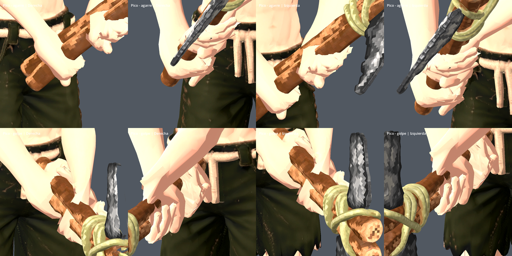

### Tensar el arco, puñetazo y recoger
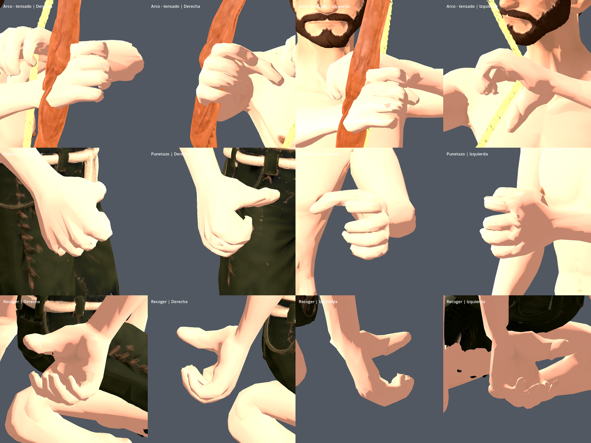

[Ver las 88 capturas individuales a resolución original](capturas/) · [Abrir los paneles](paneles/)
