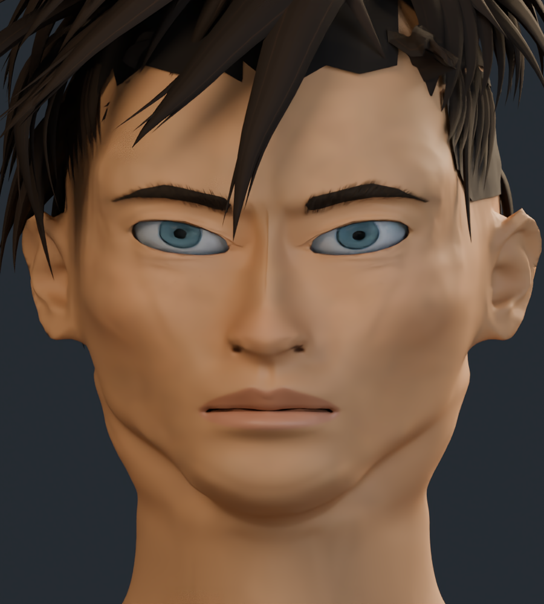
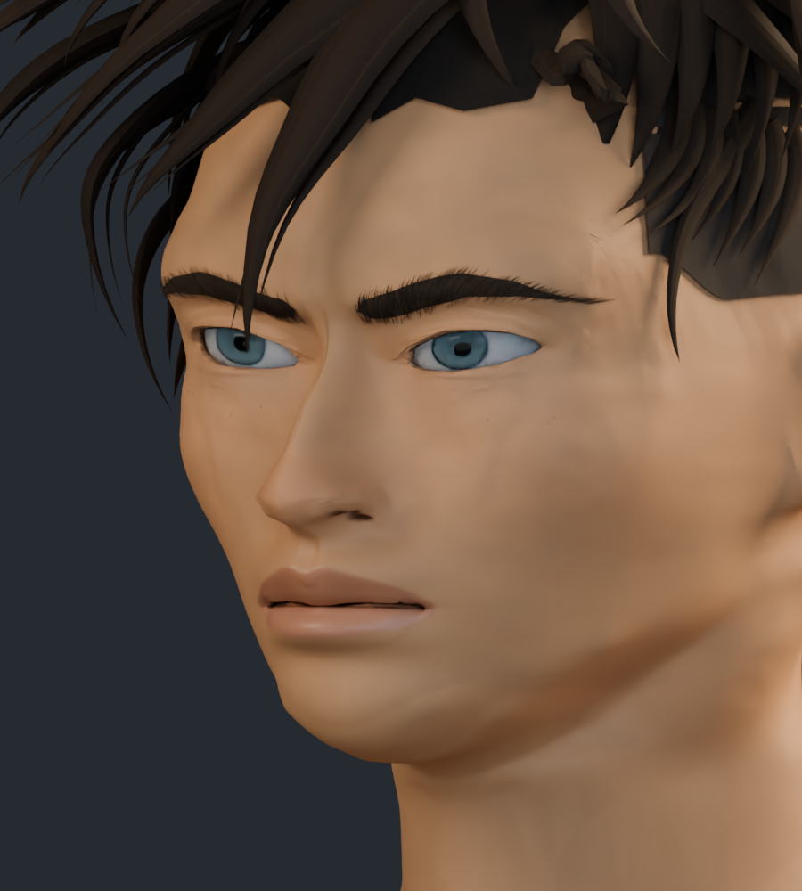
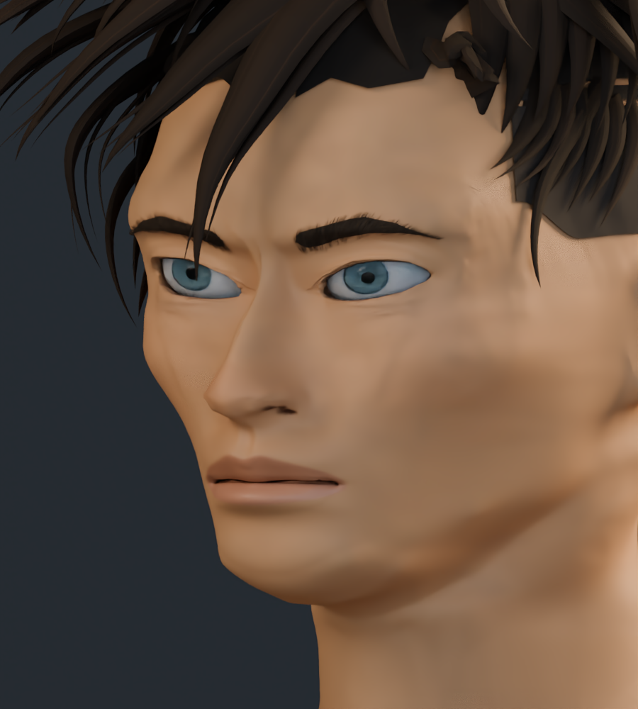

# Avance de forma facial · v15

Comparación provisional del modelo con la v14, usando los mismos encuadres e iluminación. Se revisan la abertura de los ojos, la longitud de las cejas, la mandíbula, el mentón y el volumen de los labios para acercarlos a las referencias.

El peinado mostrado es todavía el anterior; la reconstrucción del cabello se está evaluando por separado. Las capturas nuevas son renders de revisión con menos muestras que las capturas definitivas.

## Frontal

| v14 | Forma revisada |
| --- | --- |
|  |  |

## Tres cuartos

| v14 | Forma revisada |
| --- | --- |
|  |  |
