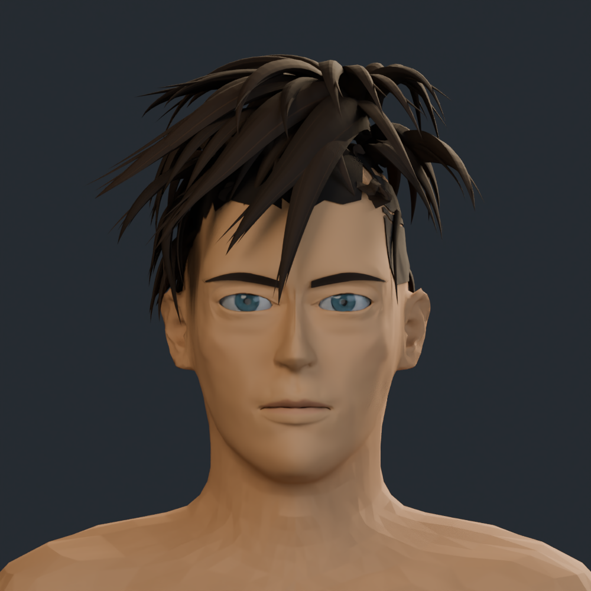
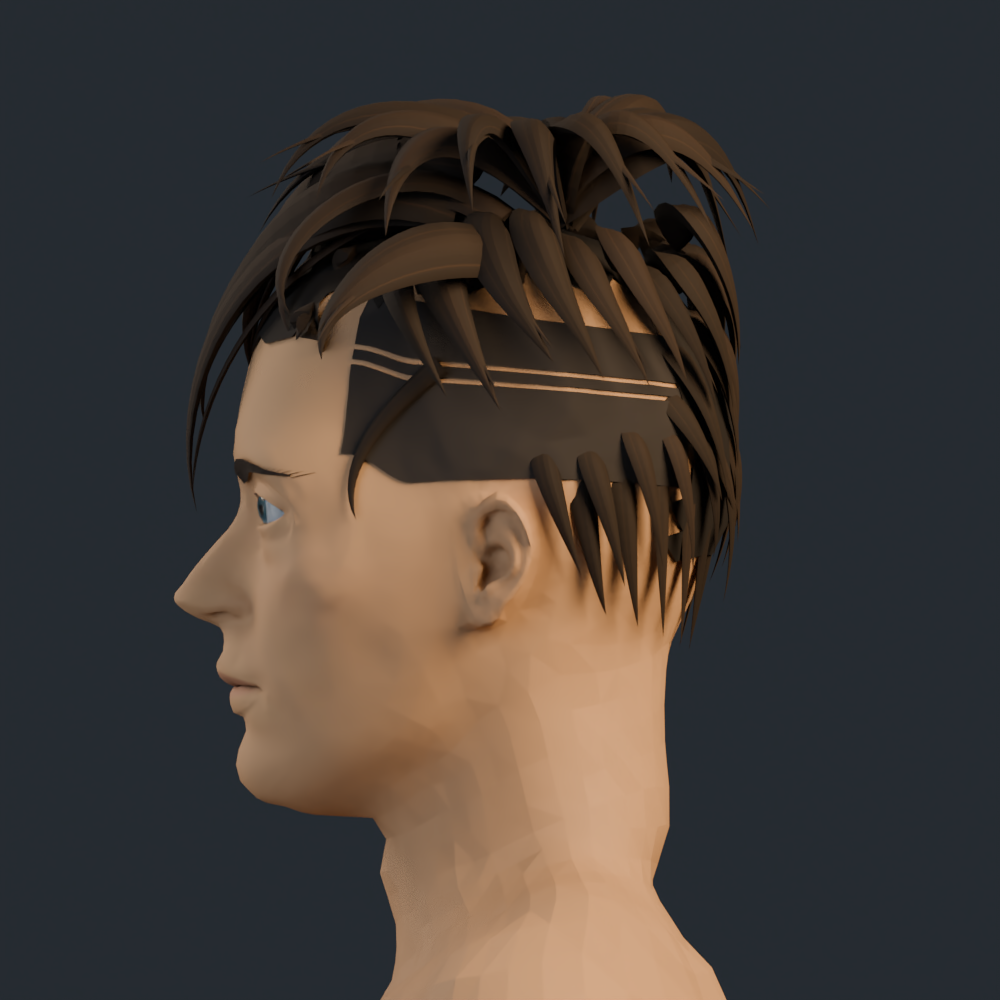
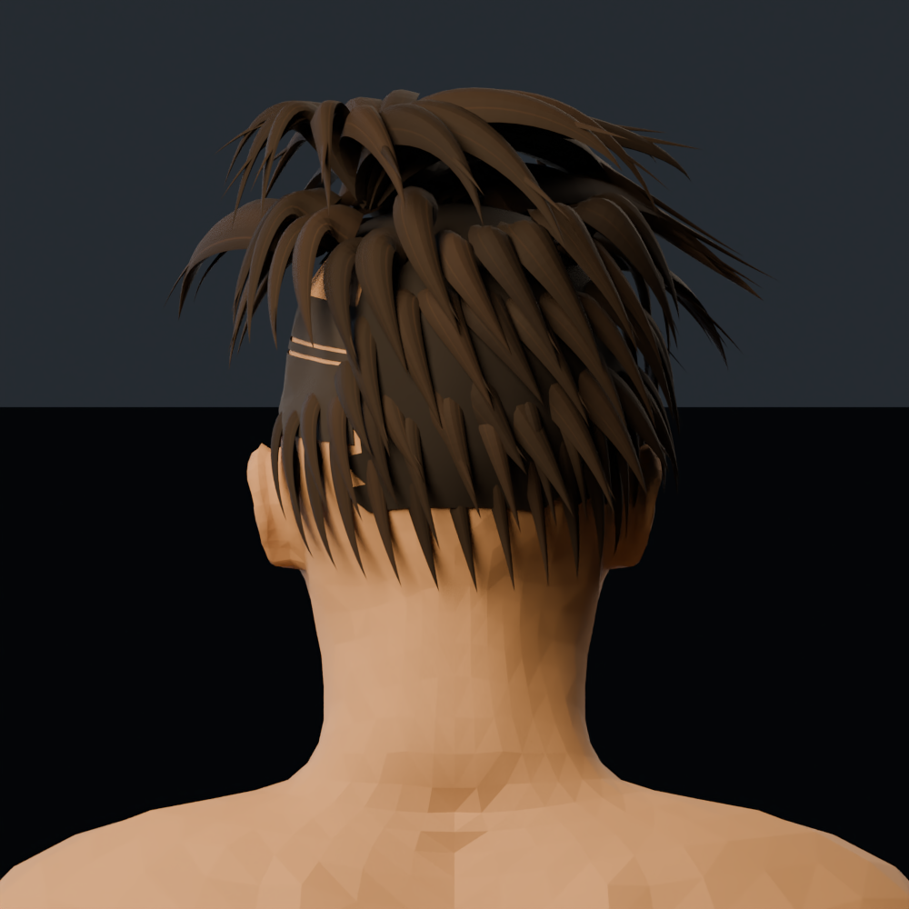
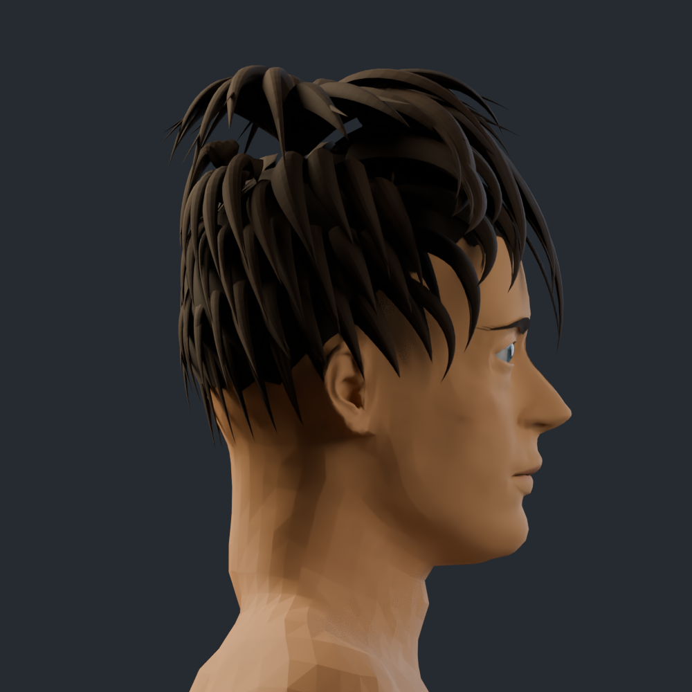
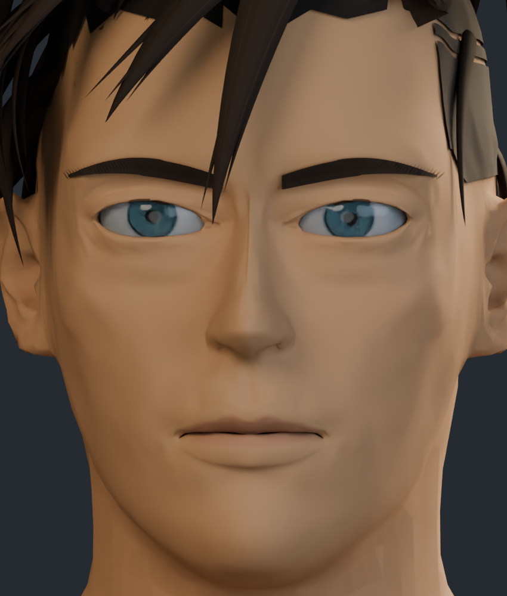
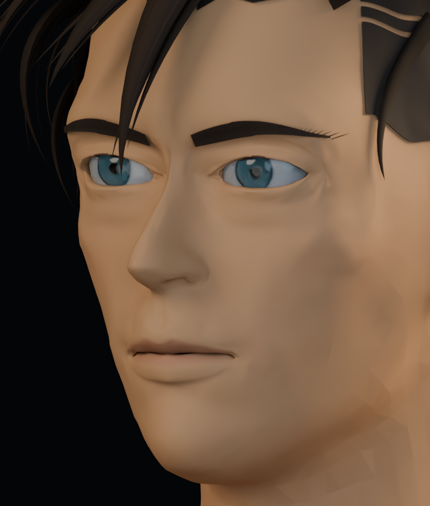

# Cabeza: revisión con la referencia ampliada

Vistas de trabajo del propio modelo 3D. Cambios de geometría y textura en ojos, párpados, iris, nariz, labios, mentón y cabello. Se utiliza la nueva referencia ampliada aportada por el usuario. El parecido sigue siendo aproximado; estas imágenes no representan un acabado definitivo.

[Análisis de los cambios](ANALISIS_CABEZA.md) · [Versión anterior](../README.md)

## Frente

## Perfil izquierdo y lateral corto

## Parte posterior

## Perfil derecho

## Ojos, nariz y boca de frente

## Detalle facial en tres cuartos

