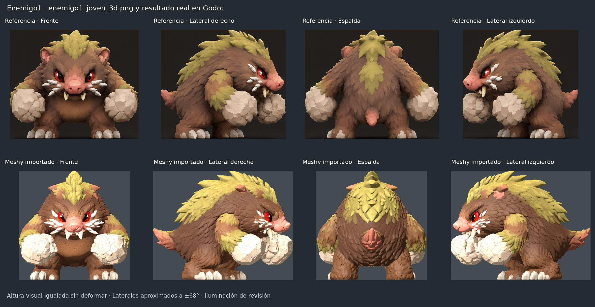
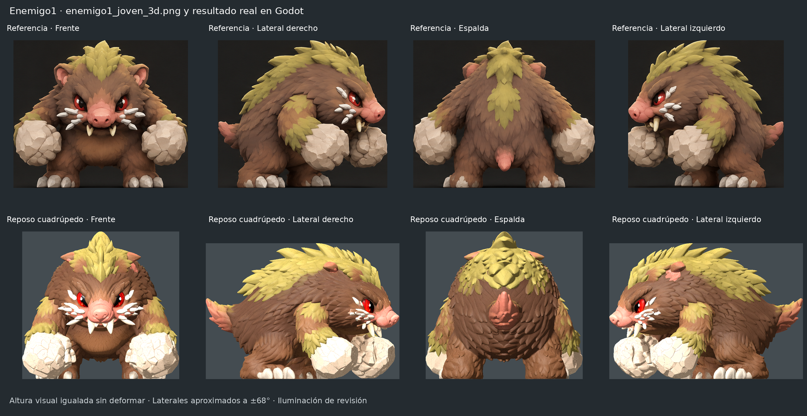
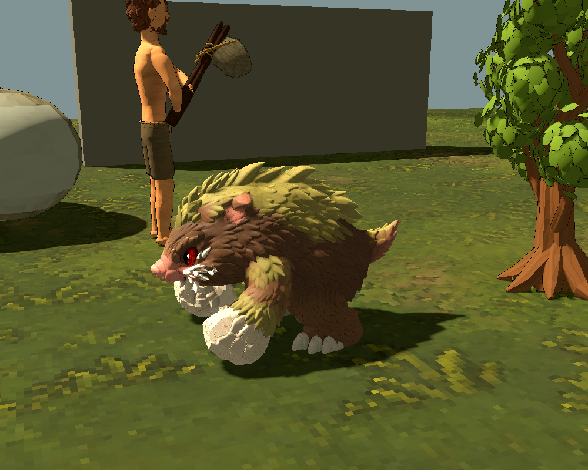

# Enemigo1: Meshy Mossclaw Boar

Por petición del usuario, se elimina la reconstrucción procedural y se utiliza
el FBX adjunto **Meshy_AI_Mossclaw_Boar_1015190139_texture.fbx**. Se conserva una
copia original sin modificar en `entregables/enemigos/enemigo1/source/`.
La ilustración `entregables/enemigos/enemigo1_joven_3d.png` se mantiene como
referencia visual; ya no se proyecta sobre el personaje ni genera su volumen.

## Procedencia y fidelidad del archivo

[ZIP original en la Release modelo-enemigo1](https://github.com/LikoKriko/Godotgame1/releases/download/modelo-enemigo1/Meshy_AI_Mossclaw_Boar_1015190139_texture_fbx.zip).
Su SHA-256 coincide con el proporcionado por el usuario:
`f0af7cc7091dfa1c6219a23b6c609e695a1a7dae90206889fab21802ed4c3655`.
`assets/enemies/first/meshy/source.json` registra URL, hashes del FBX/PNG,
versiones de herramientas y estadísticas de entrada/salida.

El FBX tiene **488891 vértices de autoría y 977782 triángulos**. La conversión
mantiene todos los triángulos; el recurso de Godot tiene **518861 vértices**
por las separaciones necesarias de normales y UV. No se decima, remalla,
reconstruye el pelaje ni modifican las proporciones. Se aplica una sola escala
uniforme y una traslación para centrarlo y colocar los pies sobre el suelo.
La postura **Postura de referencia** reproduce la geometría suministrada.

Se conservan byte por byte los cuatro PNG originales: color, normal, rugosidad
y metalicidad. El material nativo de Godot usa esas UV y mapas, con nearest y
mipmaps. Se retiran `young_reference_mesh.gd` y los shaders propios
`young_skin.gdshader` / `young_outline.gdshader`. No hay geometría alternativa
ni reproyección de la referencia. Las capturas viejas de antes/después también
se retiran para no confundirlas con la entrega actual.

## Integración en el juego

El FBX no incluye esqueleto ni animaciones. Se añade un esqueleto con catorce huesos de base y una bisagra de cola
(quince en ejecución). Los pesos de base proceden de difusión de calor de Blender; se conservan y normalizan las
cuatro influencias principales de cada vértice. La animación del juego se adapta a esta ligadura; el archivo de Meshy no
aporta clips originales.
La primera asignación analítica de pesos se descartó tras detectar estiramientos
de mejillas al golpear; la versión publicada usa la ligadura por difusión.

`young_model.gd` carga directamente `mossclaw_skin.res`. La malla y el material
se comparten entre enemigos; los esqueletos son independientes. No se genera
geometría ni se calculan pesos al crear un enemigo. Se mantiene la altura de
**0,875 m**. Los anclajes de caderas, hombros, puños y cabeza se adaptan al FBX;
la zona de impacto del hocico sigue su punta real. Los brazos tienen segmentos
de 6,1 y 6,6 unidades de autoría; las patas, 4,3 y 4,4. Se conservan marcha
cuadrúpeda, golpes alternos, sentado, comida, aturdimiento y cadáver. Vida,
memoria, botín y alcance siguen iguales. El daño y los tiempos del nuevo
estado de boxeo se describen al final de este documento.

El recurso comprimido ocupa unos 23 MiB, además de los cuatro PNG. Su detalle
es elevado: **977782 triángulos por enemigo**, sin LOD añadido. No se ha medido
el rendimiento en el ordenador del usuario ni se afirma una mejora de FPS.
El FBX original queda excluido de la importación por `.gdignore`; el recurso
nativo es el que usa el juego.

## Revisión

Abrir `scenes/prototype_3d/young_review.tscn` con F6. **Postura de referencia**
muestra el archivo en reposo de enlace; los cuatro botones permiten compararlo
con la lámina. El selector conserva las acciones y la alternancia de puños.
La revisión permite pausar y escoger una fase exacta para comprobar apoyos,
ambos puños y transiciones sobre el modelo importado actual.







Las comparativas igualan la altura visible sin deformar las imágenes. Los
laterales se capturan a ±68° aproximados, con iluminación de revisión; la
partida cambia luz y sombras. Son renders del modelo real, no retoques de la
referencia. Se verifica identidad con el FBX proporcionado, no una equivalencia
artística porcentual entre ese FBX y la ilustración.

## Conversión reproducible

Herramientas usadas: Blender **4.3.2**, Godot **4.7.2**. Ejecutar desde el proyecto
con las rutas absolutas adecuadas para los archivos intermedios:

```sh
godot --headless --path . --script tools/enemy/export_meshy_bind.gd -- /tmp/rig_seeds.json
blender --background --python tools/enemy/convert_meshy.py -- \
  entregables/enemigos/enemigo1/source/Meshy_AI_Mossclaw_Boar_1015190139_texture.fbx \
  /tmp/mossclaw.glb /tmp/rig_seeds.json
godot --headless --path . --script tools/enemy/bind_meshy.gd -- /tmp/mossclaw.glb
```

El conversor exporta la malla sin remallar, añade el rig y calcula los pesos.
El enlazador remapea los nombres de huesos al orden del juego, normaliza la
escala, conserva posición/UV/topología, genera tangentes para el mapa normal,
instala los cuatro PNG y guarda el recurso comprimido. Los pesos y materiales
se preparan una vez; los usuarios del juego no necesitan Blender.

## Comprobaciones

- `tests/prototype_3d_young_reference_mesh.gd`: original FBX y PNG por SHA-256,
  identidad de posiciones/UV del recurso, 977782 triángulos, proporciones,
  ligadura neutra, pesos, caché e independencia; deforma el modelo en todos
  los estados y ambas manos.
- `tests/prototype_3d_creature.gd`: altura, catorce huesos, longitudes,
  zona de impacto sobre un vértice real del hocico, rutinas, combate y parry.
- `tests/prototype_3d_reference_models.gd`: piel ligada y acciones de ambos actores.
- `tests/prototype_3d_loot.gd`, `prototype_3d_saves.gd` y `prototype_3d.gd`:
  botín, persistencia e integración del juego.

Se revisan cuatro vistas de referencia, cuatro en cuadrupedia, seis acciones
con ambas manos y cuatro cámaras del mundo de prueba. Godot Linux/Compatibility;
no se valida Windows, audio físico ni rendimiento del equipo del usuario.

## Animaciones adaptadas al Meshy (15 de octubre de 2026)

Las quince acciones de `young_pose.gd` usan las proporciones de la ligadura
publicada en `d551f4c`. `bind_pose()` fija los puntos de enlace originales y
también alimenta el exportador; modificar un golpe no puede alterar el reposo.
No cambian el recurso `.res`, el FBX, posiciones, UV, topología, pesos ni PNG.

- Marcha y carrera cuadrúpedas con transferencia de peso, fases diferenciadas
  de manos y patas, elevación del talón y despeje de la suela real. El ciclo
  avanza según la velocidad alcanzada; el reposo respira de forma continua.
- Incorporación y bajada enlazadas con la guardia; puñetazos alternos con
  preparación, giro del torso, contrapeso y contacto en la mitad del segundo.
- Sentarse y levantarse transfieren los apoyos por separado. Descanso y
  alimentación tienen respiración, mirada y alcance alterno de los brazos.
- Aturdimiento y muerte parten de la pose que se interrumpe; recuperación
  y cadáver tienen finales continuos. El cadáver permanece inmóvil.

Las orientaciones completas de cada segmento siguen el plano de flexión y
conservan sus longitudes. Los puños acompañan al antebrazo. Se despejan los
apoyos teniendo en cuenta que la piel importada mezcla suela/pantorrilla y
piedra/antebrazo. Se mantienen las zonas de impacto del hocico y las manos.
No cambian vida, daño, alcance, botín ni tiempos de combate.

`prototype_3d_young_motion.gd` comprueba 15 acciones, ambas manos y 33 fases:
longitudes, piel deformada frente al suelo, continuidad de orientación,
enlaces entre estados, interrupciones y cadáver inmóvil. Se complementa con
la comprobación del FBX/PNG por SHA-256 de `young_reference_mesh`.


## Boxeo tras recibir daño (16 de octubre de 2026)

El primer daño no letal habilita una tirada inmediata del **50 %**; después
se comprueba cada **10 segundos** de juego. Recibir más golpes no reinicia el
reloj ni añade tiradas. Un éxito activa **20 segundos** de postura erguida:
no se extiende un estado activo en las comprobaciones intermedias. Al terminar
puede salir otra tirada en el siguiente límite de 10 segundos, incluido ese
mismo instante si coincide. Pausar congela ambos relojes; morir limpia el estado.

`boxing_rise` y `boxing_lower` enlazan la postura cuadrúpeda con la guardia.
`boxing_guard` coloca los puños de piedra junto a los lados de la cabeza,
con ángulo interior de codo de **110°** y antebrazos ascendentes; `boxing_walk`
permite perseguir manteniendo la guardia. El estado prevalece sobre sentarse
y comer; no elimina la percepción, el alcance ni los obstáculos existentes.
Un aturdimiento interrumpe el ataque y, al recuperarse, vuelve a la guardia si
quedan segundos del estado. Su reloj sigue avanzando durante el aturdimiento.

`hook` alterna los brazos: apertura, recorrido circular, acompañamiento del
torso y la cabeza, y vuelta a la guardia. Dura **1,2 segundos** frente al segundo
del golpe normal; el contacto ocurre en la mitad, a **0,6 segundos**, y entrega
**4 de daño base** al sistema existente de contacto/parry. No se repite el daño
dentro de un golpe. Si el estado termina antes del contacto, se cancela ese golpe.
Los ataques normales conservan 2 de daño y reciben un giro pequeño de torso y
cabeza más visible. Durante ambos ataques las raíces de cadera y las patas
permanecen estables; el torso tiene su transformación propia, con longitudes
óseas constantes y la misma piel continua. No cambian FBX, malla, pesos ni PNG.

El guardado conserva activación, temporizadores, brazo y variante de ataque.
Los archivos anteriores sin estos campos siguen cargando. Los cinco clips
nuevos están disponibles con etiquetas en español en la revisión F6.
`prototype_3d_enemy_boxing.gd` comprueba probabilidad, tiempos, daño, alternancia,
cancelación, codos, patas y separación de muestras de la piedra deformada frente
a la envolvente convexa de la cabeza. Se complementa con las comprobaciones
existentes de apoyos de piel, continuidad, combate, parry y guardado.


## Persecución y caída sobre la espalda (16 de octubre de 2026)

La persecución cuadrúpeda pasa de 0,26 a 0,36 s por ciclo, con mayor recorrido
anterior y posterior y ligera inclinación del torso. La persecución en guardia
pasa de 0,52 a 0,65 s y también amplía la zancada. No cambia la velocidad física,
la percepción ni los tiempos o el daño de los golpes.

`fall_motion.gd` comparte el orden de caída con el superviviente: apoyo de
rodillas, pérdida progresiva del equilibrio y apertura final de extremidades.
El enemigo conserva sus dos segundos de muerte y enlaza exactamente con un
cadáver inmóvil. Las entradas desde marcha, ataque, crochet y sentado capturan
la pose visible; los planos articulares se transportan para evitar inversiones.
La zona de interacción del botín abarca la nueva pose del cadáver.

La cola larga necesita una bisagra para apoyarse al lado del cuerpo sin hundirse
al reclinarse. `young_skin_weights.gd` redistribuye solo la influencia corporal
necesaria y añade el hueso 14, conservando los índices anteriores. El horneado
reproducible en `tools/enemy/bind_meshy.gd` incorpora esta corrección. El parche
`tools/enemy/bend_tail_weights.gd` conserva los buffers originales de geometría,
normales, tangentes, UV, índices y materiales; no cambia el FBX ni los PNG.
La pose neutra reproduce el modelo original. Pruebas de soporte, apertura,
interrupciones y continuidad: `tests/prototype_3d_falls.gd`.
