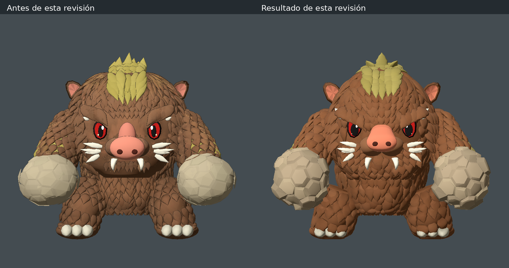
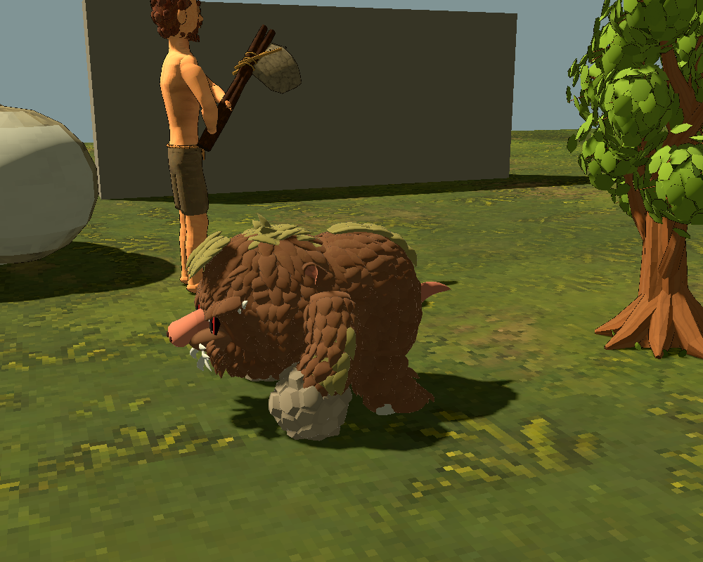

# Enemigo joven: reconstrucción desde las cuatro vistas

Referencia vigente, conservada sin editar:
`entregables/enemigos/enemigo1_joven_3d.png`. La copia de ejecución continúa en
`assets/enemies/first/reference_3d.png`.

## Geometría

`young_reference_mesh.gd` construye la superficie sólida en la postura de la
lámina: torso compacto bajo la cabeza, cabeza baja y ancha, brazos largos adelantados,
patas traseras cortas con separación lateral y tres uñas en cada pie. La cara
incluye ojos rojos hundidos con apertura almendrada, cejas de pelaje, orejas
cóncavas con interior rosa, hocico, fosas nasales, colmillos y marcas claras.

Hay **1277 mechones de pelaje marrón y 130 piezas doradas**, con bases y extremos
cerrados, sección redondeada, relieve y puntas independientes. La distribución
separa frente, mejillas, vientre, lomo y extremidades. La cresta sigue la cabeza
y enlaza visualmente con la franja del lomo; los brazos tienen parches propios.
Los puños suman **84 placas de piedra** con contornos irregulares y biseles.
No se utilizan planos orientados hacia la cámara para simular el pelaje.

La autoría se separa del rig y las decisiones de criatura. `young_model.gd`
conserva los catorce huesos y comparte una sola malla ligada entre instancias;
cada criatura tiene un esqueleto independiente. La malla no se reconstruye al
animar. La copia temporal sin ligar se libera al sustituirla por la compartida.

`young_pose.gd` adapta los centros anatómicos a la reconstrucción: caderas de
6,4 unidades laterales, apoyos de 8,6, hombros de 8,3 y postura de puños
(±13,5; 10,2; 10,5). Los segmentos de los brazos miden 7,1 y 7,5; los de las
patas conservan 4,4 y 4,2. Se mantienen la marcha cuadrúpeda, incorporaciones,
puñetazos alternos, comida, sentado, aturdimiento y muerte. La altura normalizada
en el mundo continúa siendo **0,875 m**. No se cambian vida, daño, recompensas,
memoria ni tiempos de acciones.

## Revisión de formas y perfil

La primera corrección (`e5c301e`) redujo el torso y pasó la inclinación
cuadrúpeda de 55° a 31,5°. Esta revisión rehace también la cabeza: frente
estrechada hacia la coronilla y adelantada, hocico cerrado con puente inclinado
y disco nasal redondeado, ojos almendrados con pupilas más anchas, cejas
inclinadas, mejillas cubiertas y orejas insertadas en el pelaje.

El perfil longitudinal de los volúmenes axiales utiliza `CORE_DEPTH=1.32`;
la profundidad máxima del núcleo del torso es ahora 17,69 unidades frente a
22,2 de la primera reconstrucción. Su anchura máxima continúa en 14,4 frente
a 18, y la coronación queda en 24,8 frente a 27,3. La cabeza tiene mayor
profundidad que el torso y una coronilla adelantada. No se aplica esta
transformación a los brazos ni a las patas: sus posiciones se resuelven por IK.

Los mechones tienen nueve secciones, contorno irregular, curvatura lateral y
normales suaves. Se redistribuyen para evitar filas de escamas y el peine recto
bajo la boca. La cresta acompaña el cráneo y el lomo con abanicos; los brazos
tienen manchas doradas en hombros y antebrazos. El pelo cubre también el talón.
Los vértices de patas y pies quedan por encima del plano de suelo en enlace.

Los puños utilizan placas contiguas con esquinas compartidas, tapas planas y
biseles, sobre un núcleo interior: no es una esfera con líneas dibujadas ni
fragmentos separados. La altura de los puños aumenta y su anchura se reduce.
Las patas traseras se apoyan en z=-4,5; los apoyos delanteros en z=9,8 durante
la cuadrupedia. El anclaje de cabeza y el desplazamiento de la nariz se declaran
en `young_pose.gd`; la zona de impacto sigue la superficie del nuevo hocico.

La superficie final tiene **965124 vértices y 321708 triángulos** sin indexar,
compartidos entre enemigos; el contorno añade una segunda pasada de dibujo.
No se ha medido el rendimiento en el equipo del usuario.

## Materiales

El pelaje combina una paleta controlada con color de las cuatro referencias,
proyectado en reposo y mezclado por normales almacenadas. El shader limita la
aportación de la imagen, cuantiza el detalle y utiliza nearest con mipmaps;
rechaza fondo neutro, ojos, piel rosa, piedra, marfil y zonas doradas al pintar
pelaje marrón. Los materiales no nadan ni cambian de vista durante la animación.
La contribución de la referencia baja al 7 % para reducir manchas al modificar
la forma; la paleta y el relieve proceden principalmente de la geometría.
El contorno propio utiliza un grosor de 0,014 unidades de autoría, color al 62 %
y normales suaves, con un acabado fino y color dependiente del material para
no convertir cada superposición de mechones en una línea negra gruesa.

## Revisión visual

Abrir `scenes/prototype_3d/young_review.tscn` con **F6**. La opción inicial
**Postura de referencia** deja el modelo quieto en la postura de la lámina.
Los botones Frente, Derecha, Espalda e Izquierda permiten comparar las cuatro
vistas; el botón derecho mantiene el giro libre. El selector conserva todas
las acciones y la alternancia de puños.

Las vistas laterales de la ilustración muestran parte del frente; se utilizan
±68° como aproximación de revisión. No son planos ortográficos de calibración.
La comparación iguala la altura visible sin deformar las proporciones.
Muestra capturas del modelo real con iluminación de estudio;
la luz de la partida cambia su aspecto. El volumen entre vistas y algunos
mechones requieren reconstrucción artística. Las pruebas no certifican una
copia visual idéntica a la ilustración ni un porcentaje global de parecido.
Persisten diferencias en el relieve del pelaje, la forma fina de cresta/cara y
los laterales; no se presenta el objetivo del 80 % como una medición validada.

## Comprobaciones

- `tests/prototype_3d_young_reference_mesh.gd`: malla real, pesos, proyecciones,
  proporción frontal, postura de enlace, independencia de instancias y piel
  deformada en todos los estados y ambas manos: 2642 comprobaciones, incluidas
  81 sobre las envolventes de cabeza y torso en reposo, marcha y carrera, y una
  sobre el plano de apoyo de la geometría ligada.
- `tests/prototype_3d_creature.gd`: catorce huesos, altura, longitudes, rutinas,
  memoria, parry e integración: 6537 comprobaciones, incluidas seis que localizan
  la punta real de la nariz en la malla y verifican el contacto en cinco poses.
- `tests/prototype_3d_reference_models.gd`: referencias y ligaduras: 539.
- `tests/prototype_3d_loot.gd` y `tests/prototype_3d_saves.gd`: cadáveres, botín,
  recogida y persistencia: 16 y 191 respectivamente.

Las capturas revisan las cuatro vistas, reposo cuadrúpedo, marcha, golpes de
ambas manos, sentado, aturdimiento y cadáver. Son comprobaciones en Godot 4.7.2,
Linux/Compatibility; no una medición de FPS en el ordenador del usuario.

## Animaciones provisionales tras esta subida

El usuario indica que, después de publicar esta integración, se rehacerán todas
las animaciones del enemigo1. Los estados actuales permiten integrar y probar
el nuevo modelo, pero no se consideran su animación definitiva. La revisión de
esta subida comprueba integridad de malla y rig, ejecución sin errores, combate,
botín y guardado; no exige conservar el acabado de las animaciones anteriores
ni constituye una aprobación artística de sus movimientos actuales.
