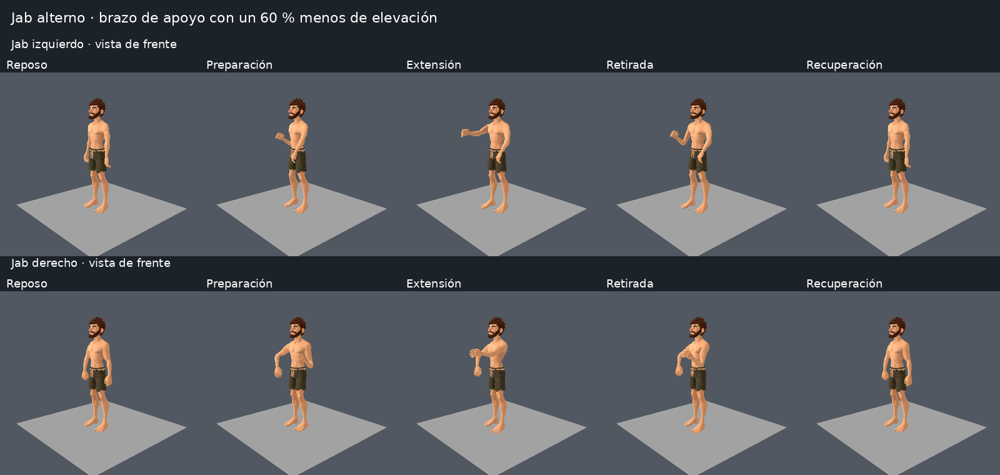
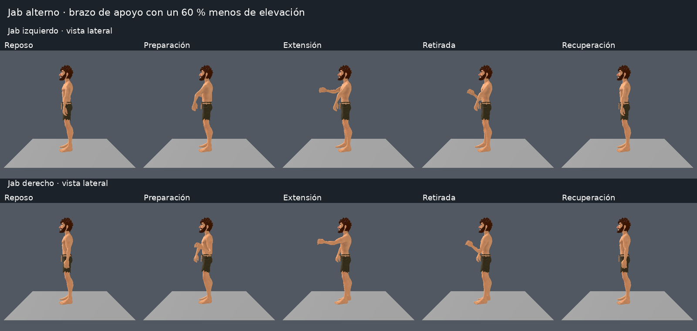
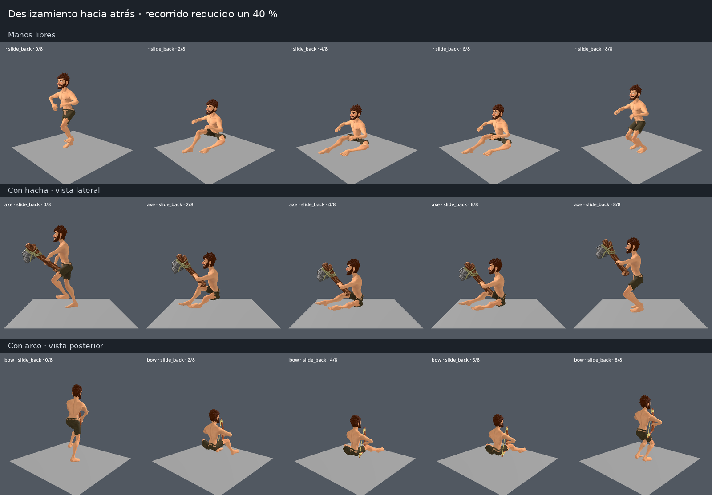
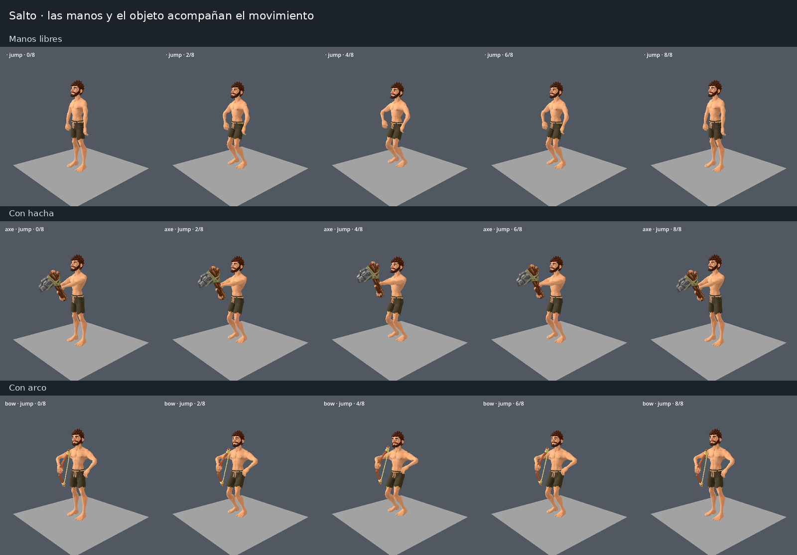
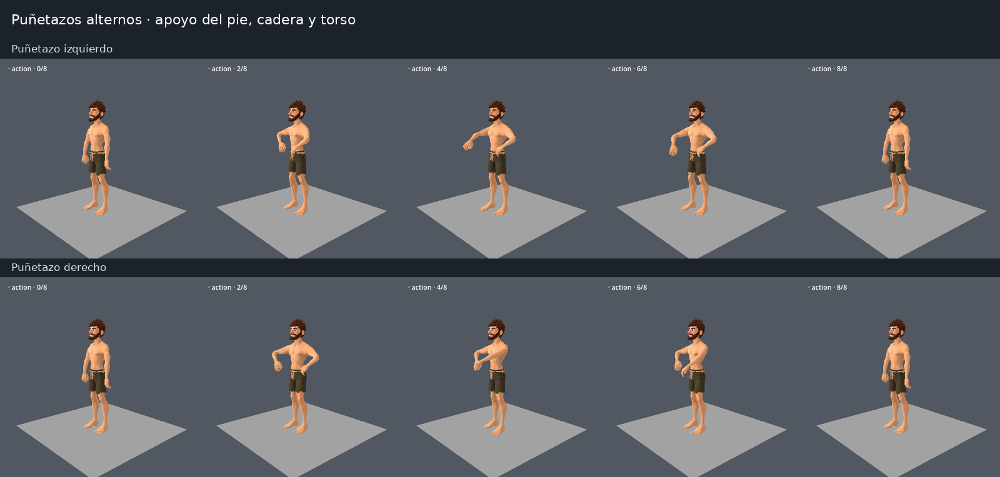
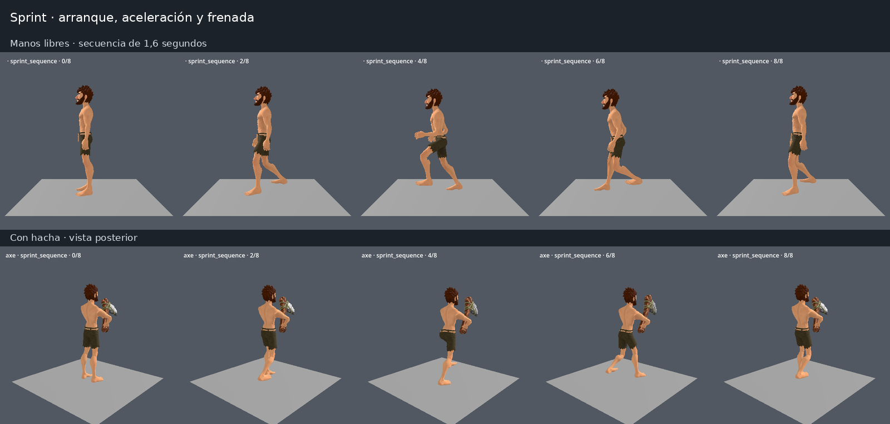

# Ejemplos de las nuevas animaciones del personaje

## Actualización: jab recto y brazo de apoyo más bajo

El brazo contrario se eleva un 60 % menos. El jab se extiende y se retira por la misma línea, manteniendo el apoyo de torso, cadera y pie. Las filas muestran ambos brazos y las fases de reposo, preparación, extensión, retirada y recuperación.

Las secuencias siguientes corresponden a la revisión anterior.

Capturas reales renderizadas en Godot 4.6.3 con el modelo y las texturas del juego. Cada fila se lee de izquierda a derecha. Son secuencias de poses; el desplazamiento físico del personaje y el retardo de cámara se aprecian al jugar.

Esta rama publica únicamente la galería. La implementación de las animaciones permanece local, pendiente de commit y push.

## Deslizamiento hacia atrás

La cadera dirige la retirada, con apoyo asimétrico de piernas y torso recogido. Su recorrido en el juego es un 40 % menor que el de los otros deslizamientos.

## Salto

Elevación gradual de manos y acompañamiento del arma o herramienta.

## Puñetazos alternos

Brazo, torso y cadera acompañan al golpe; el pie del mismo lado avanza ligeramente.

## Sprint

Arranque de 0,16 s, aceleración de un segundo y frenada de 0,24 s. Capturas de una secuencia de 1,6 s; se muestran ejemplos sin equipo y con hacha.

El giro normal sigue la cámara con un segundo de retraso. Ese cambio es temporal y no puede demostrarse mediante capturas estáticas.
