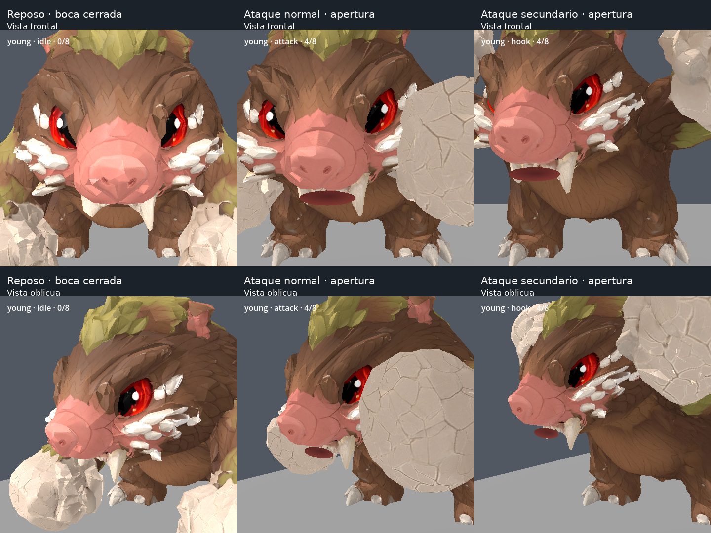
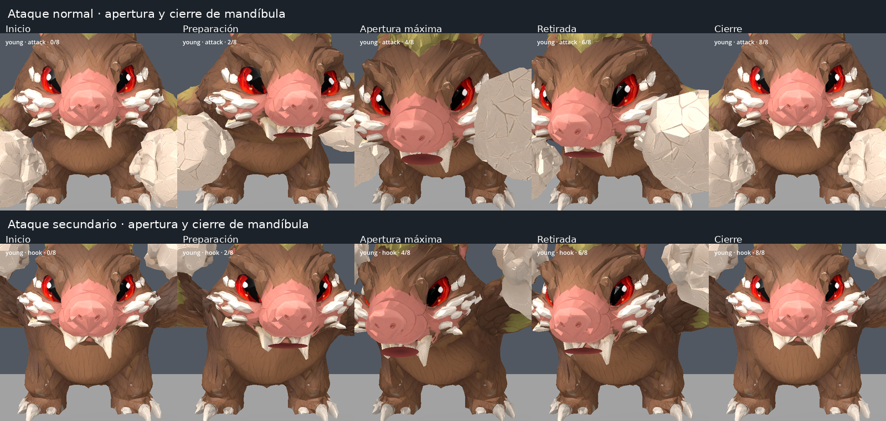
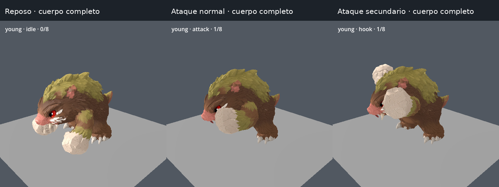

# Enemigo1: boca durante los ataques

Capturas reales de Godot tomadas después del commit y push de la implementación [c422e88](https://github.com/LikoKriko/Godotgame1/commit/c422e88), sobre el nuevo modelo reducido del departamento de modelaje.

La mandíbula se abre levemente y las mejillas acompañan el esfuerzo. Dentro aparece una cavidad del tono del hocico, más oscura. La expresión se aplica al ataque normal y al secundario; en reposo permanece cerrada. El cuello, la unión entre cabeza y cuerpo y las texturas originales se conservan.

## Comparación de cerca

Columnas: reposo, ataque normal y ataque secundario. Filas: frente y vista oblicua.

## Apertura y cierre

Cada fila se lee de izquierda a derecha.

## Cuerpo completo

Estas vistas permiten comprobar la unión entre cabeza, cuello y torso.

La implementación incluye también las correcciones pendientes de activación del secundario por daño real, sueño nocturno y comportamientos de sentarse y comer en los troncos. Validación: ocho suites superadas; pruebas específicas de cuello sin deformación, buffers originales idénticos y límites de estiramiento de la cara.
