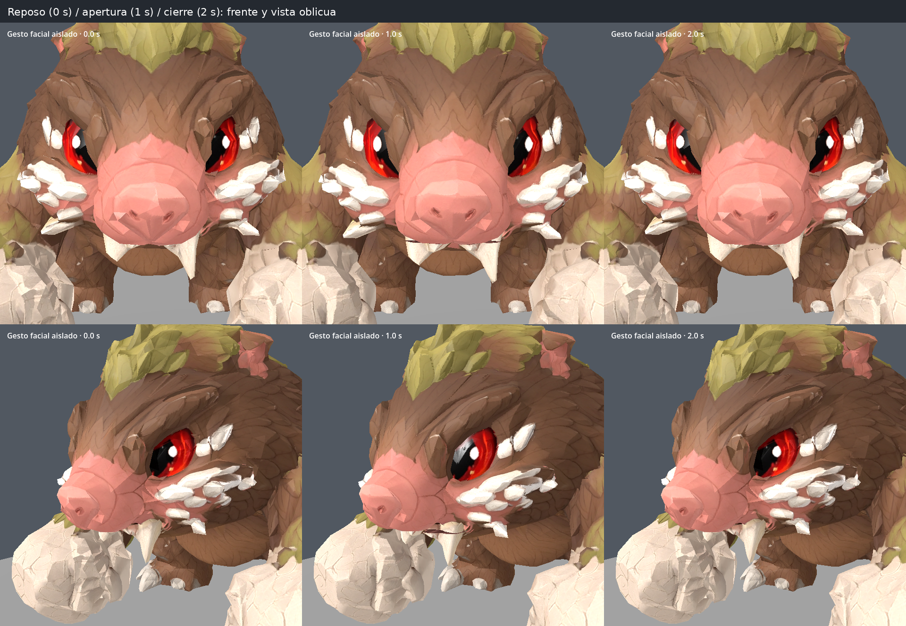
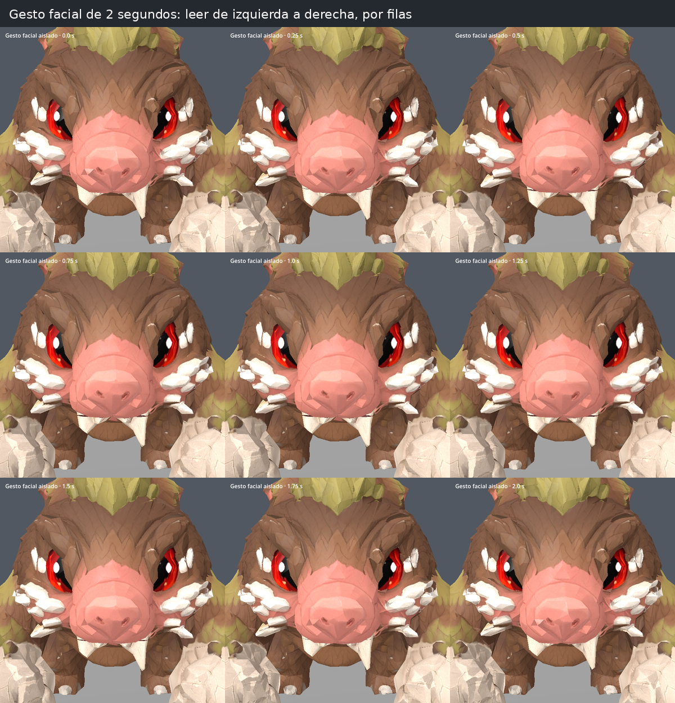
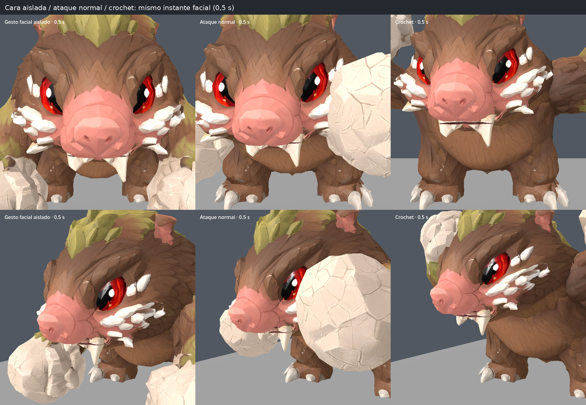
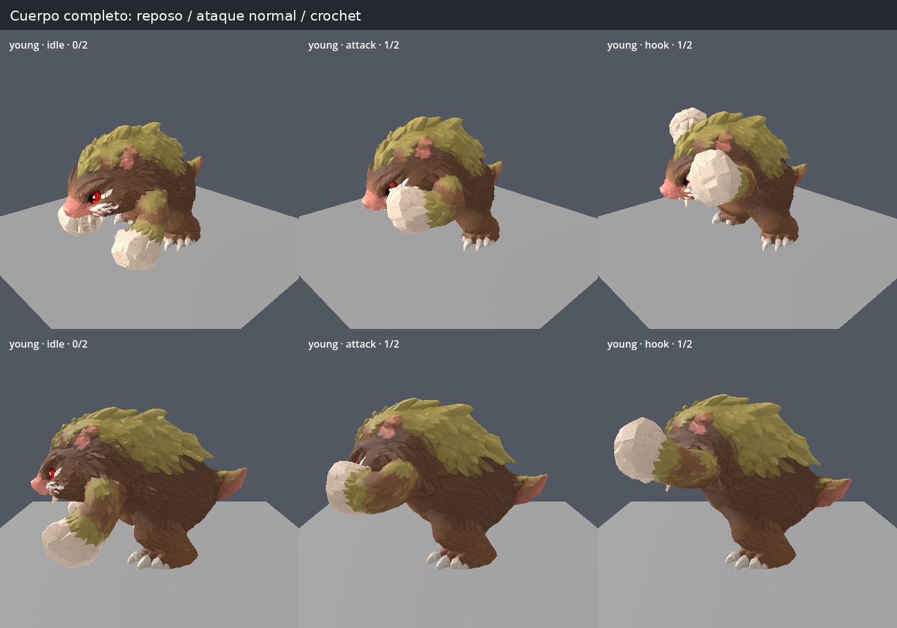

# Enemigo1: boca interior y gesto facial de 2 segundos

Capturas nuevas del modelo reducido vigente, renderizadas en Godot 4.6.3.
Esta revisión sustituye la boca exterior mostrada en la galería anterior.

La boca se abre en la propia piel y su revestimiento se hunde dentro del hocico.
No hay una pieza oscura independiente por delante de la cara. El interior usa
cinco tonos oscuros del hocico y muestreo de píxeles nítido. Los dos colmillos
superiores permanecen en el maxilar; los dos inferiores acompañan el giro de
la mandíbula. Los cinco controles corresponden a ambos lados de la mandíbula,
ambos pómulos y una elevación leve de la nariz.

**Los 2 segundos corresponden solo al gesto facial.** El ataque normal conserva
1 segundo y el crochet 1,2 segundos. El gesto termina aunque el cuerpo ya haya
salido del ataque; otro golpe durante ese intervalo no lo reinicia.

## Detalle frontal y oblicuo

Columnas: boca cerrada a 0 s, apertura a 1 s y cierre a 2 s. Para ver claramente
los cuatro colmillos y el interior, se aísla el gesto facial sobre cuerpo en
reposo. La apertura es deliberadamente pequeña.

## Secuencia facial completa

Nueve muestras separadas por 0,25 s, de 0 a 2 segundos. Leer por filas,
de izquierda a derecha. Misma pose corporal para comparar únicamente la cara.

## Aplicación a los ataques

Mismo instante facial a 0,5 s: gesto aislado, ataque normal y crochet.
Las manos pueden ocultar parte de la cara durante el ataque; por eso se
incluyen también las vistas aisladas anteriores.

## Cuerpo completo

Comparación de poses de reposo e instante medio de cada ataque, desde dos
cámaras. Se conserva la unión de cabeza, cuello y cuerpo y las animaciones
corporales existentes.

Validación: ocho suites superadas, incluida la comprobación del ciclo real de
2 s independiente del ataque, cinco músculos, cuatro colmillos, coincidencia
exacta de labios/revestimiento y pesos compartidos. En 65 muestras del gesto
no hay triángulos invertidos; área máxima de textura +32,4 % y arista máxima
+19,2 %, dentro de los límites anteriores. Los FBX, PNG, UV y vértices de la
fuente original siguen intactos; solo se subdivide la línea del labio en la
malla derivada usada en ejecución. No incluye prueba en el equipo del usuario.
