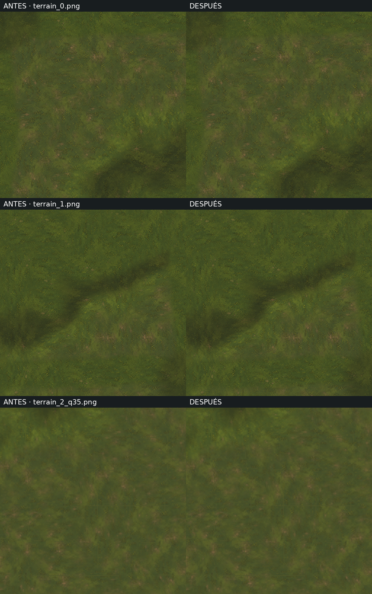
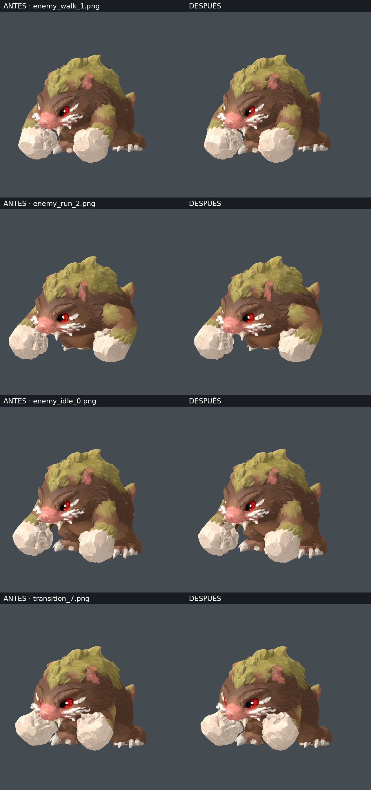

# Antes y después: sombreado y animación

**Izquierda: antes. Derecha: después.** Misma cámara, luz, fase, resolución y
nivel de calidad. PNG sin pérdidas; pulsa cada imagen para verla a tamaño real.
Hay 37 parejas completas en [before/](before/) y [after/](after/).

## Terreno

Se cachean las máscaras de biomas y caminos; se conserva el detalle original de
las texturas y la iluminación. Error medio de color 0,004–0,033 sobre 255 en
las nueve capturas del terreno, máximo cuatro niveles. Comprobadas también las
calidades del 65 % y 35 % usadas por el sistema de distancia.

| Caso | Antes | Después |
| --- | --- | --- |
| Camino y vegetación, 100 % | [PNG](before/terrain_0.png) | [PNG](after/terrain_0.png) |
| Coordenadas negativas, 100 % | [PNG](before/terrain_1.png) | [PNG](after/terrain_1.png) |
| Terreno lejano, 35 % | [PNG](before/terrain_2_q35.png) | [PNG](after/terrain_2_q35.png) |

## Enemigo

Keyframes adaptativos para los ciclos repetitivos y reutilización de matrices
fijas del esqueleto. Los ataques mantienen sus tiempos. El reposo coincide
píxel a píxel en las cuatro capturas; en las demás poses y mezclas se observan
pequeñas diferencias de subpíxel, que cambian algunos píxeles de bordes y detalle.

| Caso | Antes | Después |
| --- | --- | --- |
| Caminar | [PNG](before/enemy_walk_1.png) | [PNG](after/enemy_walk_1.png) |
| Correr | [PNG](before/enemy_run_2.png) | [PNG](after/enemy_run_2.png) |
| Reposo | [PNG](before/enemy_idle_0.png) | [PNG](after/enemy_idle_0.png) |
| Dormir | [PNG](before/enemy_sleep_3.png) | [PNG](after/enemy_sleep_3.png) |
| Mezcla de transición | [PNG](before/transition_7.png) | [PNG](after/transition_7.png) |

## Tiempos y alcance

En este entorno: aproximadamente **27 % menos de tiempo** en las escenas
aisladas del terreno y **10–16 % menos de CPU** en la actualización de animación
del enemigo con las mezclas habituales. Son mediciones de Linux con renderizado
por software, no una promesa de FPS en el ordenador del usuario.

Datos completos: [terreno](terrain_timing.json), [animación](animation_timing.json)
y [diferencias de píxeles](visual_errors.json). Método, memoria, pruebas y
órdenes para repetirlo en [SHADING_ANIMATION_OPTIMIZATION.md](../../SHADING_ANIMATION_OPTIMIZATION.md).
