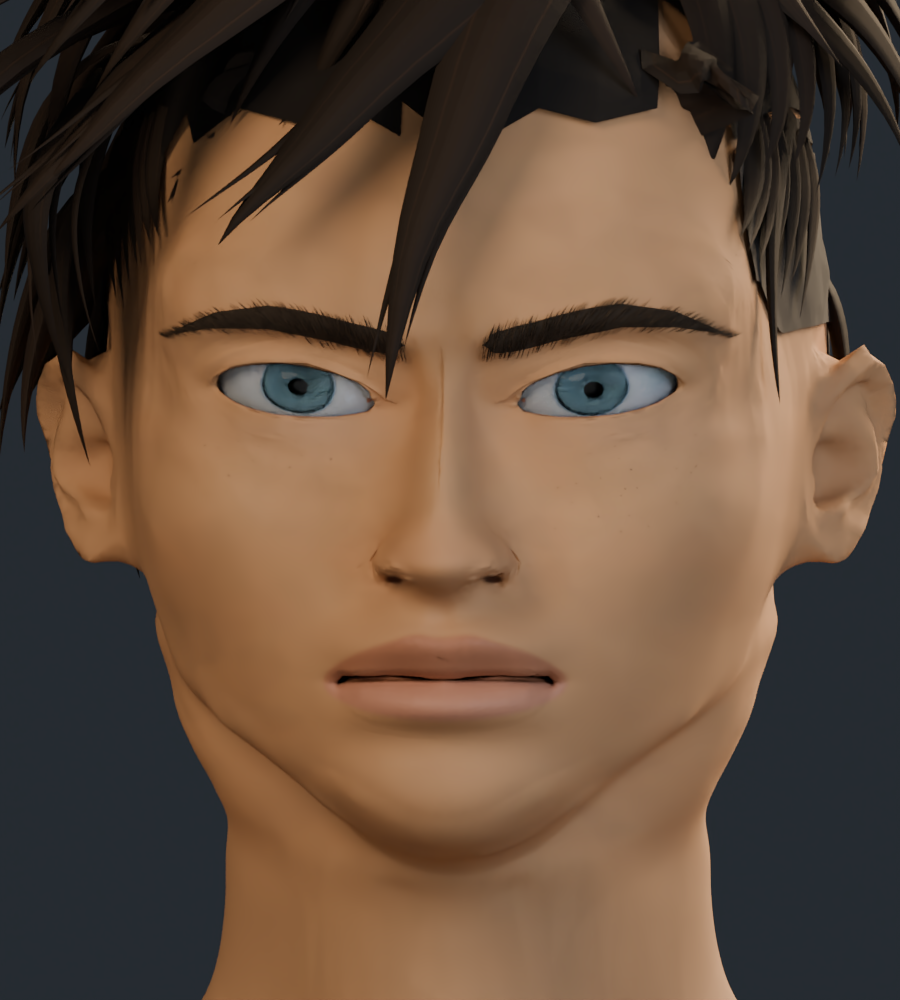
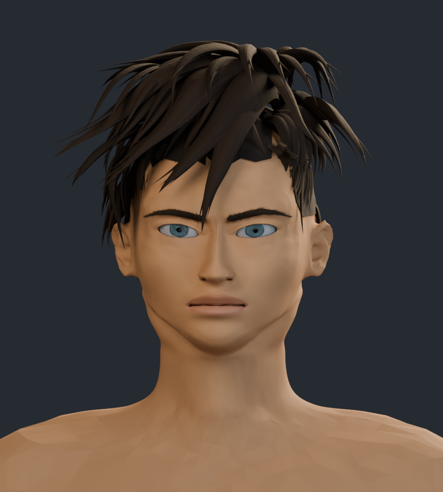
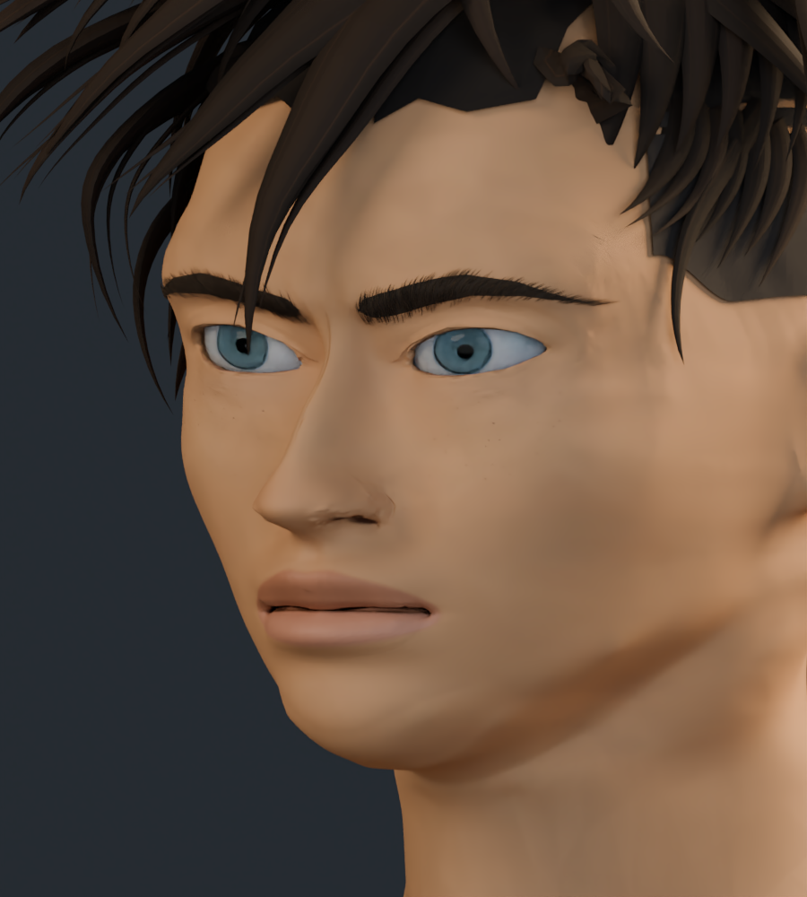
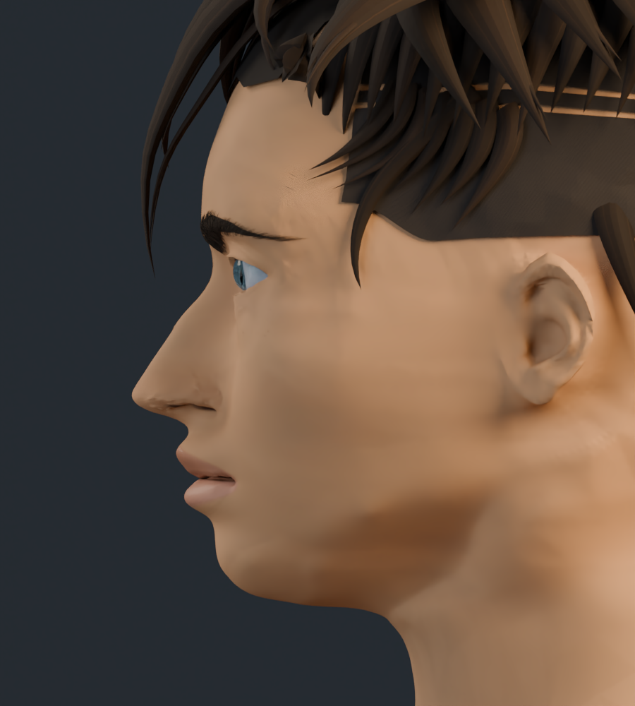
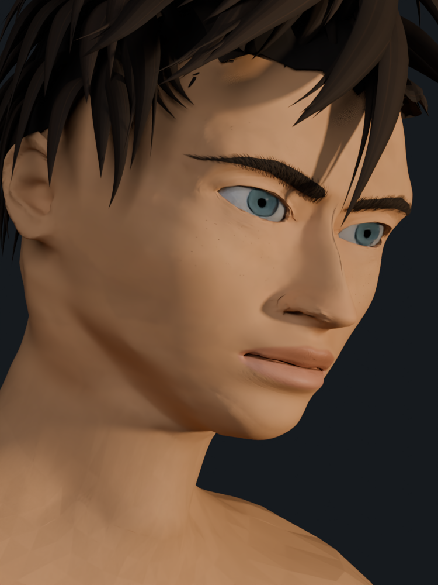
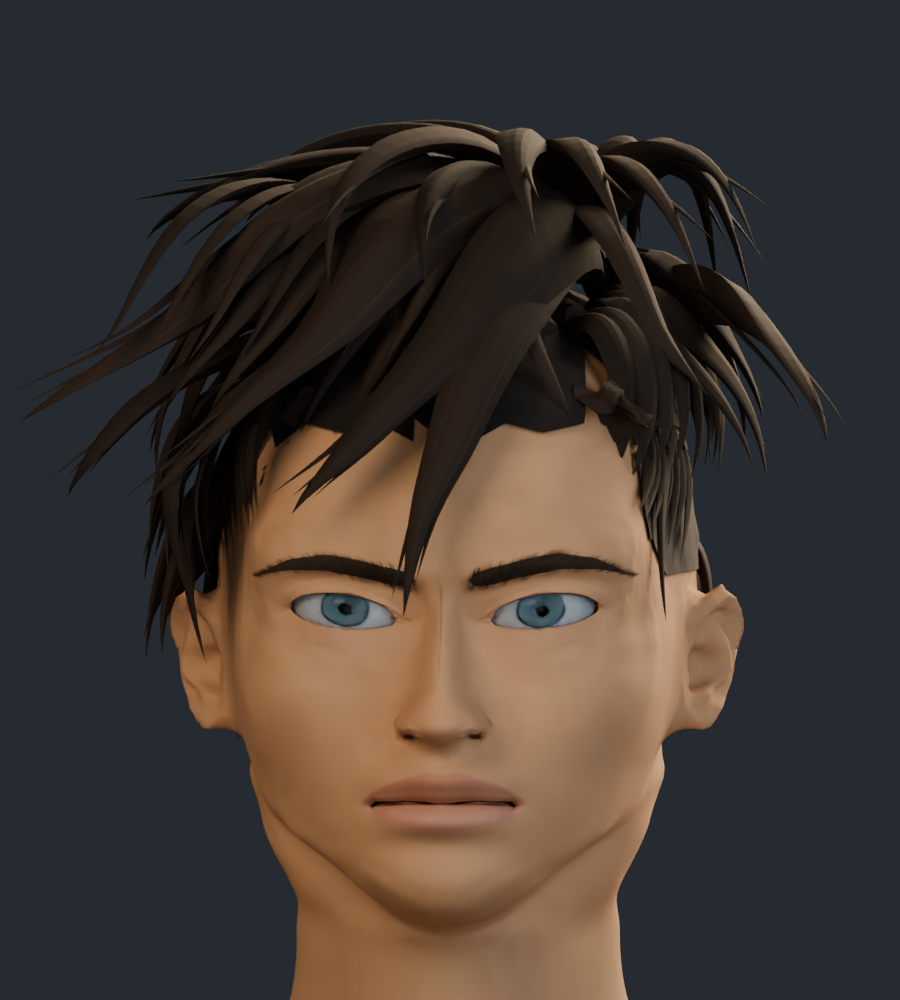

# Rostro v10 · ojos, nariz y boca

Revisión centrada en el contorno de las fosas nasales, los pliegues y el color de los labios, la claridad del iris y el contacto del lagrimal. La cabeza tiene un atlas propio de 4K y la anatomía conserva mayor resolución local en nariz y labios.

El personaje completo tiene 294.817 vértices y 576.431 triángulos. La semejanza sigue en desarrollo; estas imágenes muestran una revisión de trabajo del modelo 3D.

## Comparación del ojo

Mismo encuadre y luz de estudio.

| Anterior · v9 | Actual · v10 |
| --- | --- |
|  |  |

## Comparación de nariz y boca

| Anterior · v9 | Actual · v10 |
| --- | --- |
|  |  |

## Comparación frontal

| Anterior · v9 | Actual · v10 |
| --- | --- |
|  |  |

## Cabeza y cuello

## Tres cuartos

## Perfil

## Cuarto encuadre de referencia

Perspectiva, inclinación y luz cálida aproximadas a la cuarta referencia aportada por el usuario.

## Cabeza completa

[Estudio con material neutro](estudio_formas/README.md) · [Galería v9](../rostro_v9/README.md) · [Procedencia de recursos](../LICENCIAS.md)
