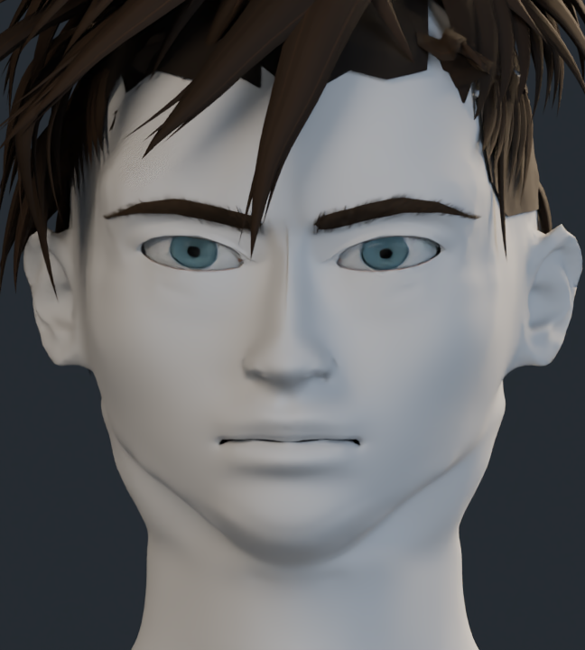
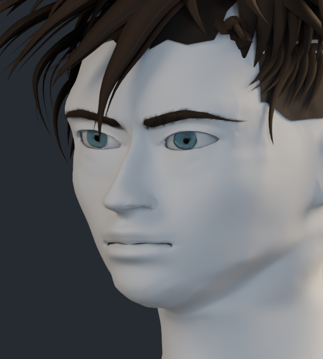
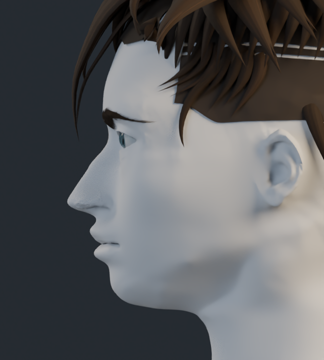
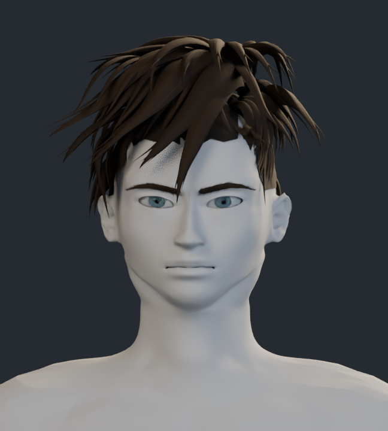

# Estudio de formas · v10

Mismo modelo, con material neutro en la anatomía. La malla anatómica tiene 195.947 vértices, con detalle local en nariz y labios. Es cerrada y no tiene caras degeneradas ni triángulos invertidos respecto a la base refinada de v9. Estas comprobaciones técnicas no miden la semejanza con la referencia.

## Frente

## Tres cuartos

## Perfil

## Cabeza y cuello

[Volver a la galería y comparaciones](../README.md)
