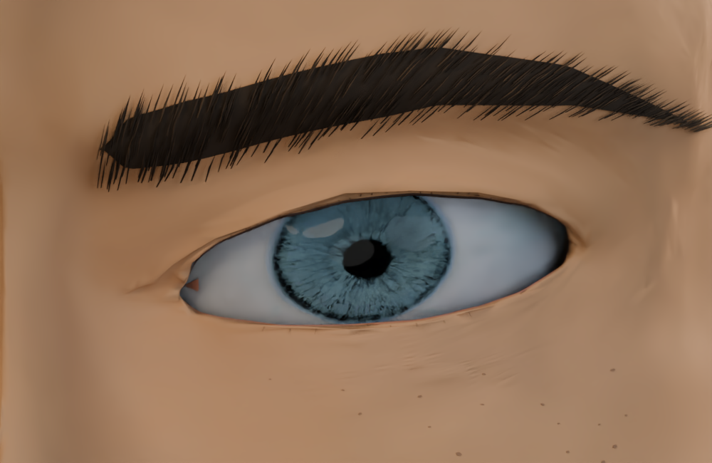
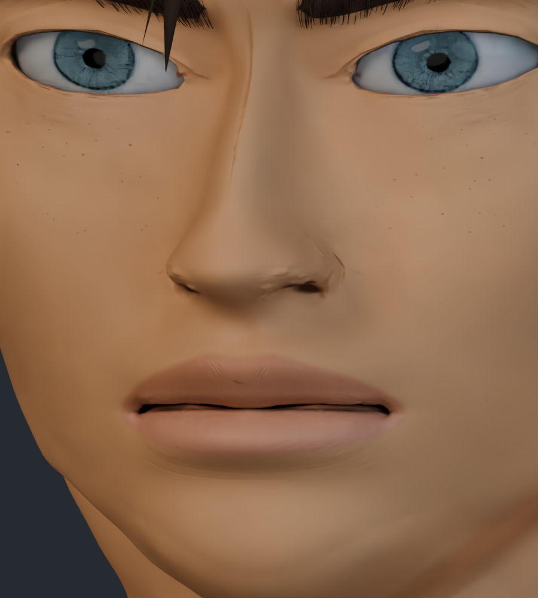
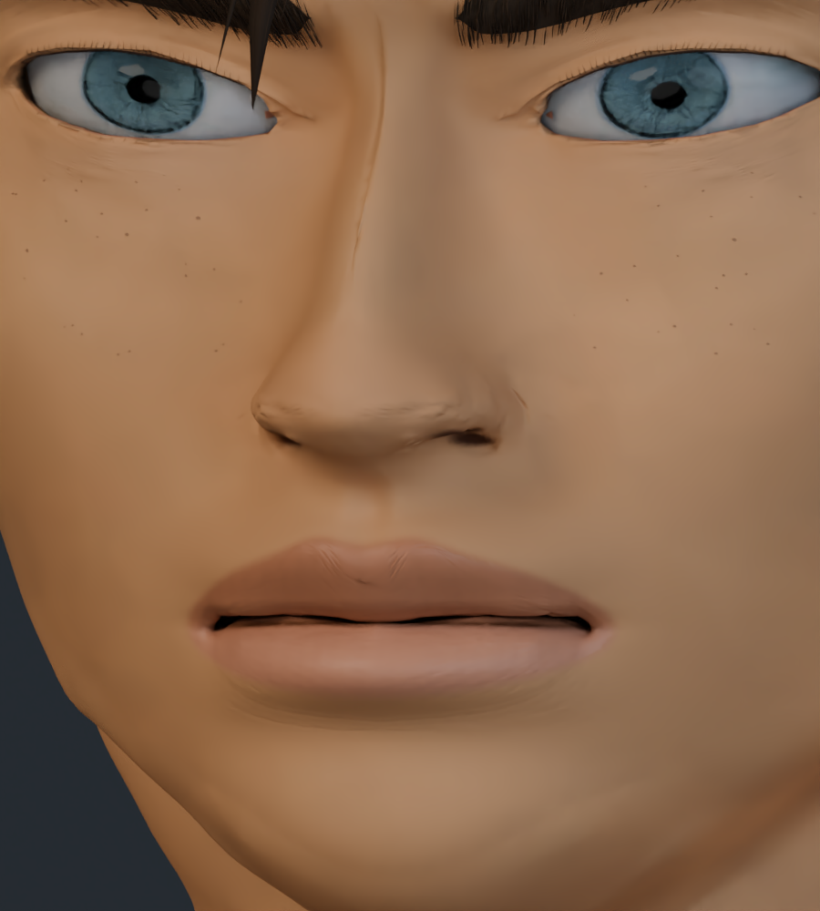
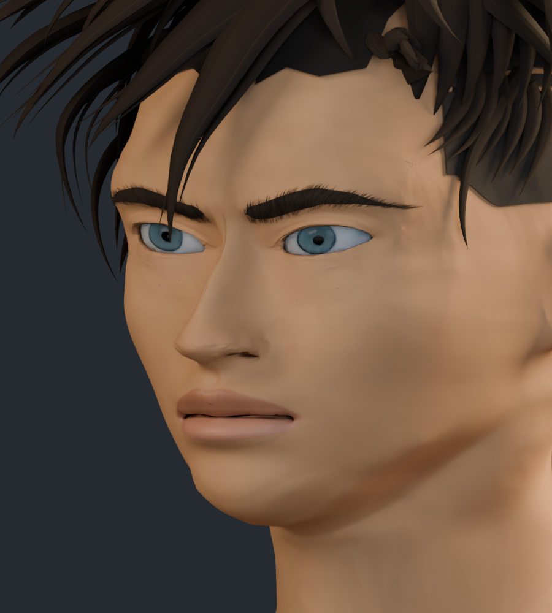
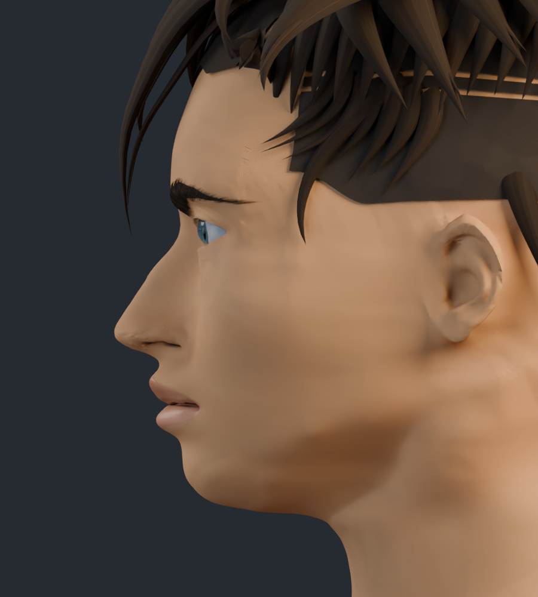
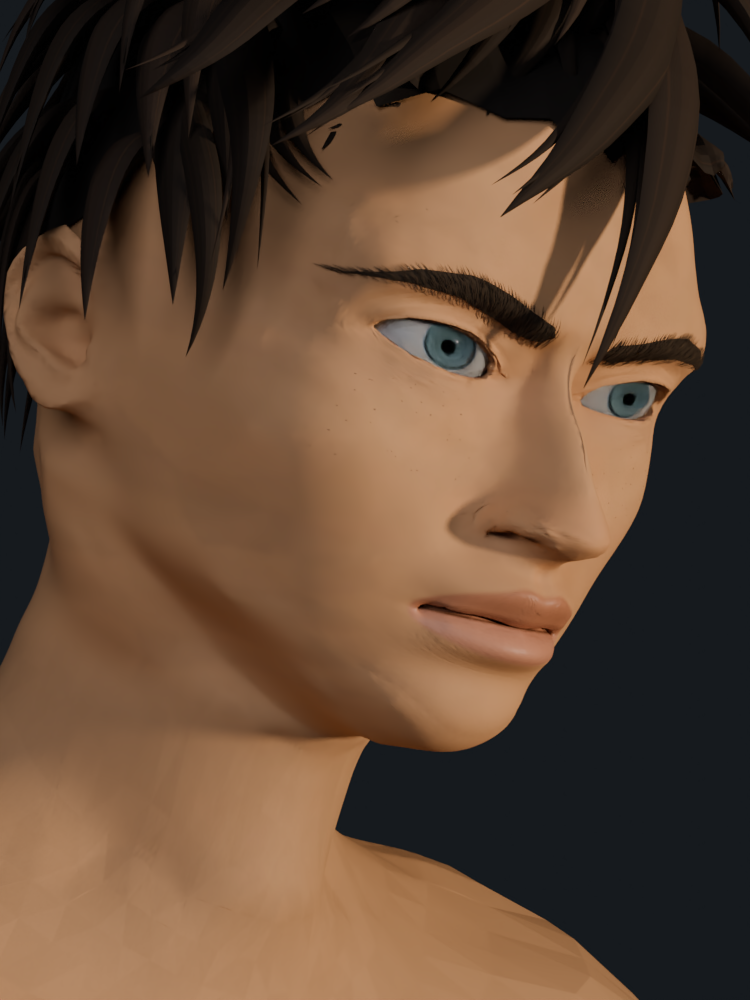
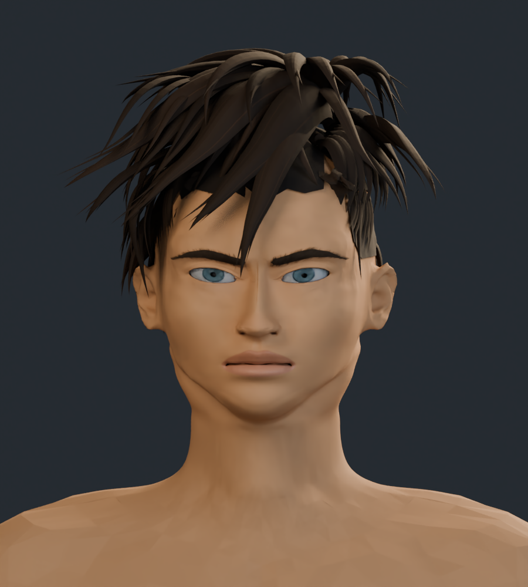
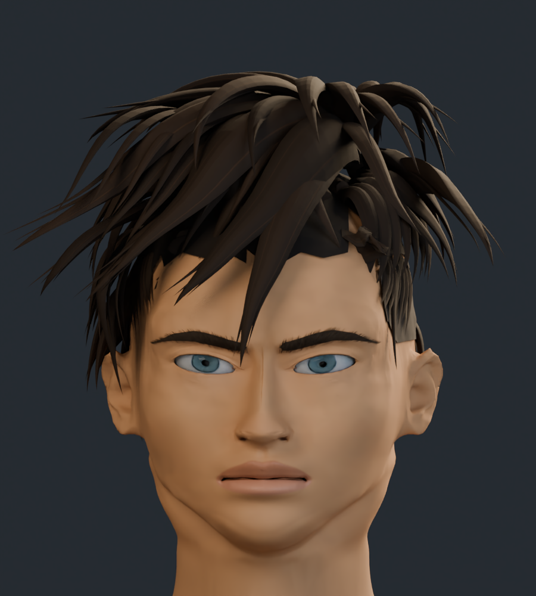

# Rostro v11 · párpados, nariz, labios y cuello

Revisión a partir de v10: apertura ocular algo más contenida, pliegue y margen superiores, pestañas reconstruidas, base nasal más suave y alas menos pinzadas. Se han ajustado el filtrum y el arco del labio, la pintura labial y el relieve del cuello.

El personaje completo tiene 297.149 vértices y 580.983 triángulos. La anatomía conserva sus 195.947 vértices y la topología de v10; el incremento procede de las pestañas. Siete texturas, con atlas de cabeza de 4K actualizado.

Son capturas reales del modelo 3D. El parecido con las ilustraciones sigue en desarrollo; no se asigna un porcentaje nuevo de fidelidad.

## Comparación del ojo

Mismo encuadre y luz de estudio.

| Anterior · v10 | Actual · v11 |
| --- | --- |
|  |  |

## Comparación de nariz y boca

| Anterior · v10 | Actual · v11 |
| --- | --- |
|  |  |

## Comparación frontal

| Anterior · v10 | Actual · v11 |
| --- | --- |
|  |  |

## Tres cuartos

## Perfil

## Cuarto encuadre de referencia

Perspectiva, inclinación y luz cálida aproximadas a la cuarta ilustración.

## Cabeza y cuello

## Cabeza completa

[Estudio con material neutro](estudio_formas/README.md) · [Galería v10](../rostro_v10/README.md) · [Procedencia de recursos](../LICENCIAS.md)
