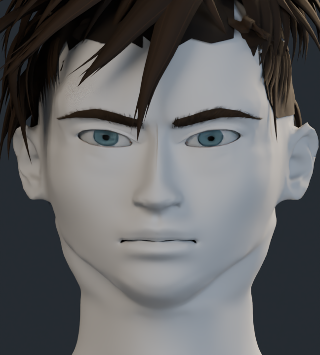
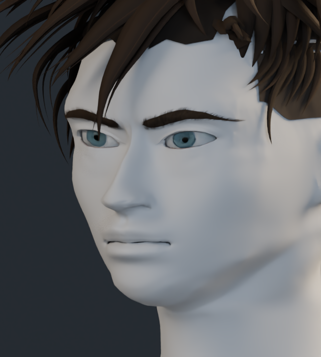
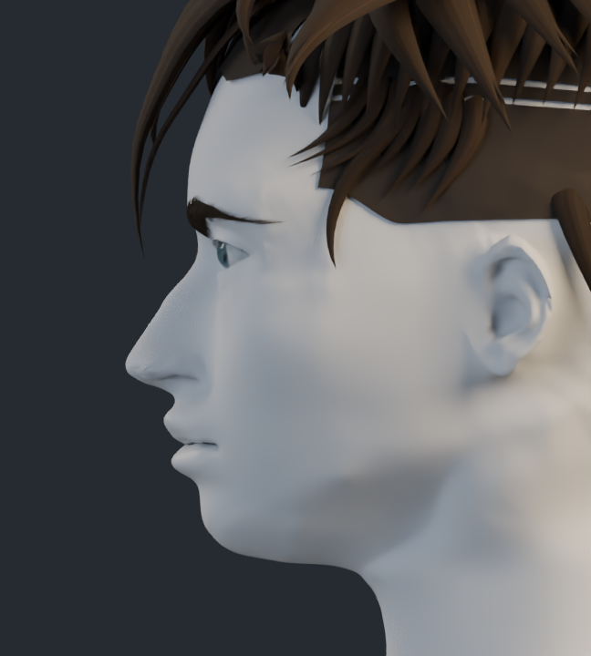
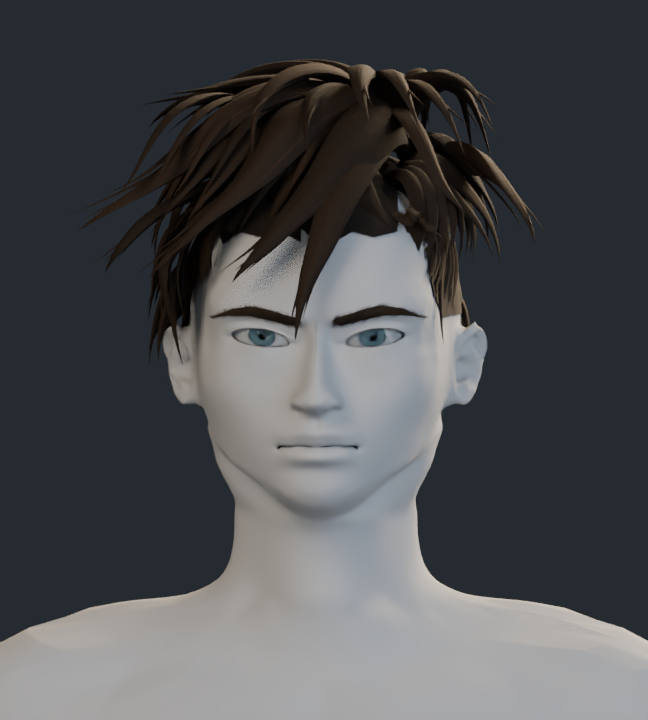

# Estudio de formas · v11

Material neutro sobre la anatomía para revisar las formas sin la pintura. La malla conserva su topología de v10: 195.947 vértices, superficie cerrada y ninguna cara degenerada ni invertida respecto a esa base. Estos controles no miden el parecido artístico.

## Frente

## Tres cuartos

## Perfil

## Cabeza y cuello

[Volver a comparaciones](../README.md)
