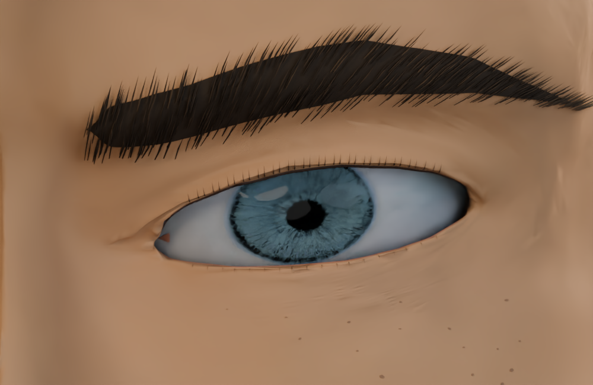
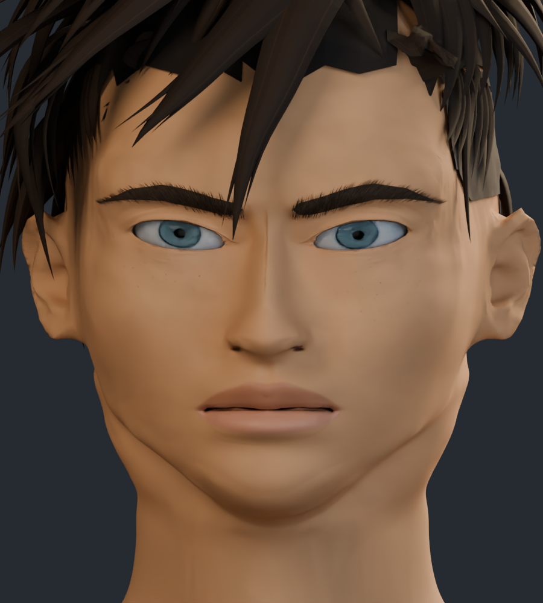
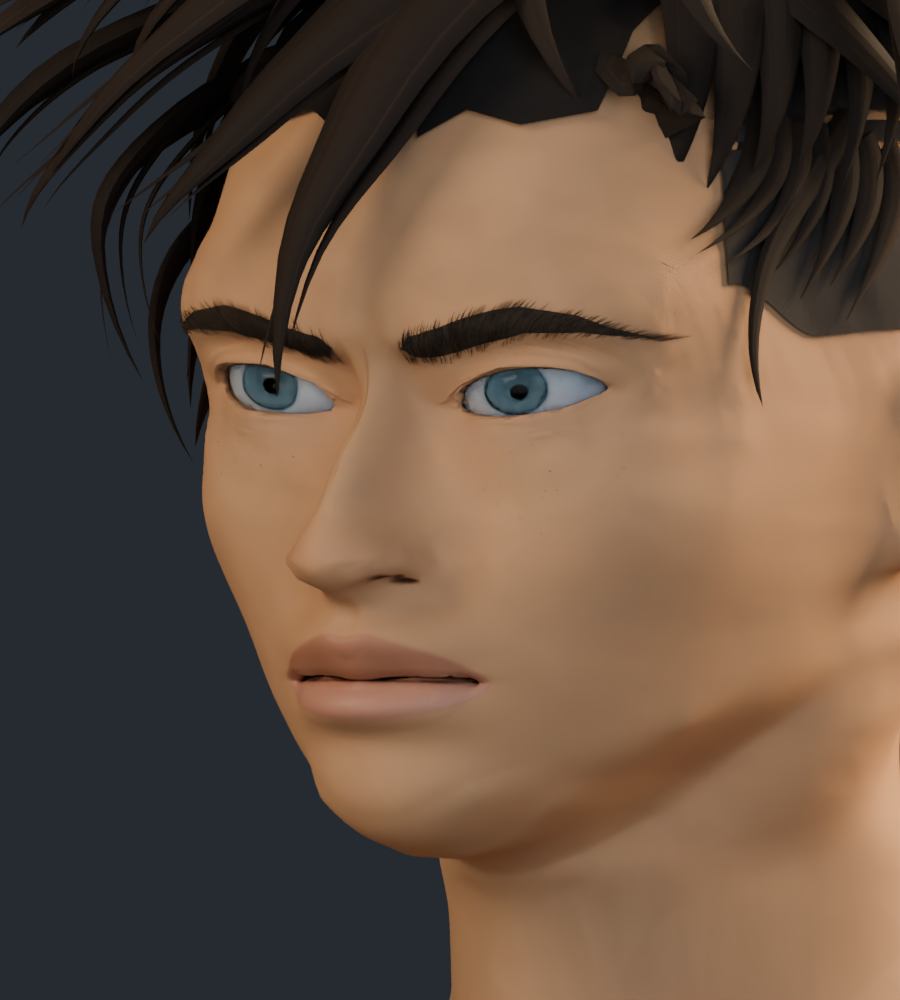
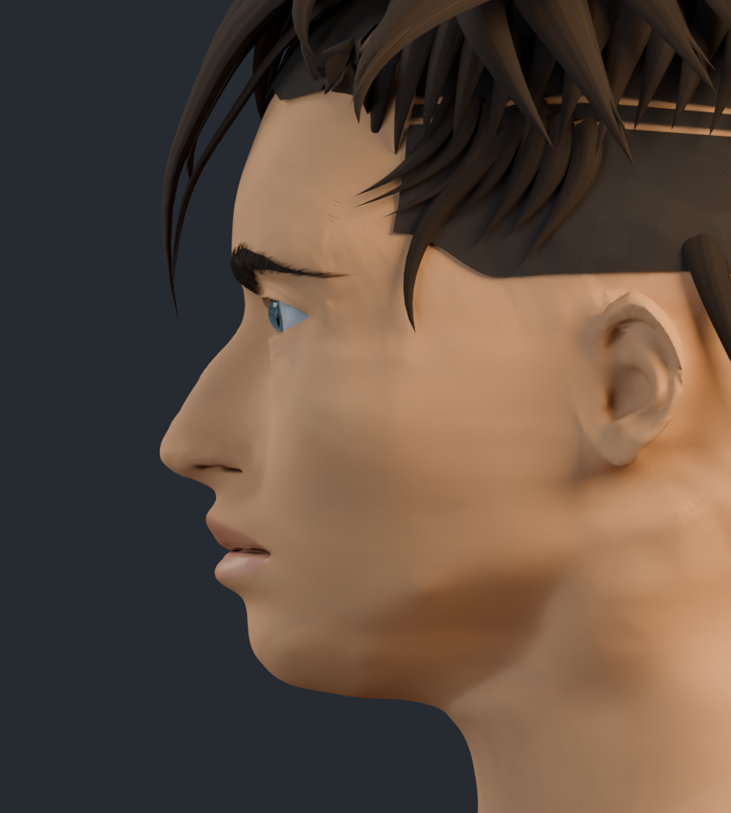
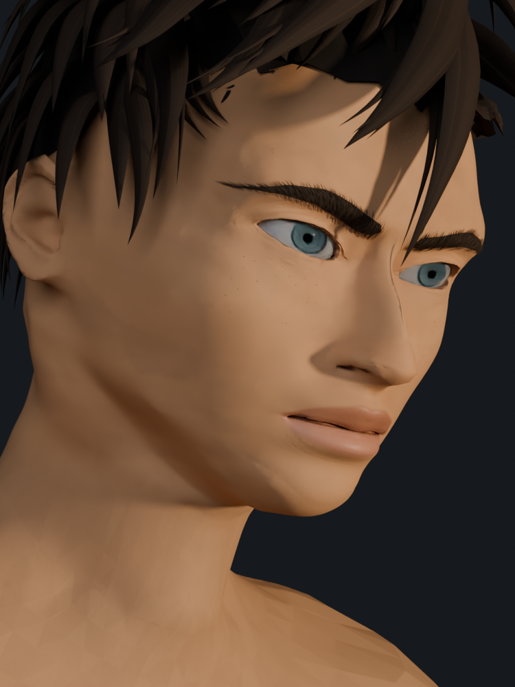
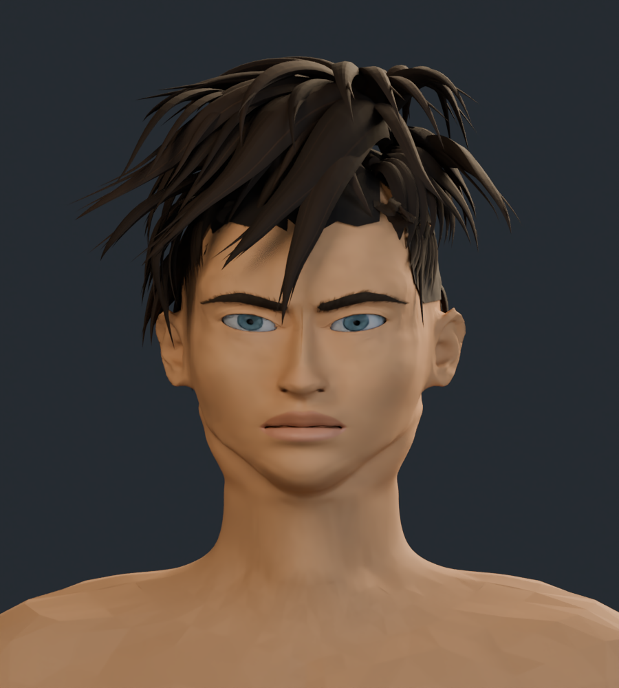
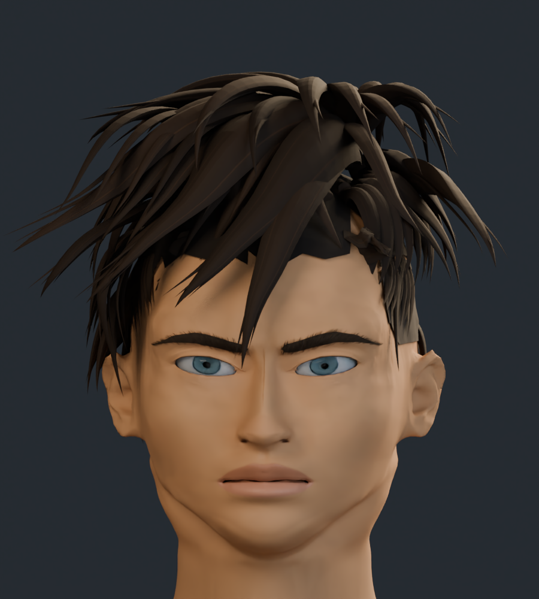

# Rostro v12 · base nasal, comisuras y lagrimales

Revisión a partir de v11: base nasal más suave, comisuras algo más cerradas y labios menos proyectados. El párpado superior recibe un volumen de apoyo, los lagrimales se redondean y asientan en el canto interno, y las pestañas tienen distribución, longitud y grosor variables. Se han revisado el color de las comisuras, el exterior de las fosas y el párpado superior.

El personaje completo tiene 297.457 vértices y 581.599 triángulos. La anatomía conserva sus 195.947 vértices y la topología de v11; el incremento procede de los dos lagrimales. Siete texturas, con atlas de cabeza de 4K actualizado.

Son capturas reales del modelo 3D. El parecido con las ilustraciones sigue en desarrollo; no se asigna un porcentaje nuevo de fidelidad.

## Comparación del ojo

Mismo encuadre y luz de estudio.

| Anterior · v11 | Actual · v12 |
| --- | --- |
|  |  |

## Comparación de nariz y boca

| Anterior · v11 | Actual · v12 |
| --- | --- |
|  |  |

## Comparación frontal

| Anterior · v11 | Actual · v12 |
| --- | --- |
|  |  |

## Tres cuartos

## Perfil

## Cuarto encuadre de referencia

Perspectiva, inclinación y luz cálida aproximadas a la cuarta ilustración.

## Cabeza y cuello

## Cabeza completa

[Estudio con material neutro](estudio_formas/README.md) · [Galería v11](../rostro_v11/README.md) · [Procedencia de recursos](../LICENCIAS.md)
