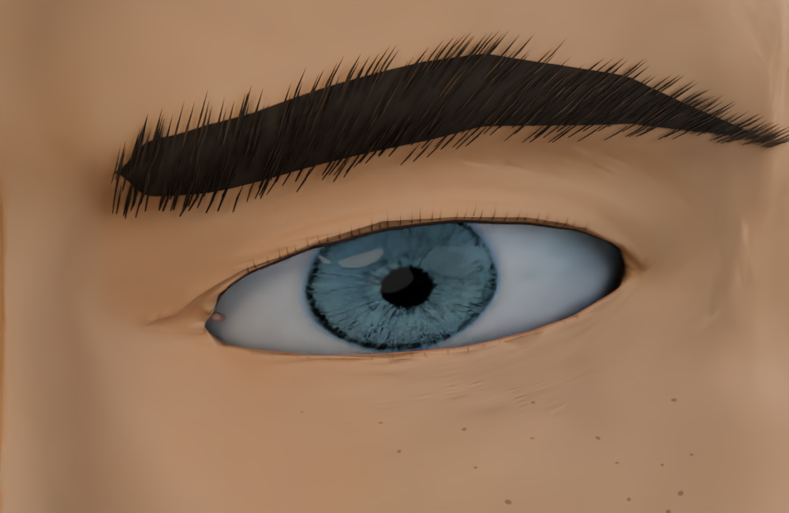
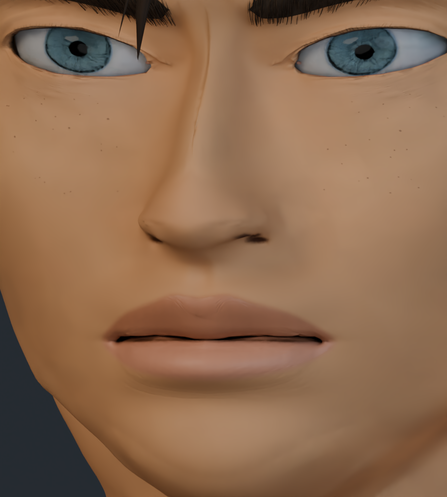
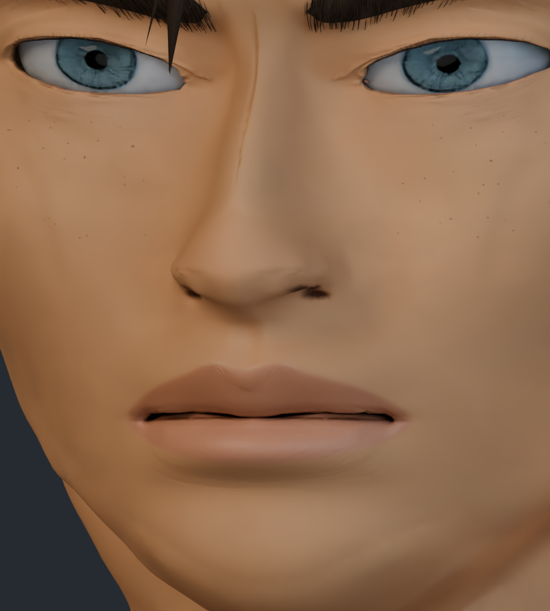
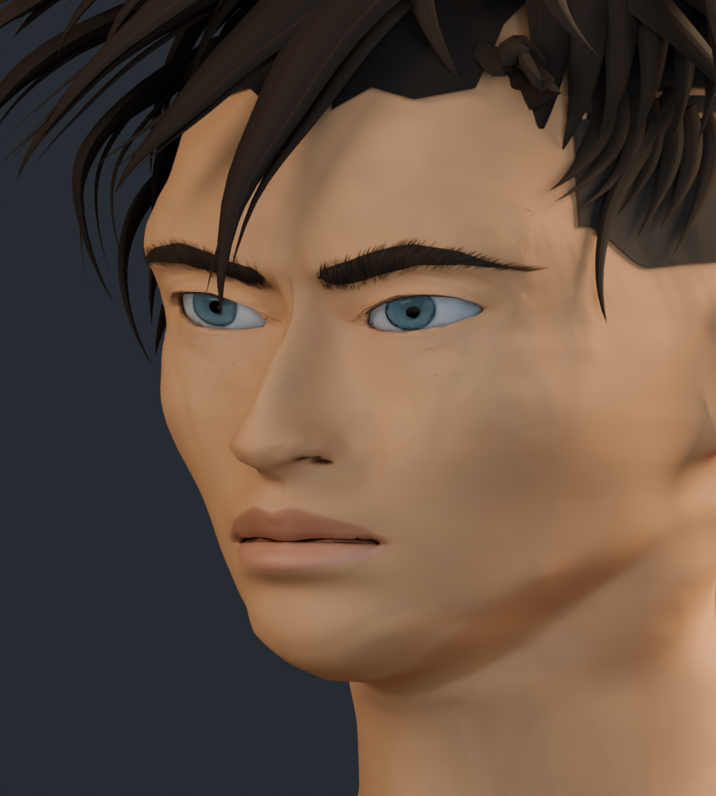
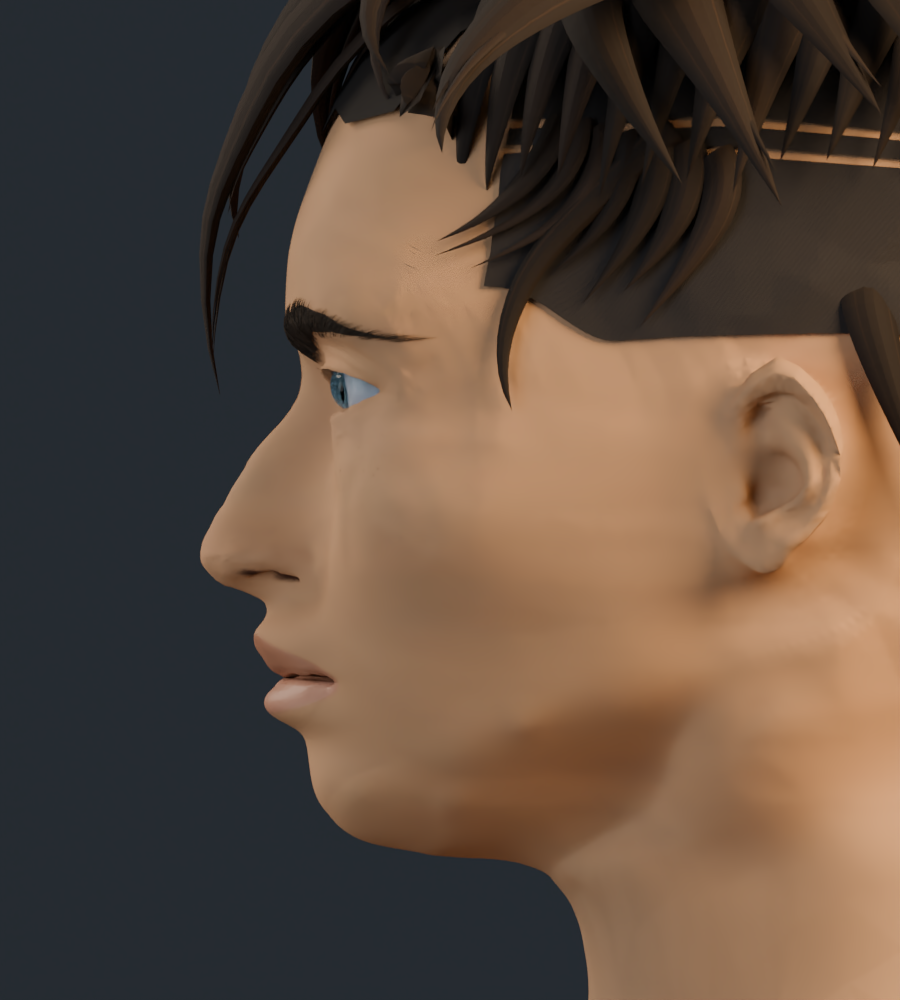
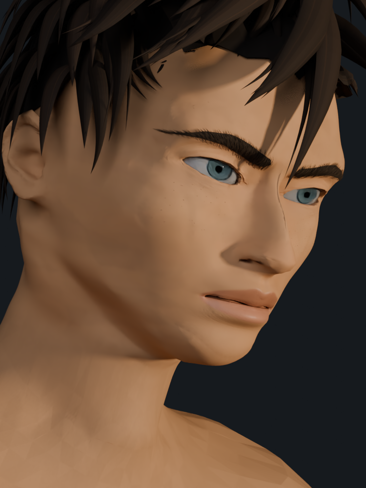
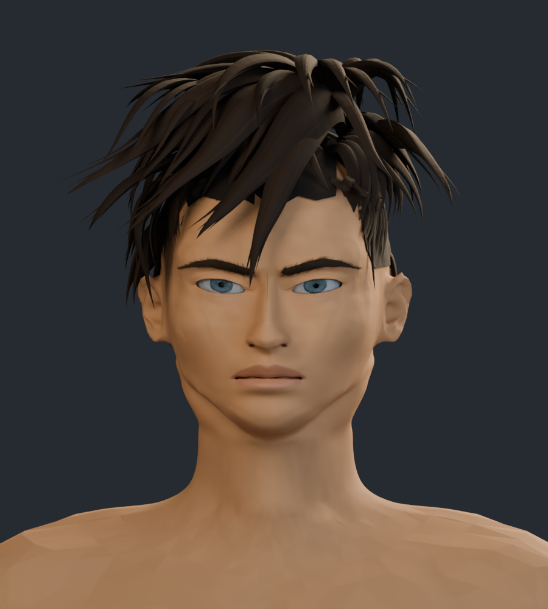
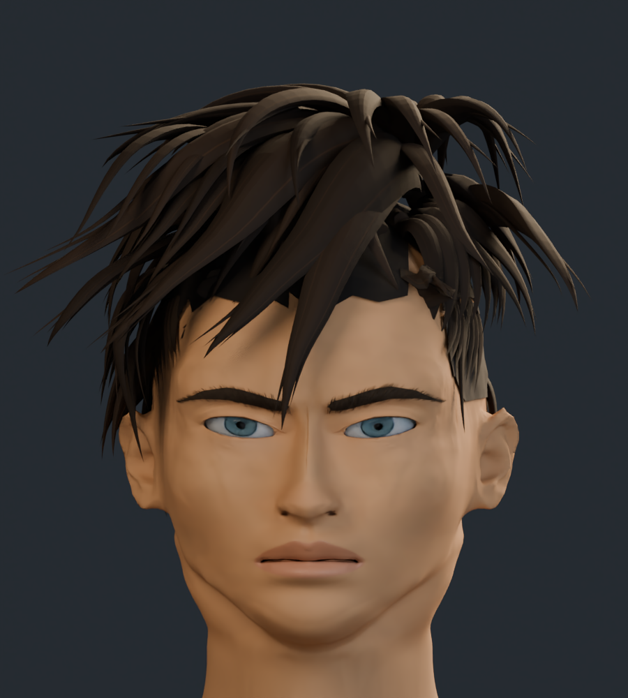

# Rostro v13 · forma facial y rasgos

Revisión de la forma facial: mandíbula más afinada, barbilla menos abultada y apoyo de pómulos más definido. Se ajustan el párpado superior, la proyección de la punta nasal y el arco de los labios, con nuevos márgenes palpebrales y pestañas adaptados a la abertura revisada.

El personaje completo tiene 298.369 vértices y 583.423 triángulos. Las estadísticas corresponden a los archivos de esta entrega. Incluye 7 imágenes de textura.

Son capturas reales del modelo 3D. El parecido con las cuatro ilustraciones sigue en desarrollo; no se asigna un porcentaje de fidelidad.

## Comparación del ojo

Mismo encuadre y luz de estudio.

| Anterior · v12 | Actual · v13 |
| --- | --- |
|  |  |

## Comparación de nariz y boca

| Anterior · v12 | Actual · v13 |
| --- | --- |
|  |  |

## Comparación frontal

| Anterior · v12 | Actual · v13 |
| --- | --- |
|  |  |

## Tres cuartos

## Perfil

## Cuarto encuadre de referencia

Perspectiva, inclinación y luz cálida aproximadas a la cuarta ilustración.

## Cabeza y cuello

## Cabeza completa

[Estudio con material neutro](estudio_formas/README.md) · [Galería v12](../rostro_v12/README.md) · [Procedencia de recursos](../LICENCIAS.md)
