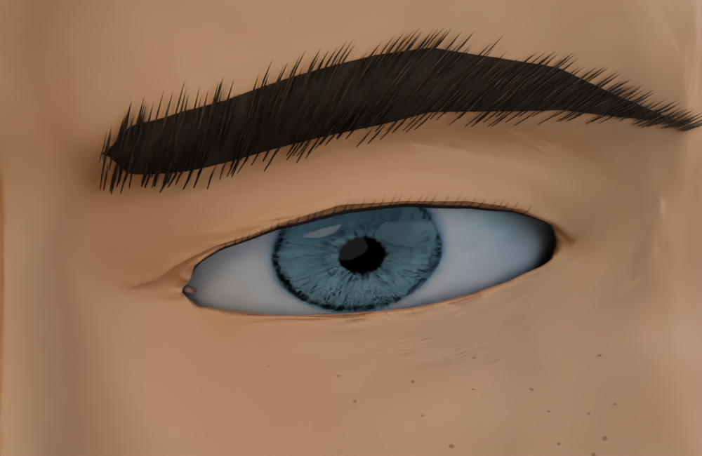
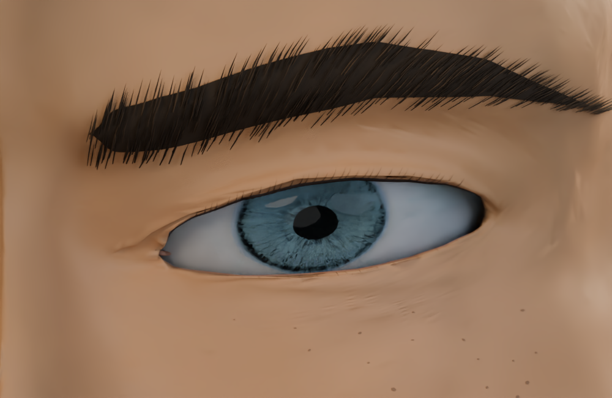
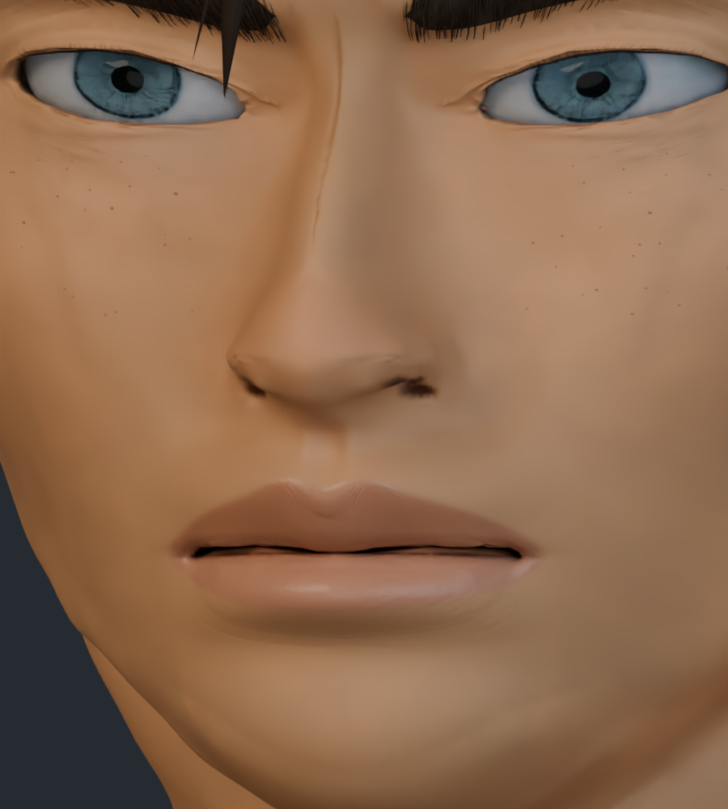
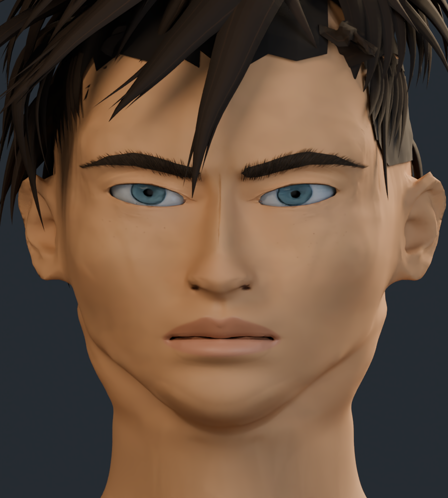
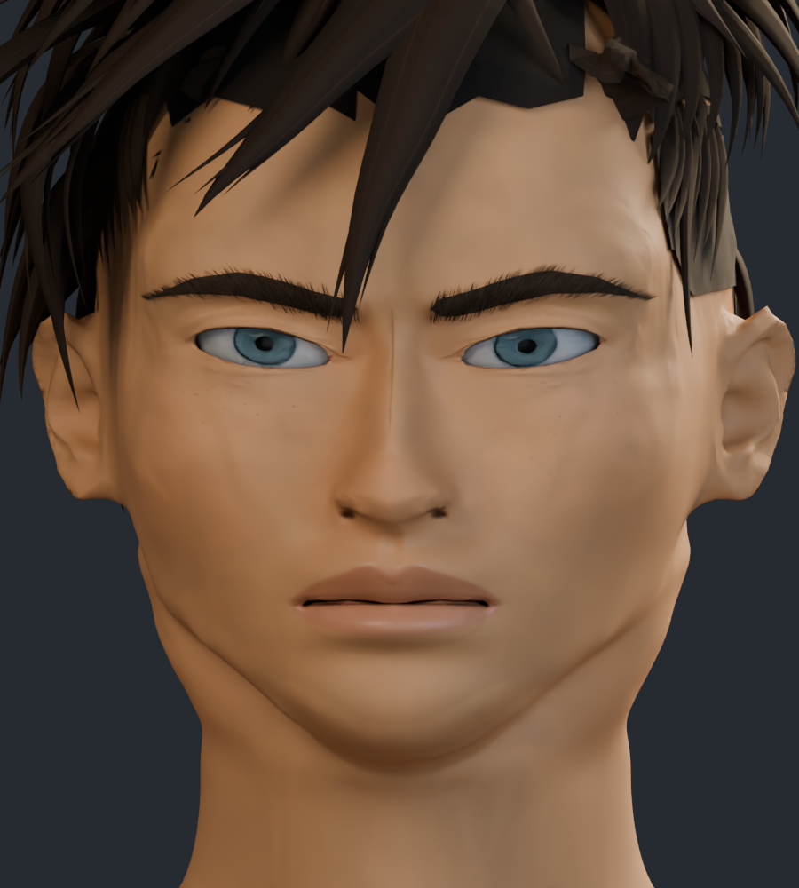
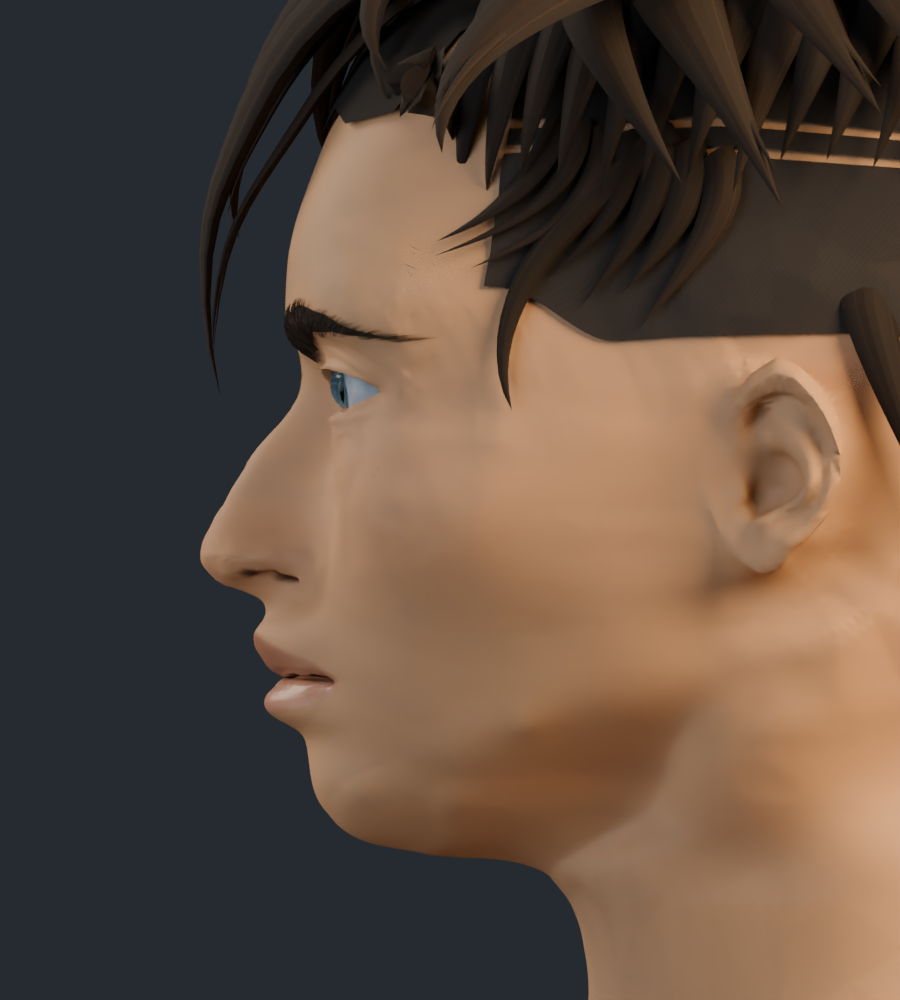
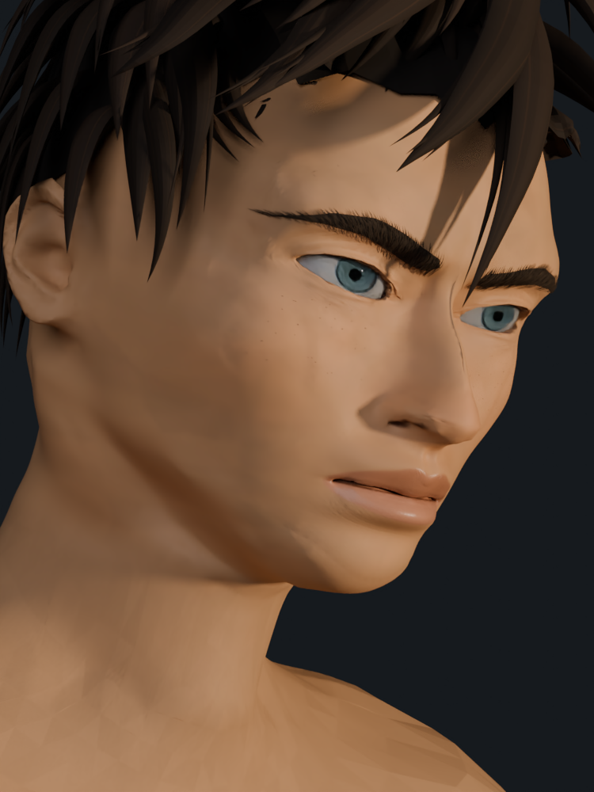
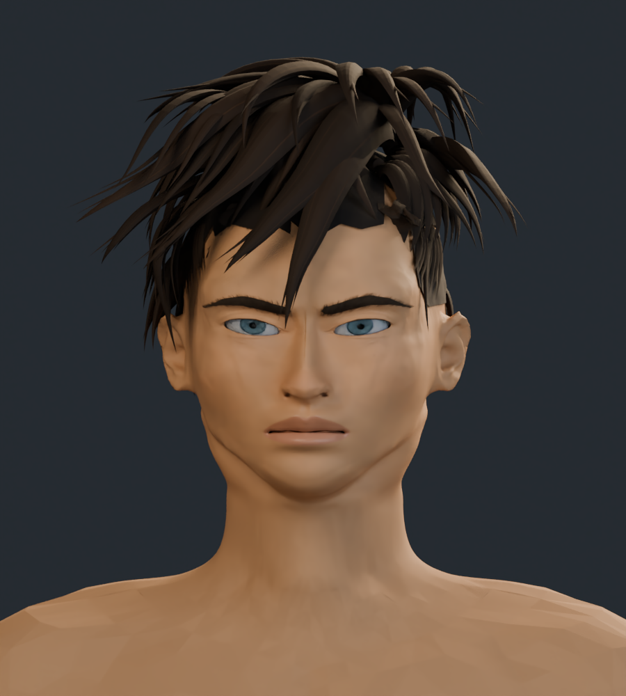
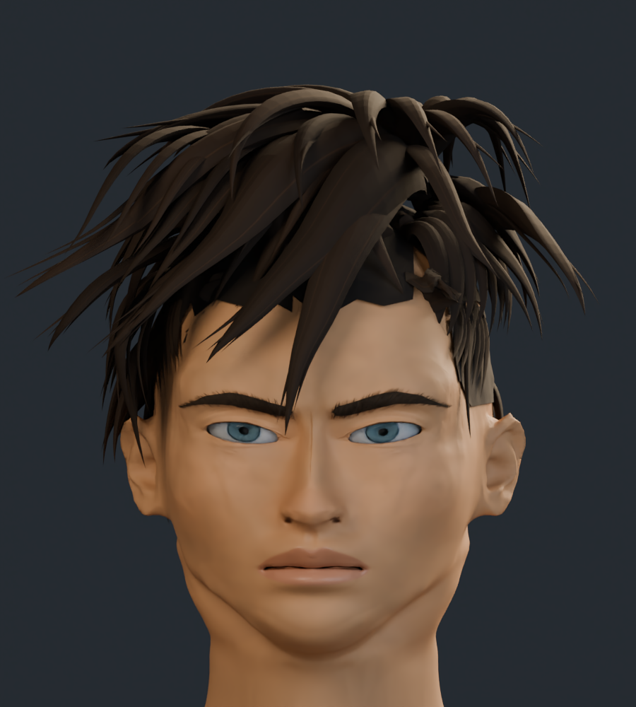

# Rostro v14 · detalle facial y pintura

Revisión de detalle facial: alas de la nariz y filtrum más articulados, transiciones de párpados y lagrimales revisadas, pupilas de contorno regular y pintura de piel con variaciones por planos. Se añade un relieve fino de piel y labios mediante mapa normal, conservando la densidad anatómica de la pasada anterior.

El personaje completo tiene 299.725 vértices y 586.127 triángulos. Las estadísticas corresponden a los archivos de esta entrega. Incluye 8 imágenes de textura.

Son capturas reales del modelo 3D. El parecido con las cuatro ilustraciones sigue en desarrollo; no se asigna un porcentaje de fidelidad.

## Comparación del ojo

Mismo encuadre y luz de estudio.

| Anterior · v13 | Actual · v14 |
| --- | --- |
|  |  |

## Comparación de nariz y boca

| Anterior · v13 | Actual · v14 |
| --- | --- |
|  |  |

## Comparación frontal

| Anterior · v13 | Actual · v14 |
| --- | --- |
|  |  |

## Tres cuartos

## Perfil

## Cuarto encuadre de referencia

Perspectiva, inclinación y luz cálida aproximadas a la cuarta ilustración.

## Cabeza y cuello

## Cabeza completa

[Estudio con material neutro](estudio_formas/README.md) · [Galería v13](../rostro_v13/README.md) · [Procedencia de recursos](../LICENCIAS.md)
