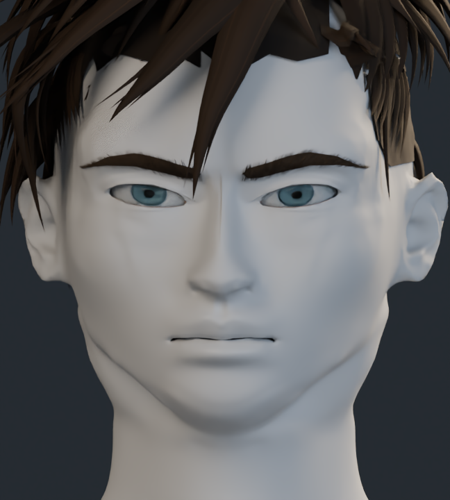
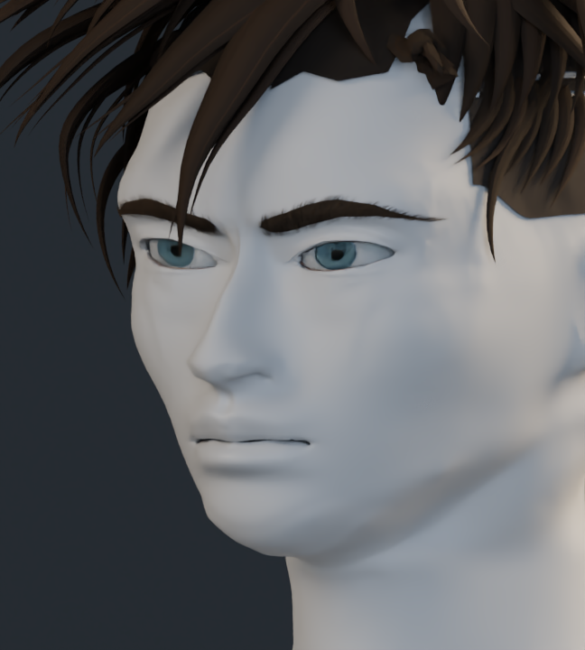
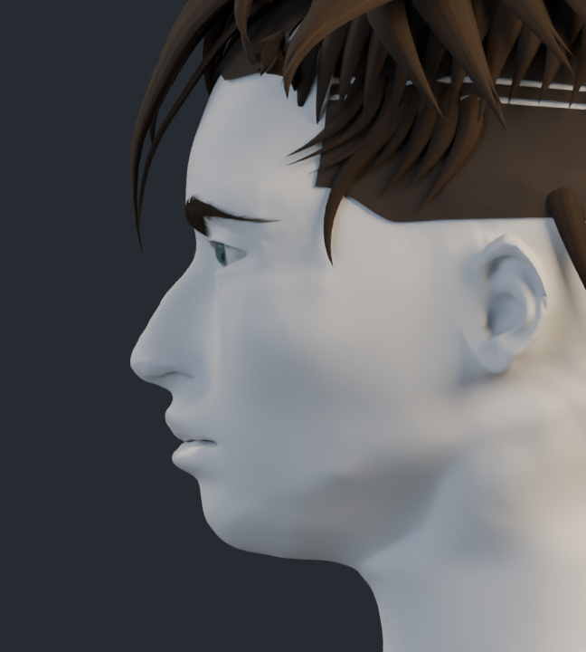

# Estudio de formas · v14

Material neutro sobre la anatomía para revisar los volúmenes sin la pintura. Las comprobaciones de integridad de malla y exportación se recogen en la entrega local. Esos controles no miden el parecido artístico con la referencia.

## Frente

## Tres cuartos

## Perfil

## Cabeza y cuello

[Volver a comparaciones](../README.md)
