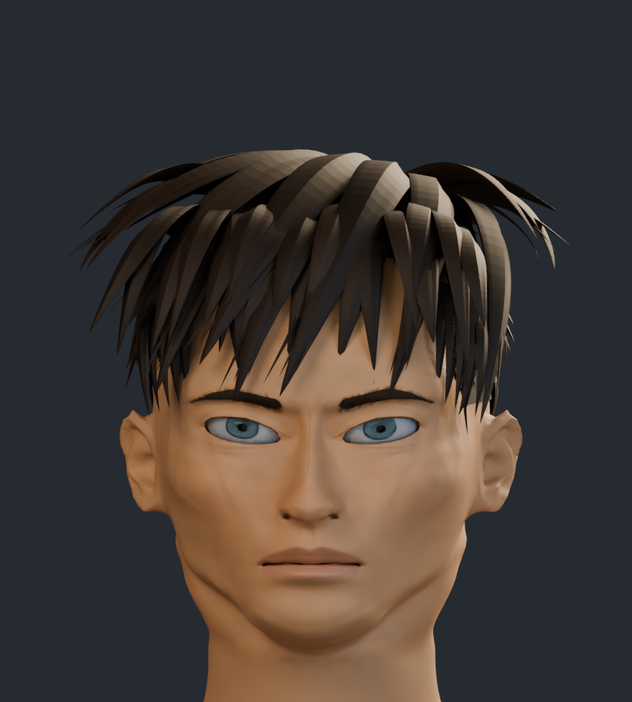
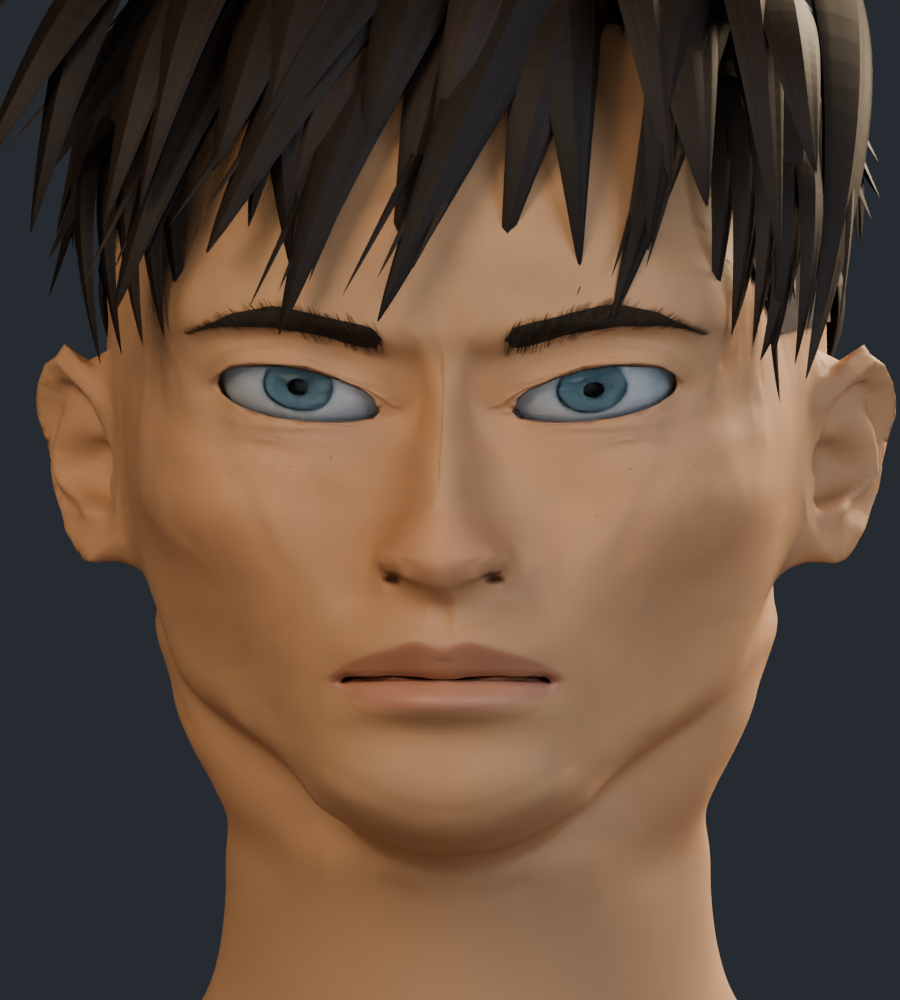
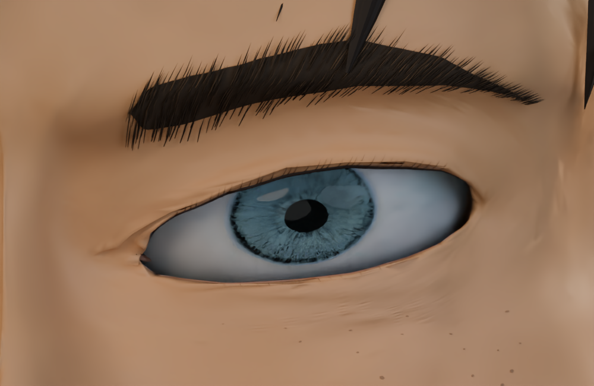
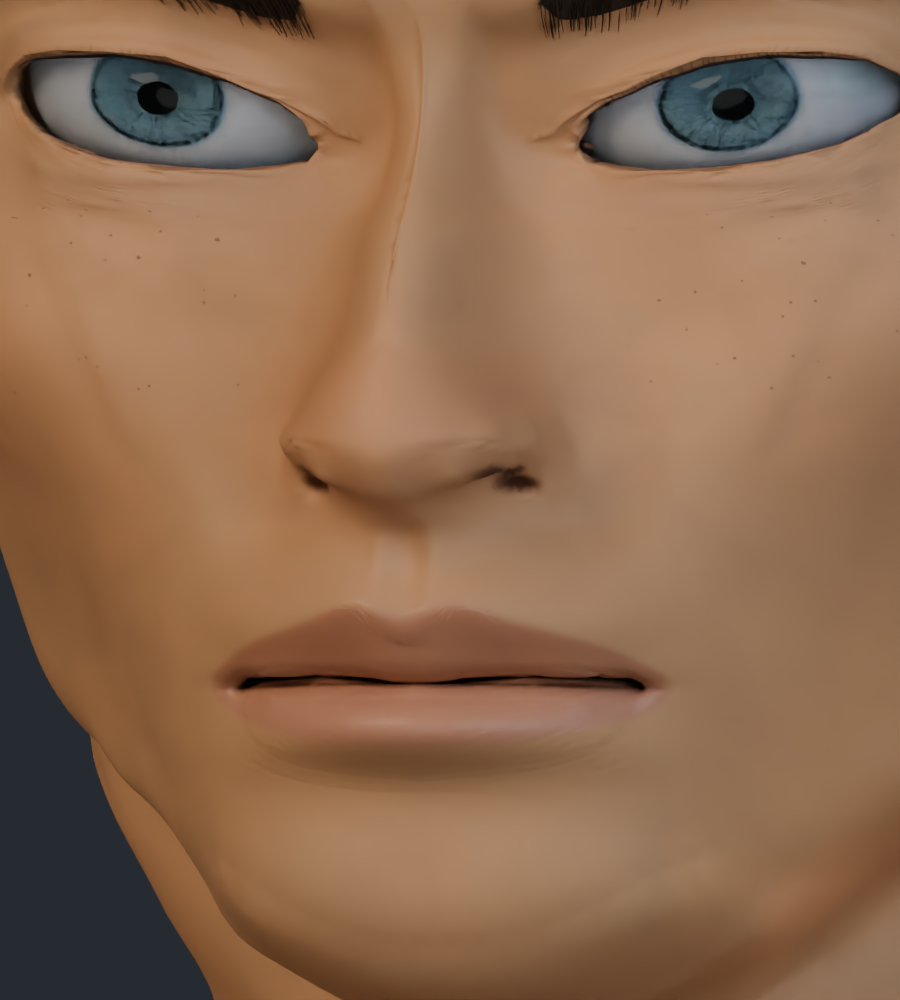
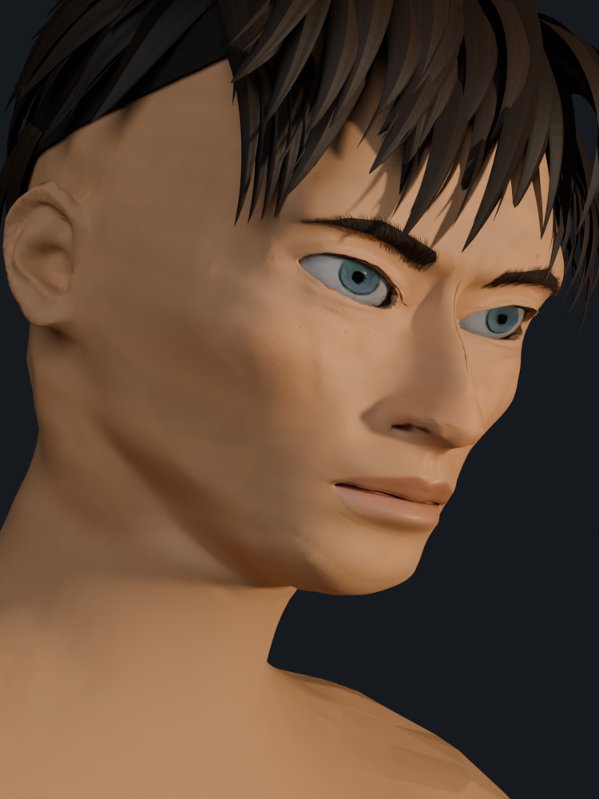
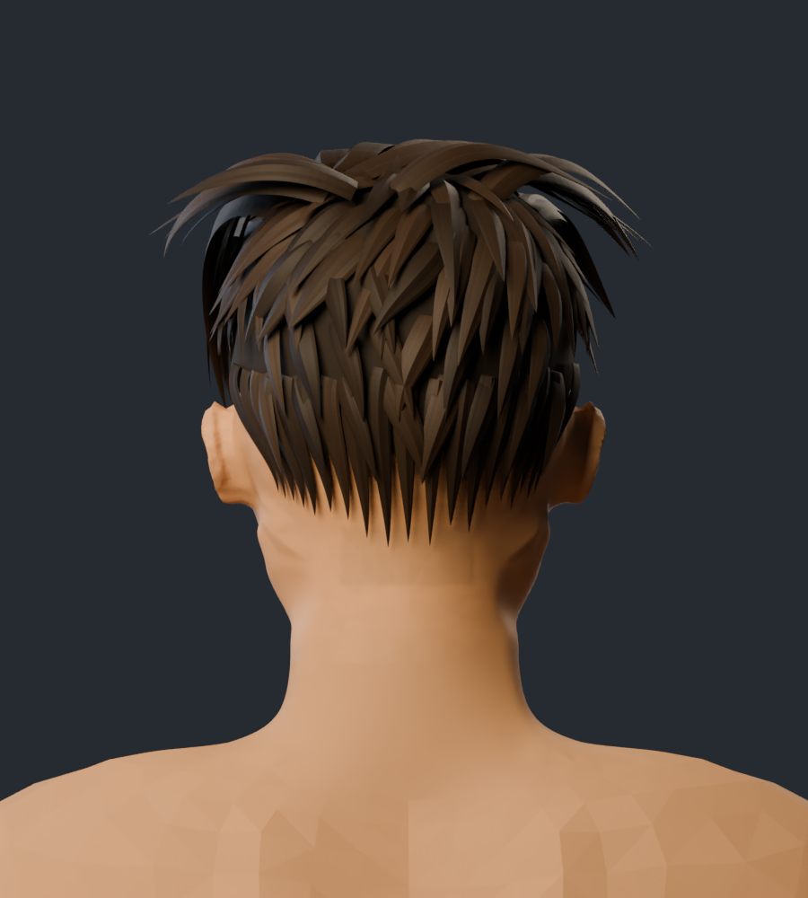

# Rostro v15 · proporciones, peinado y cuello

Revisión de proporciones, peinado y cuello: ojos más abiertos, cejas más cortas, mandíbula más afinada y un plano de barbilla más ancho y definido. Los labios tienen menos volumen de cojín y el cabello se reconstruye con mechones más pequeños y solapados. En el cuello se reducen los relieves secundarios para dar continuidad a la superficie. Las comparaciones muestran el cambio de conjunto con la misma cámara y luz.

Las comparaciones usan el mismo encuadre y la misma iluminación en ambas versiones. La cabeza completa, el frontal y el tres cuartos se muestran primero para valorar el cambio de conjunto.

## Cabeza completa: silueta y peinado

| Anterior · v14 | Actual · v15 |
| --- | --- |
|  |  |

## Comparación frontal

| Anterior · v14 | Actual · v15 |
| --- | --- |
|  |  |

## Comparación de tres cuartos

| Anterior · v14 | Actual · v15 |
| --- | --- |
|  |  |

## Comparación del ojo

| Anterior · v14 | Actual · v15 |
| --- | --- |
|  |  |

## Comparación de nariz y boca

| Anterior · v14 | Actual · v15 |
| --- | --- |
|  |  |

## Perfil

## Cuarto encuadre de referencia

Perspectiva, inclinación y luz cálida aproximadas a la cuarta ilustración.

## Comparación de cabeza y cuello

| Anterior · v14 | Actual · v15 |
| --- | --- |
|  |  |

[Comparar el cuello con material neutro](estudio_formas/README.md#comparación-de-cabeza-y-cuello).

## Vista posterior: cabello y nuca

El personaje completo tiene 308.527 vértices y 603.778 triángulos, distribuidos en 263 mallas. Incluye 8 imágenes de textura. Las cifras corresponden a los archivos de esta entrega.

Son capturas reales del modelo 3D. El parecido con las cuatro ilustraciones sigue en desarrollo; no se asigna un porcentaje de fidelidad.

[Estudio con material neutro](estudio_formas/README.md) · [Galería v14](../rostro_v14/README.md) · [Procedencia de recursos](../LICENCIAS.md)
