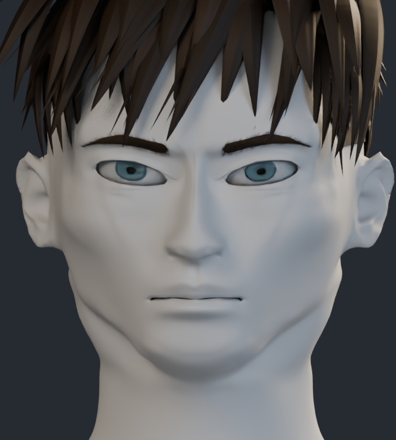
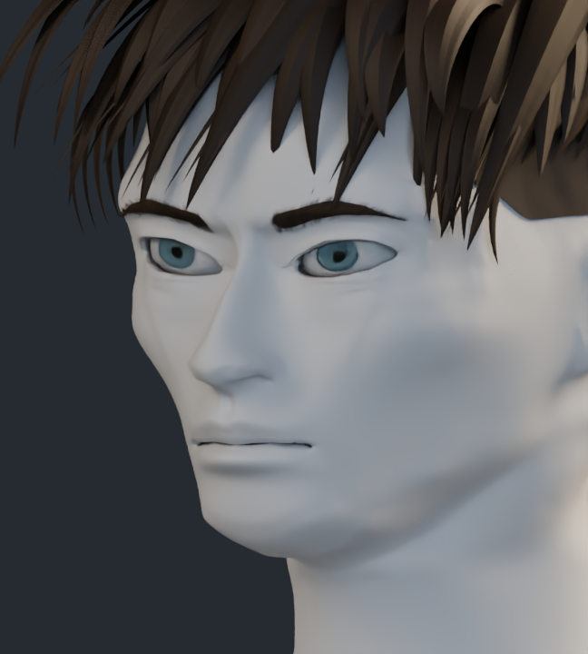
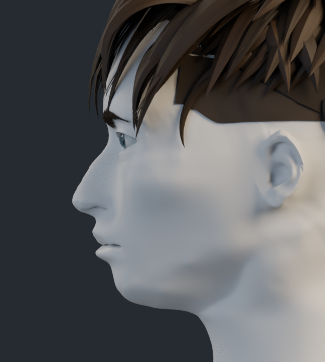
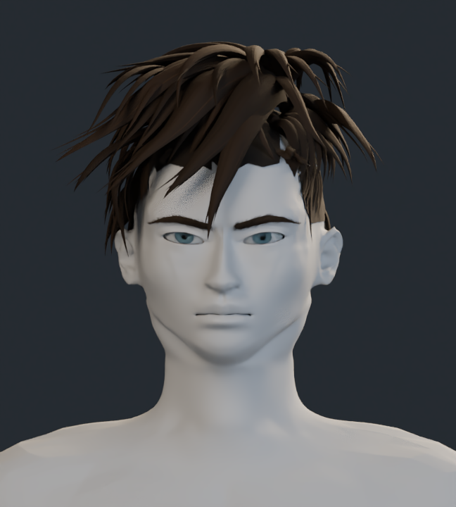
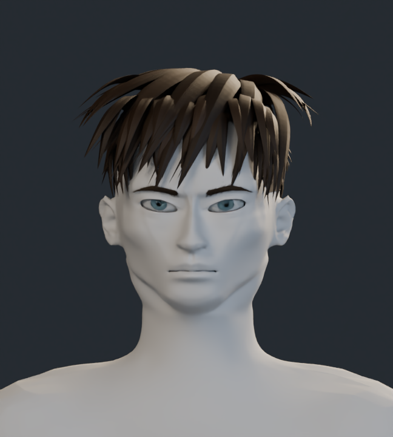

# Estudio de formas · v15

Material neutro sobre la anatomía para revisar los volúmenes sin la pintura. Los encuadres mantienen las cámaras de la comparación en color. Las comprobaciones de integridad de malla y exportación se recogen en la entrega local; no miden el parecido artístico con la referencia.

## Frente

## Tres cuartos

## Perfil

## Comparación de cabeza y cuello

| Anterior · v14 | Actual · v15 |
| --- | --- |
|  |  |

[Volver a comparaciones](../README.md)
