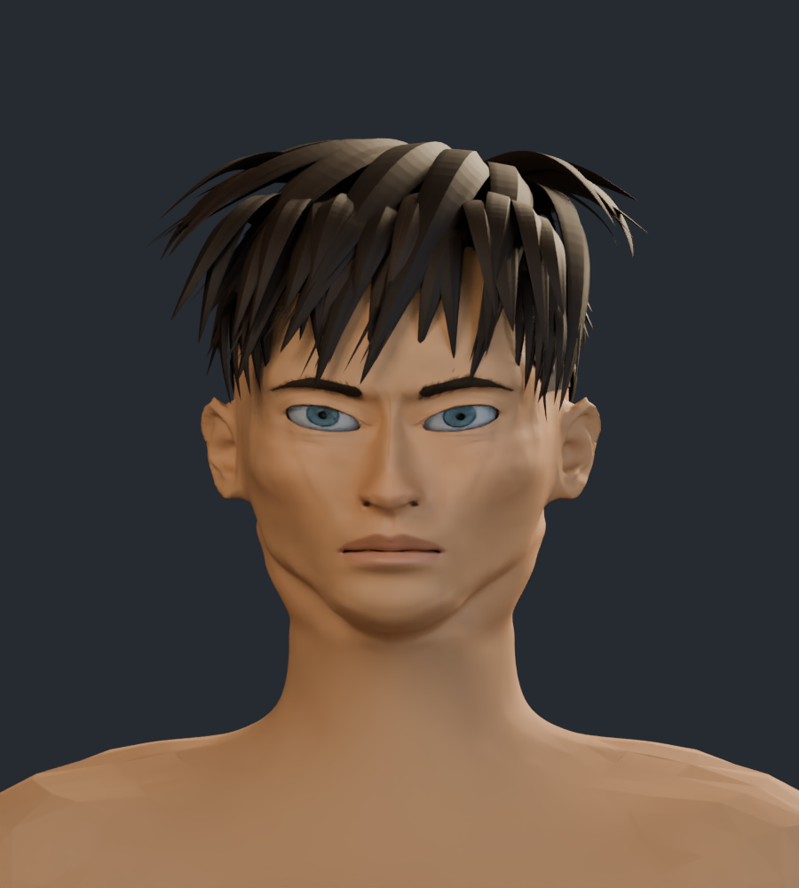
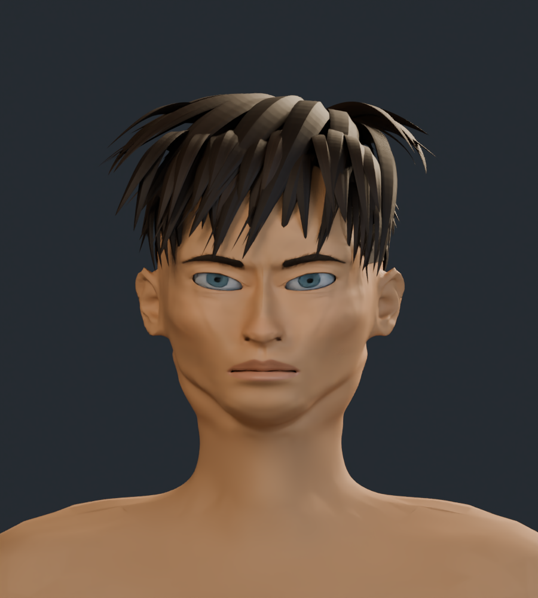
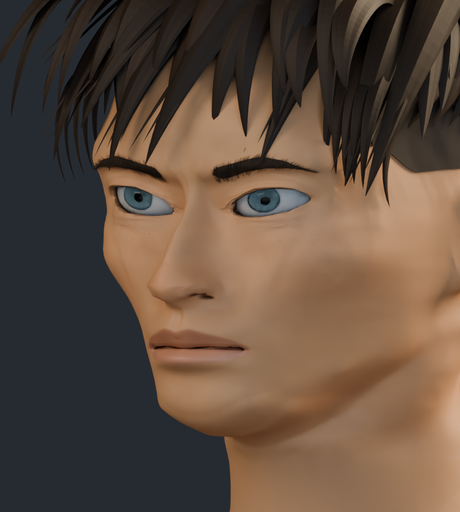
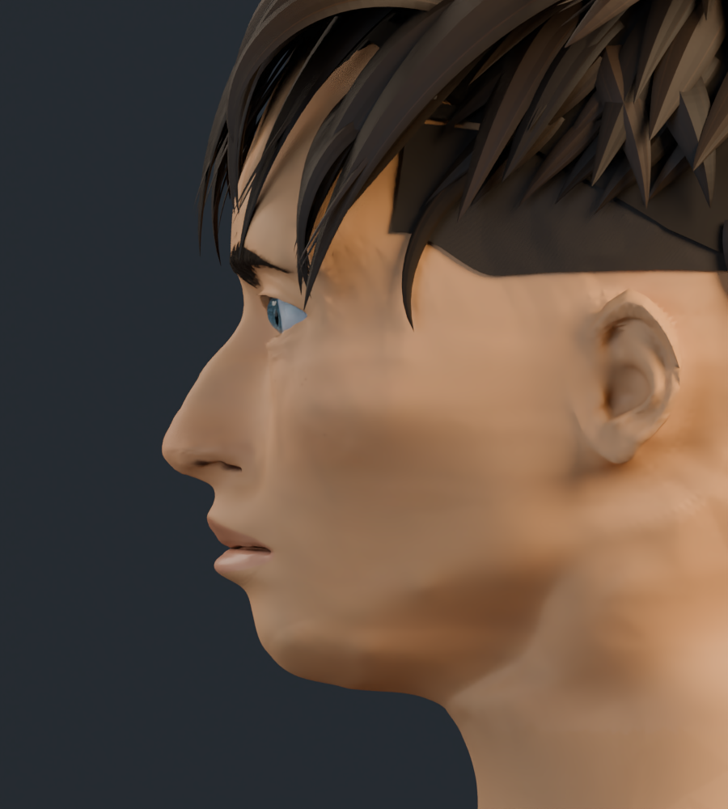
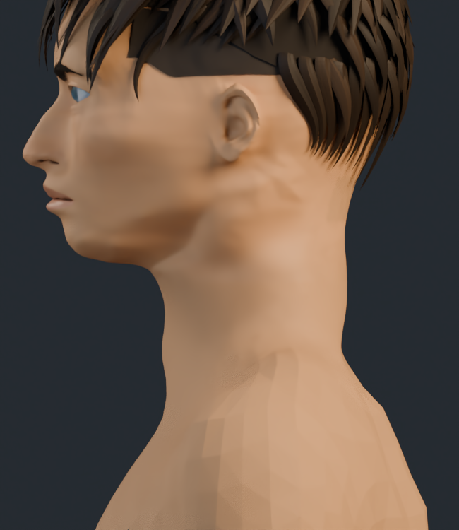
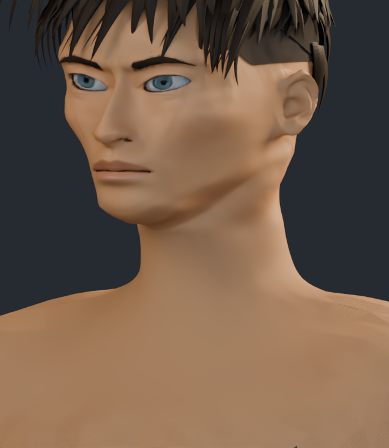

# Rostro y cuello · v16

Revisión de la silueta cervical, el arco bajo la mandíbula y las proporciones faciales. El parecido con las cuatro ilustraciones continúa en desarrollo; esta versión no se presenta como equivalente a la referencia.

Las capturas son renders reales con las mismas cámaras y luces. v16 usa 32 muestras con eliminación de ruido; v15 usa 64. Las ocho texturas se conservan; el cambio de esta pasada está en la geometría y sus normales.

## Cuello y unión con mandíbula y hombros

| v15 | v16 |
| --- | --- |
|  |  |

## Tres cuartos

| v15 | v16 |
| --- | --- |
|  |  |

## Perfil

| v15 | v16 |
| --- | --- |
|  |  |

## Frente

| v15 | v16 |
| --- | --- |
|  |  |

[Galería v15](../rostro_v15/README.md)

## Cuello completo de perfil

Ambas capturas usan 24 muestras, la misma cámara y luz.

| v15 | v16 |
| --- | --- |
|  |  |

## Cuello completo de tres cuartos

Ambas capturas usan 24 muestras, la misma cámara y luz.

| v15 | v16 |
| --- | --- |
|  |  |
