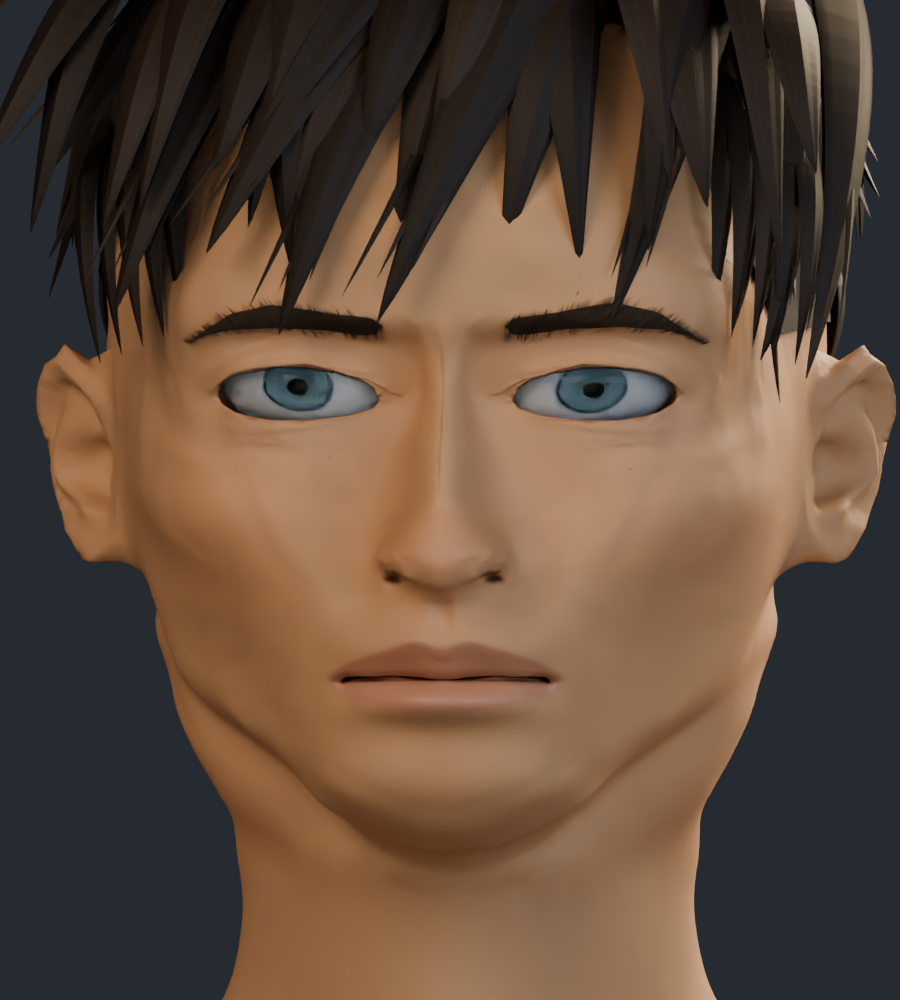
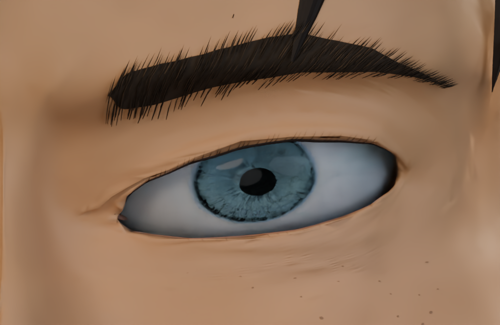
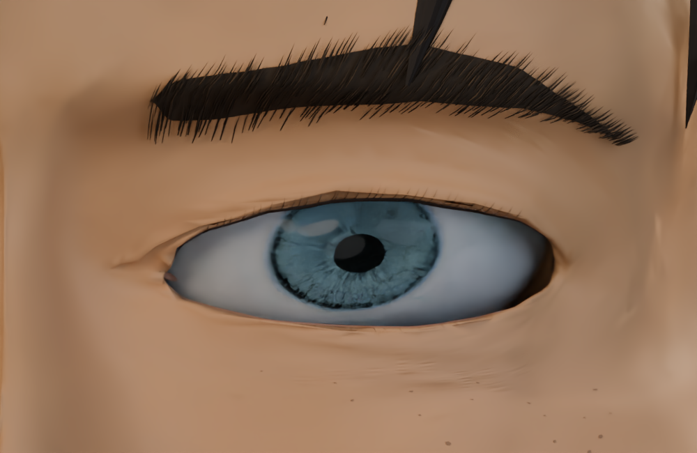
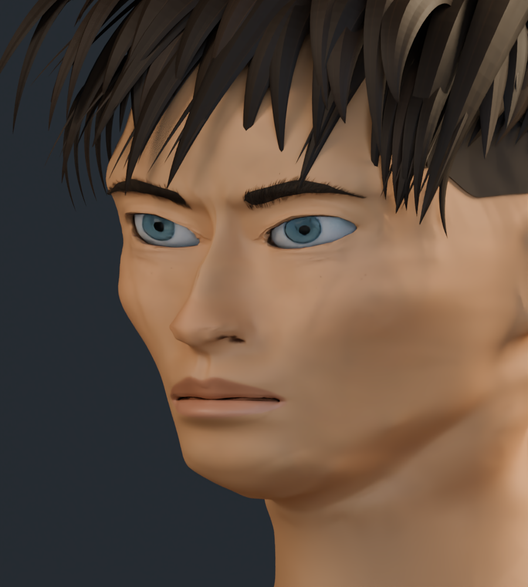
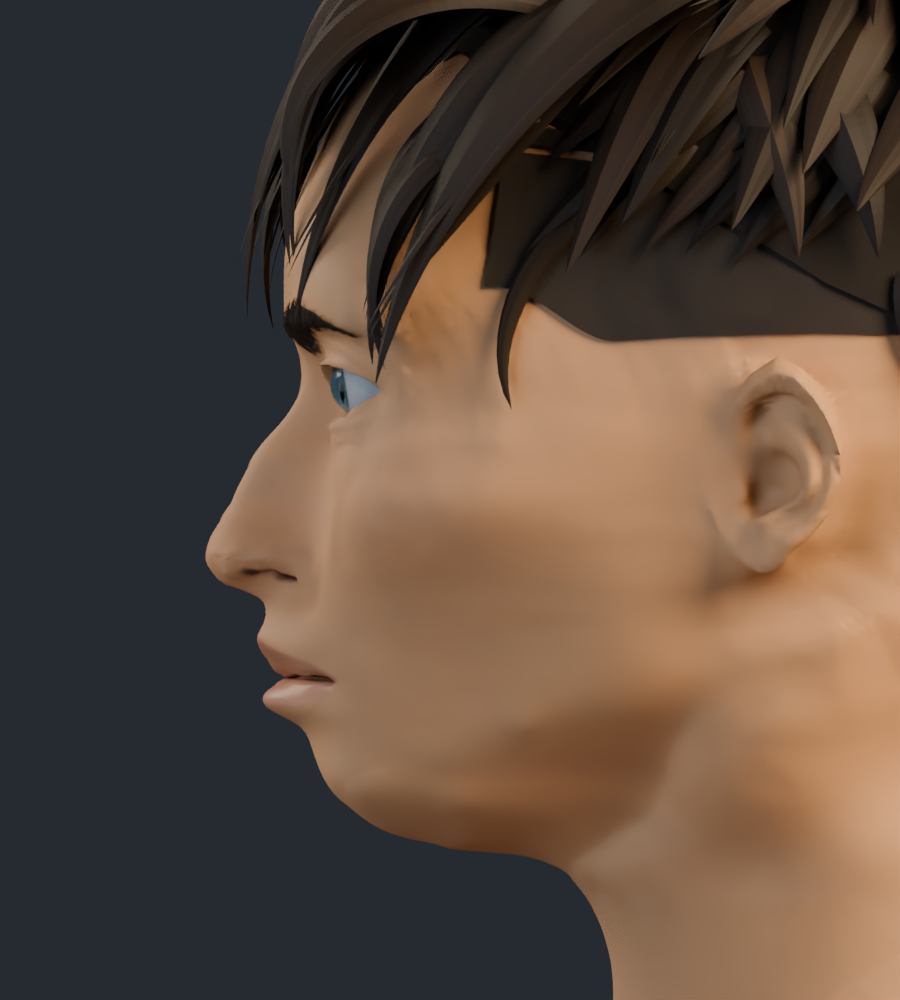
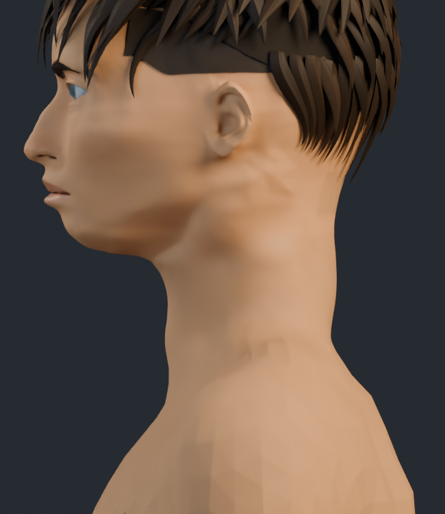
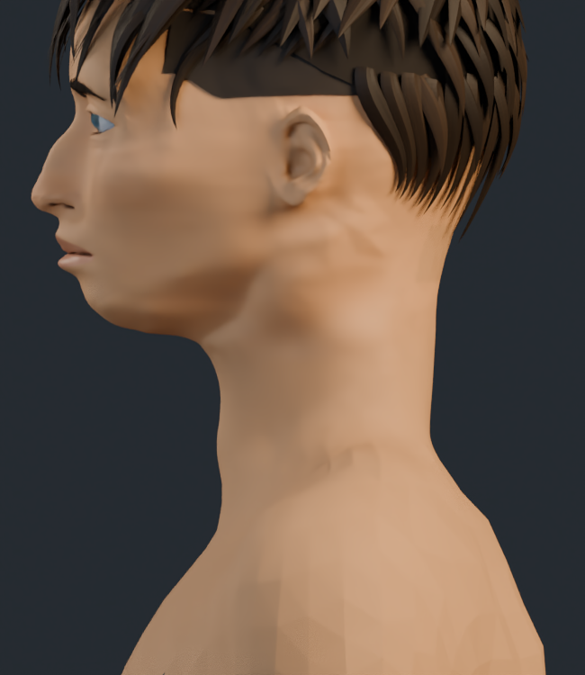
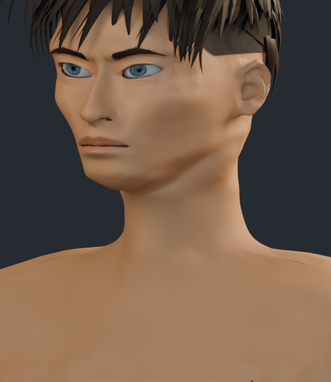
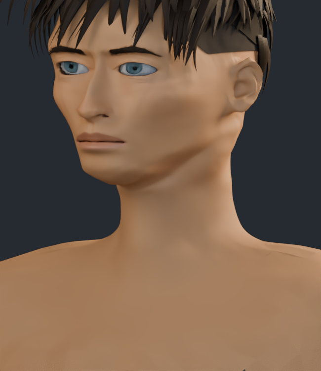

# Rostro y cuello · v17

Primero se revisó v16 frente a las cuatro ilustraciones; después se editaron las diferencias documentadas en el [análisis previo](ANALISIS_PREVIO.md).

La inclinación medida entre las comisuras de cada ojo pasa de 10.20° / 10.23° a 4.06° / 4.09°. Esto verifica una corrección del modelo, no una coincidencia exacta con la ilustración. Se ajustan cejas y glabela, continuidad nasal y pared posterior del cuello. Se mantienen el tamaño de los globos y las ocho texturas, sin otra escultura global de mejillas.

Todas las comparaciones son renders reales con las mismas cámaras, luces y número de muestras en cada pareja: 32 en las vistas principales y el detalle ocular; 24 en las dos vistas amplias de cuello. El parecido, el cabello y el acabado ilustrado siguen incompletos.

## Frente: comisuras y cejas

| v16 | v17 |
| --- | --- |
|  |  |

## Detalle de párpados

| v16 | v17 |
| --- | --- |
|  |  |

## Tres cuartos

| v16 | v17 |
| --- | --- |
|  |  |

## Perfil y puente nasal

| v16 | v17 |
| --- | --- |
|  |  |

## Cabeza y cuello

| v16 | v17 |
| --- | --- |
|  |  |

## Cuello completo de perfil

| v16 | v17 |
| --- | --- |
|  |  |

## Cuello completo de tres cuartos

| v16 | v17 |
| --- | --- |
|  |  |

[Galería v16](../rostro_v16/README.md)
