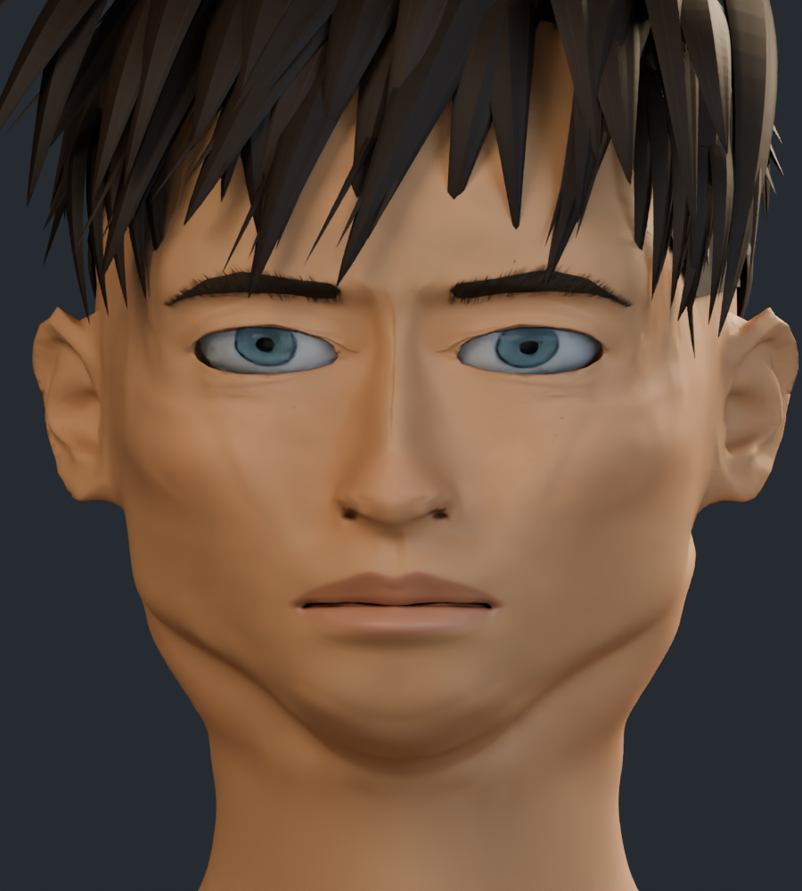
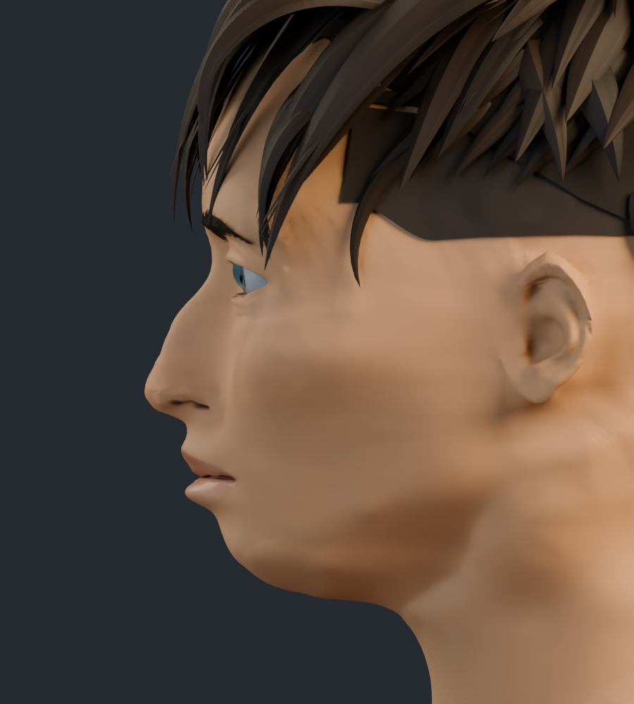
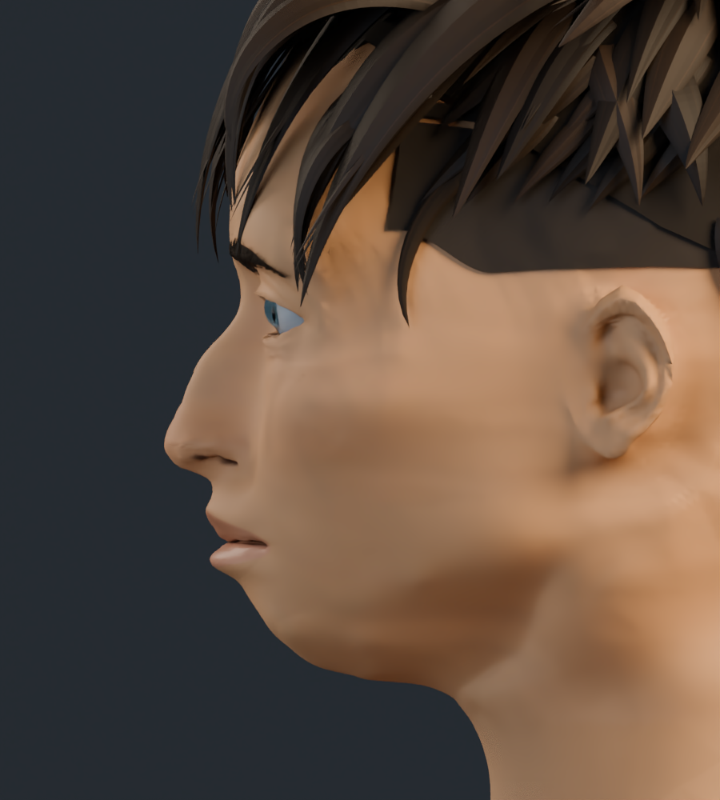
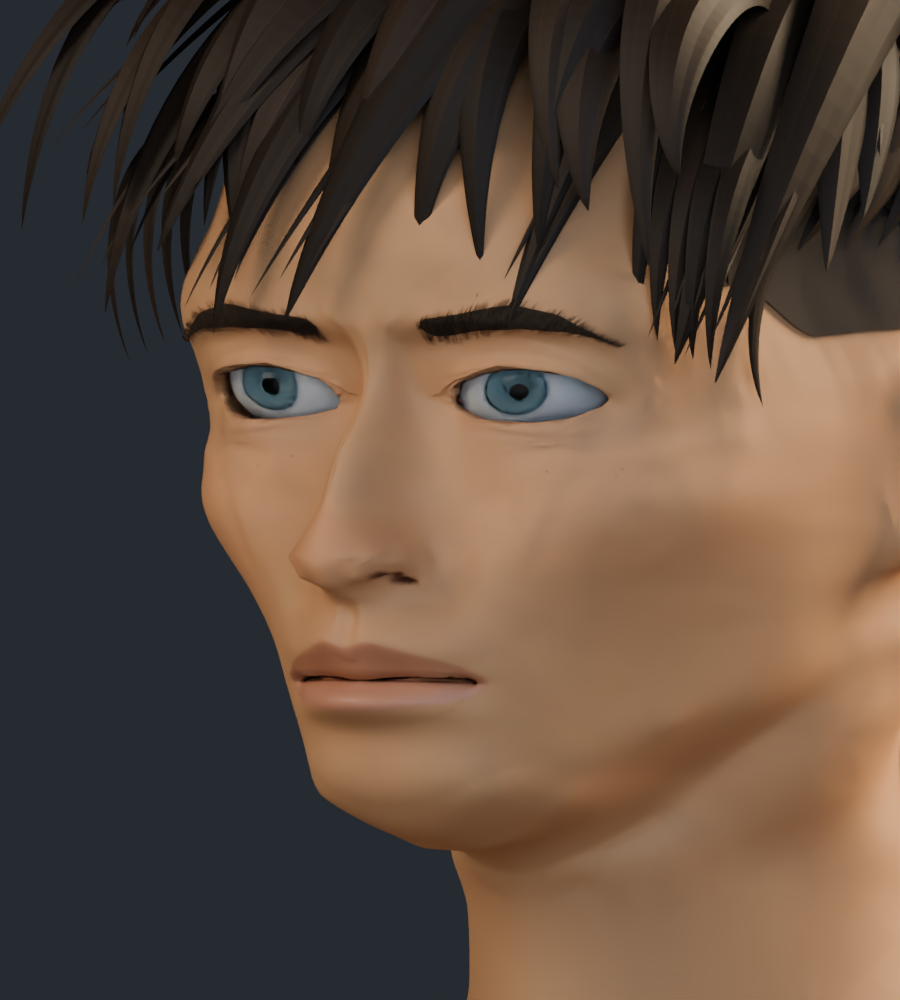
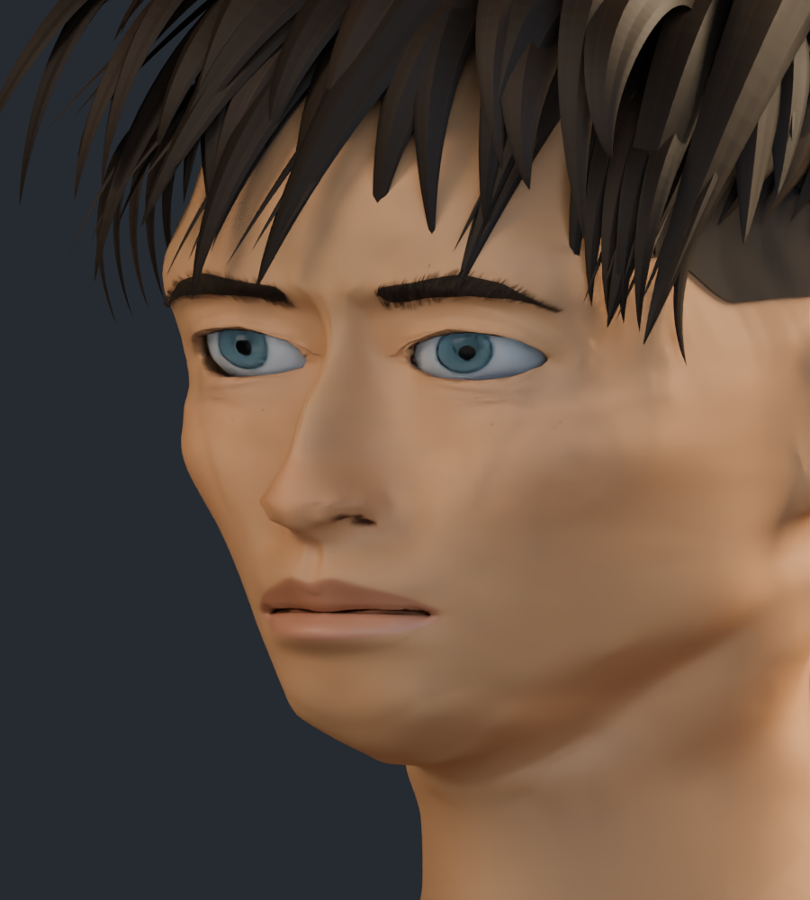
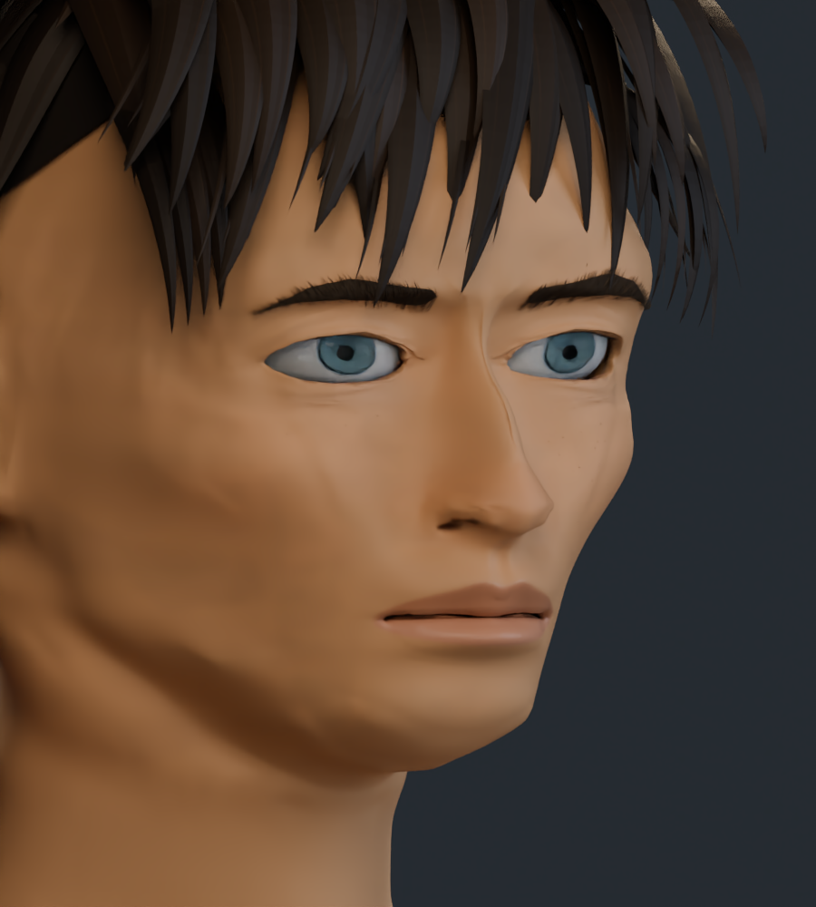
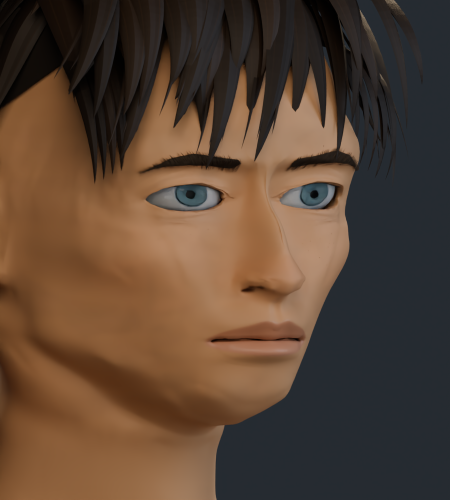
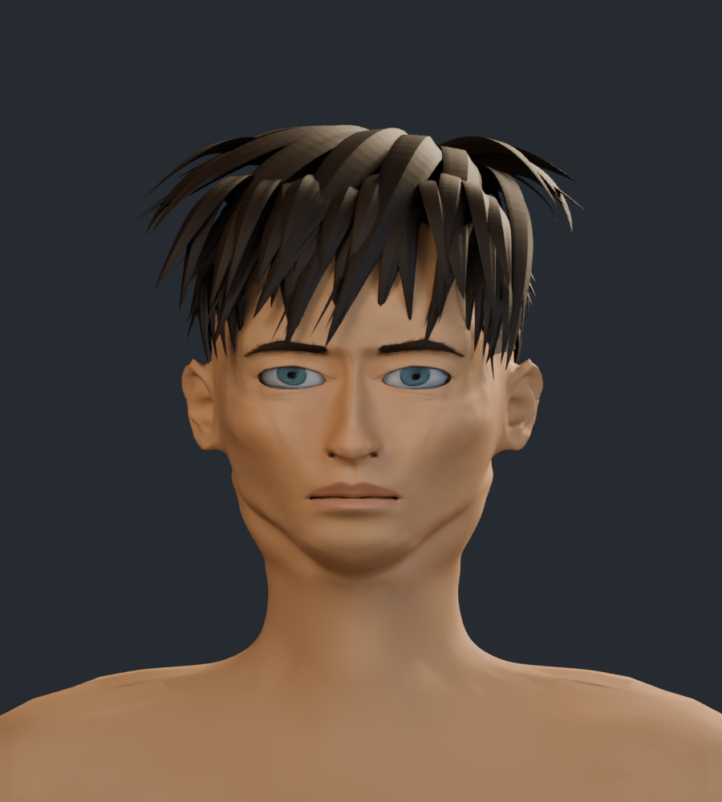

# Formas de la cara · v18

Revisión del contorno mandibular y de la base del mentón, con el soporte de las mejillas conservado. Se comparan frente, perfil y ambos tres cuartos. No se considera conseguida la igualdad de silueta con las ilustraciones.

[Análisis previo y pruebas descartadas](ANALISIS_PREVIO.md) · [Comparación con material neutro](estudio_formas/README.md)

Todas las parejas usan la misma cámara, luz y número de muestras: 32 en color y 24 en el estudio neutro. Las texturas se mantienen: el cambio está en la geometría y las normales que la acompañan.

## Contorno frontal

| v17 | v18 |
| --- | --- |
|  |  |

## Perfil

| v17 | v18 |
| --- | --- |
|  |  |

## Tres cuartos

| v17 | v18 |
| --- | --- |
|  |  |

## Tres cuartos del lado contrario

| v17 | v18 |
| --- | --- |
|  |  |

## Cabeza y cuello

| v17 | v18 |
| --- | --- |
|  |  |

[Galería v17](../rostro_v17/README.md)
