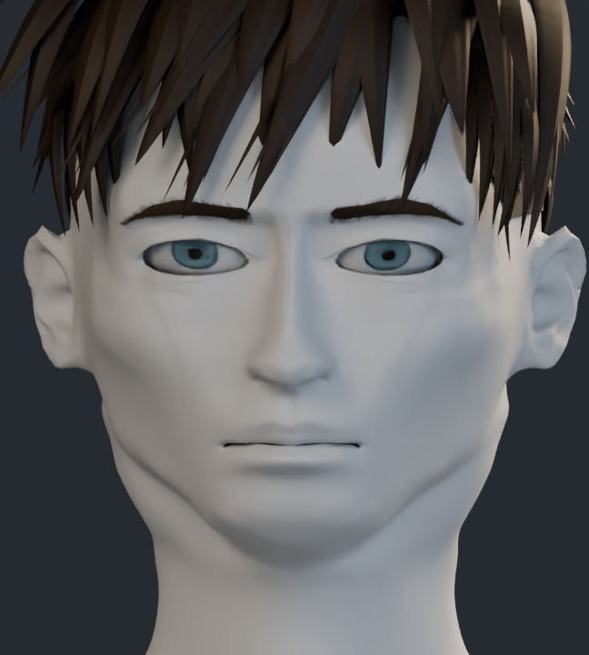
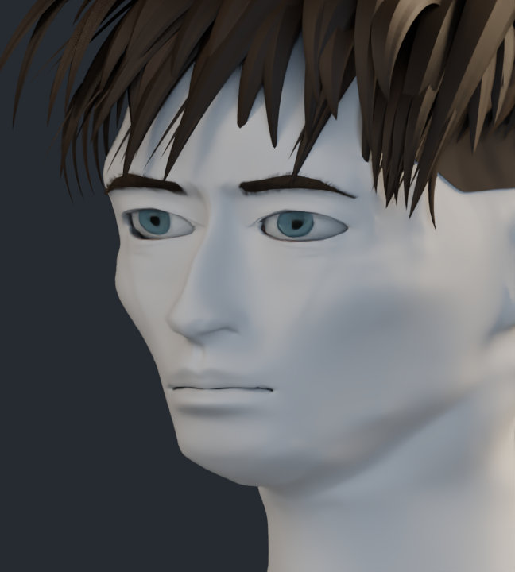
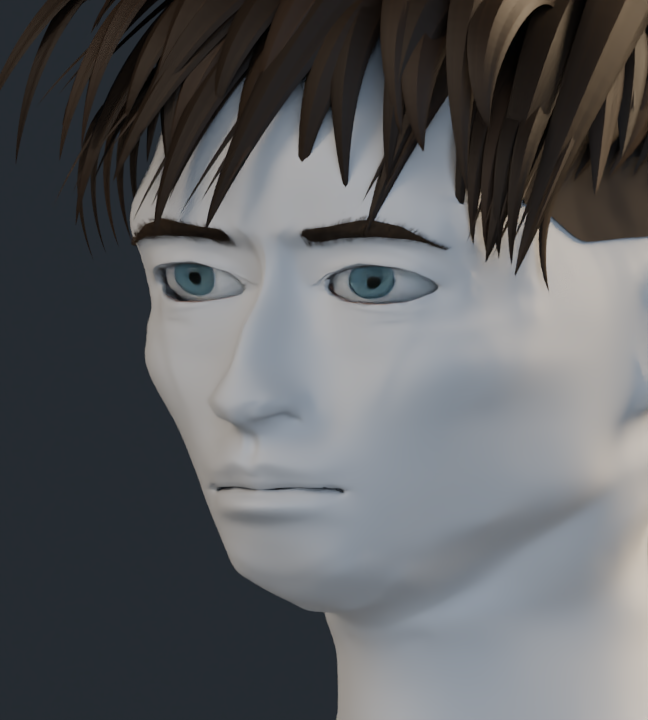

# Comparación de formas sin pintura

Material neutro en la anatomía, con cámaras, luces y 24 muestras iguales en ambas versiones.

## Frente

| v17 | v18 |
| --- | --- |
|  |  |

## Tres cuartos

| v17 | v18 |
| --- | --- |
|  |  |

[Volver](../README.md)
