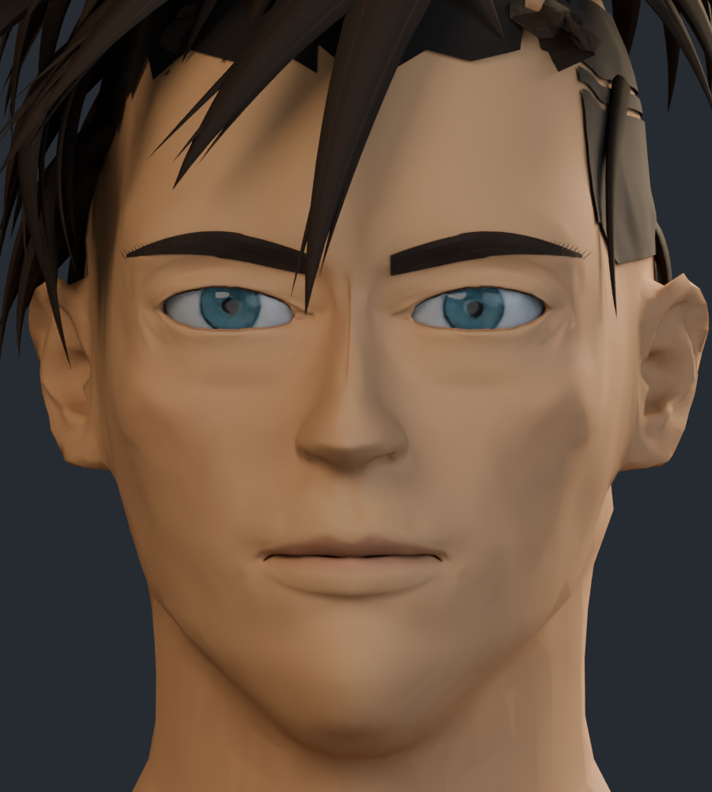
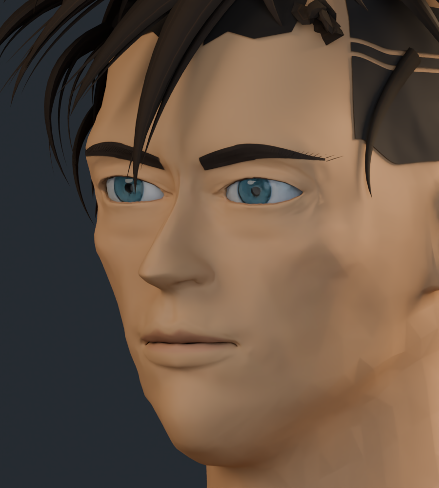
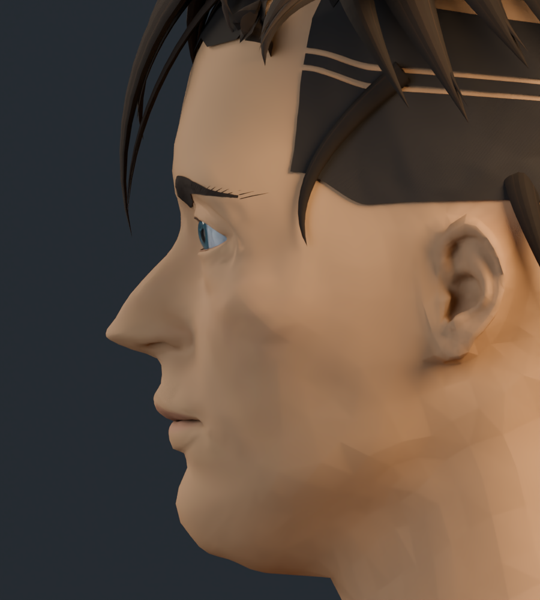
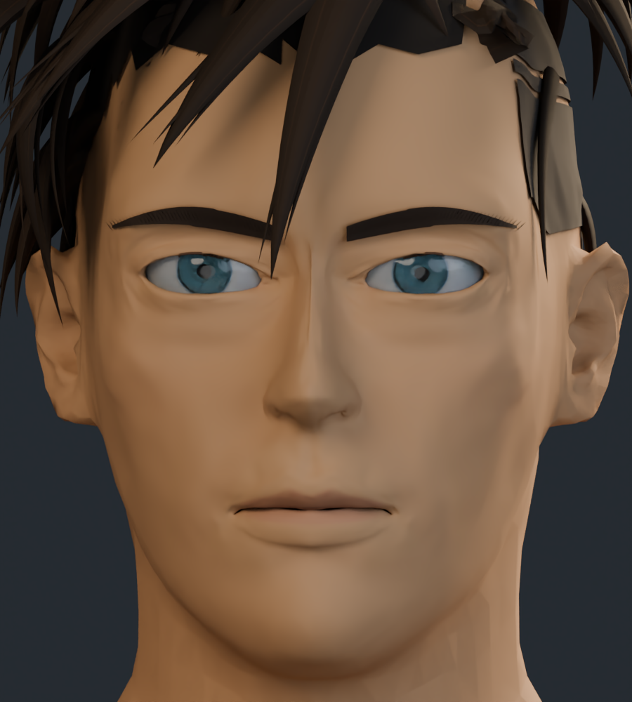

# Rostro v3: capturas de trabajo

Revisión con ajustes en proporciones, pómulos, mandíbula, nariz, labios y párpados. Son renders del modelo 3D editable. La semejanza y el acabado dibujado siguen siendo aproximados.

## Frente

## Tres cuartos

## Perfil

## Comparación con la versión anterior

Ambas imágenes usan el mismo encuadre e iluminación.

| Anterior | Actual · v3 |
| --- | --- |
|  |  |

[Revisión anterior de la cabeza](../cabeza_refinada/README.md) · [Procedencia de los recursos](../LICENCIAS.md)
