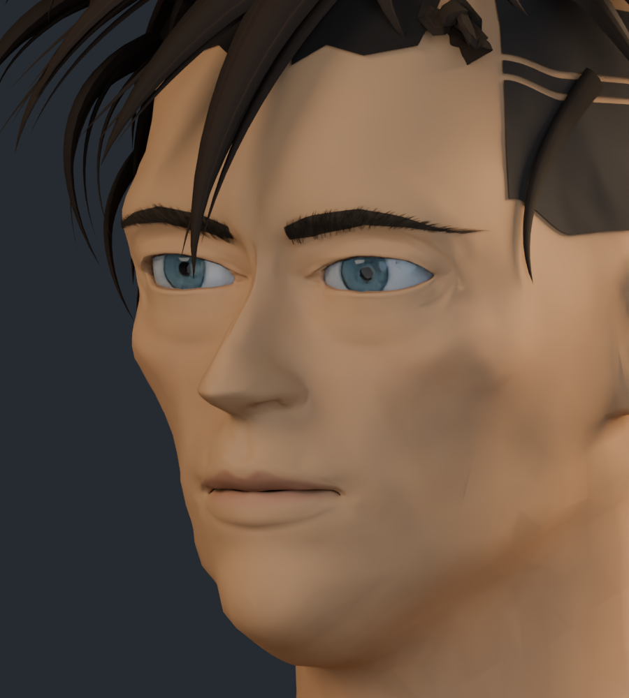
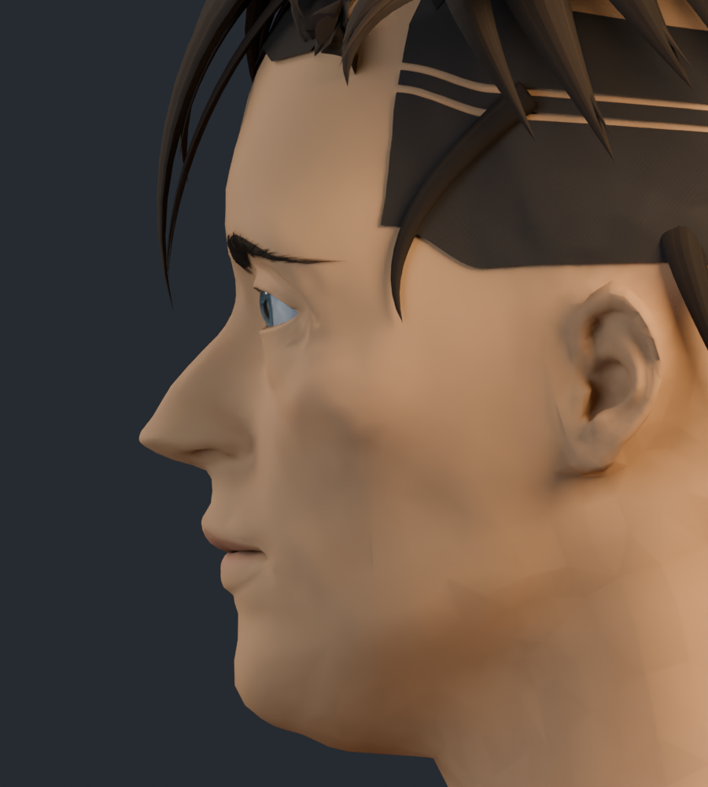
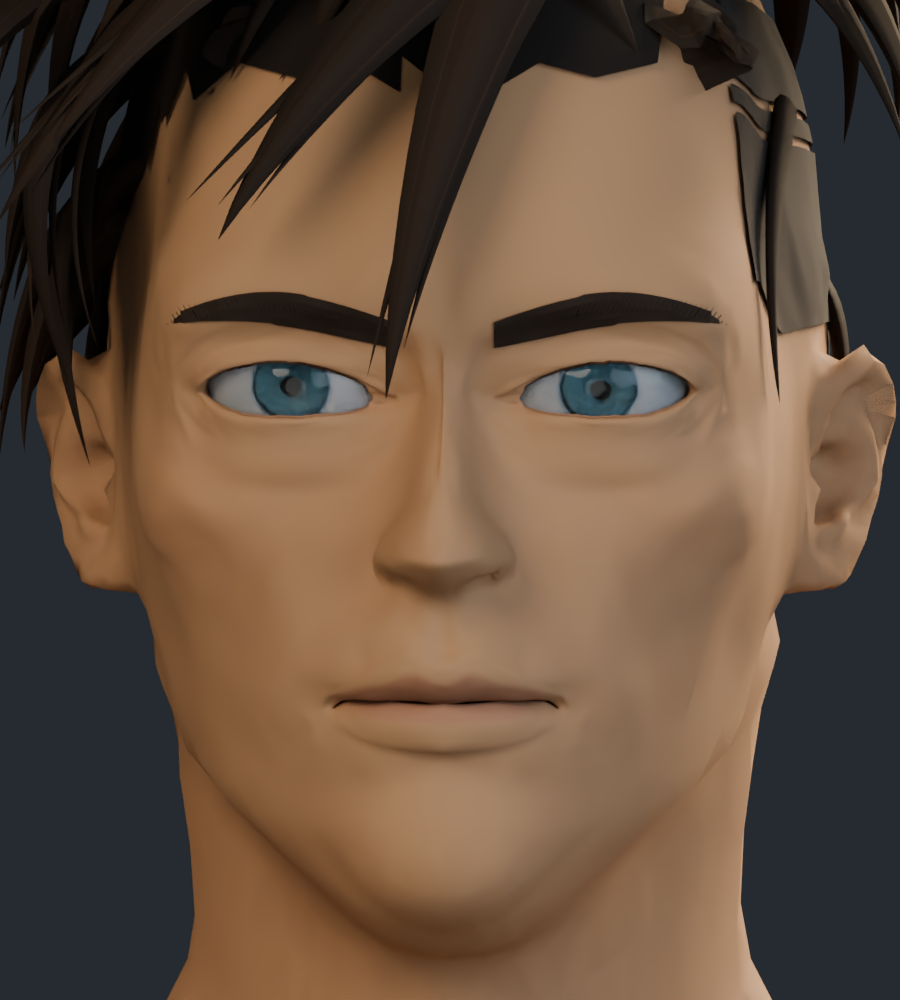

# Rostro v5: capturas de trabajo

Revisión de frente, cejas, ojos, nariz, pómulos, boca y barbilla. Son renders del modelo 3D editable. La semejanza facial y el acabado pintado siguen siendo aproximados.

## Frente

## Tres cuartos

## Perfil

## Comparación con la v4

Ambas imágenes usan el mismo encuadre e iluminación.

| Anterior · v4 | Actual · v5 |
| --- | --- |
|  |  |

[Galería anterior publicada · v3](../rostro_v3/README.md) · [Procedencia de los recursos](../LICENCIAS.md)
