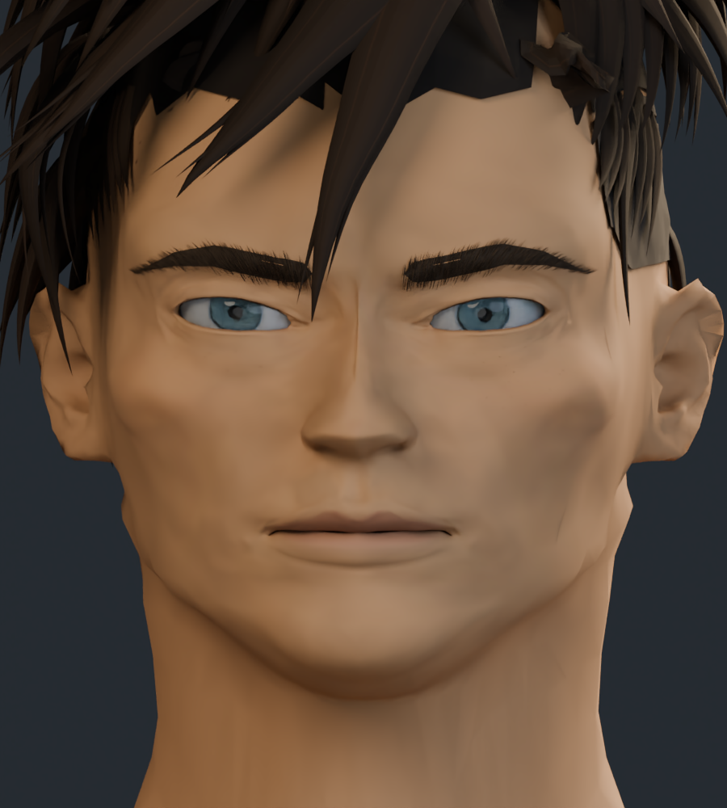
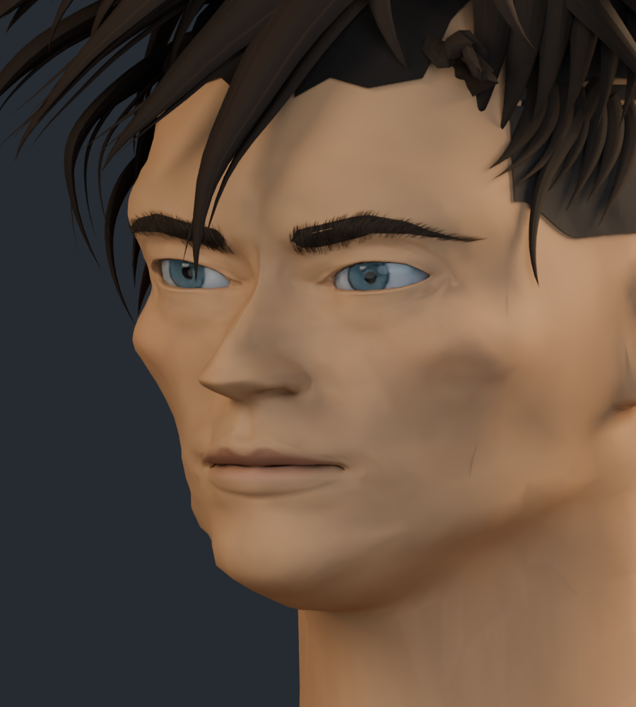
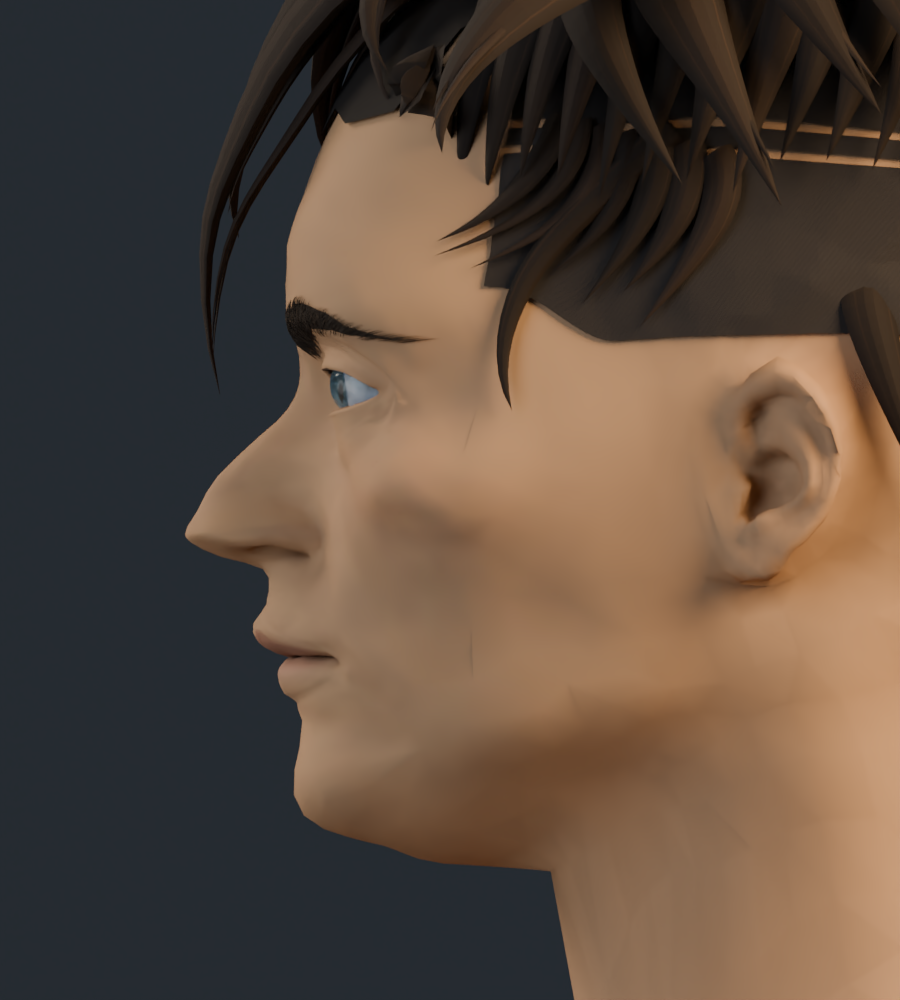
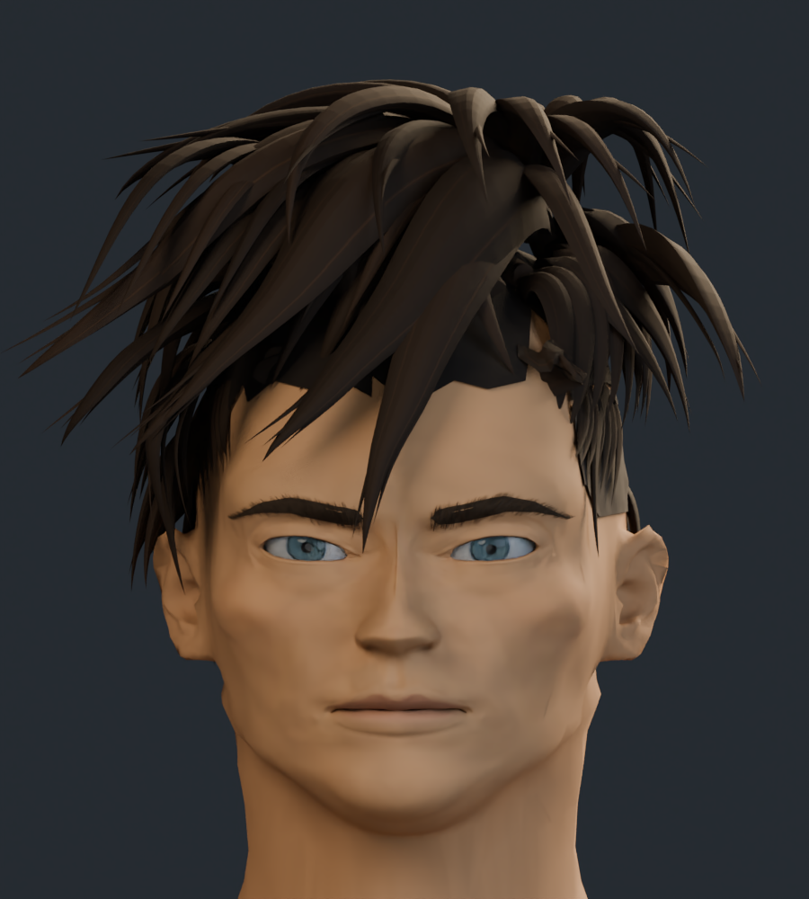

# Rostro v6: revisión de formas

La prioridad de esta pasada son las proporciones generales: menor altura de frente, ojos más contenidos, distancia más corta entre ojos y barbilla y un mentón y una mandíbula más definidos. Se revisan frente y perfil antes de continuar con más detalle facial. Son renders del modelo 3D editable; la semejanza con la referencia sigue siendo aproximada.

## Frente

## Tres cuartos

## Perfil

## Cabeza completa

## Comparación con la v5

Ambas imágenes usan la misma cámara e iluminación.

| Anterior · v5 | Actual · v6 |
| --- | --- |
|  |  |

[Galería anterior · v5](../rostro_v5/README.md) · [Procedencia de los recursos](../LICENCIAS.md)
