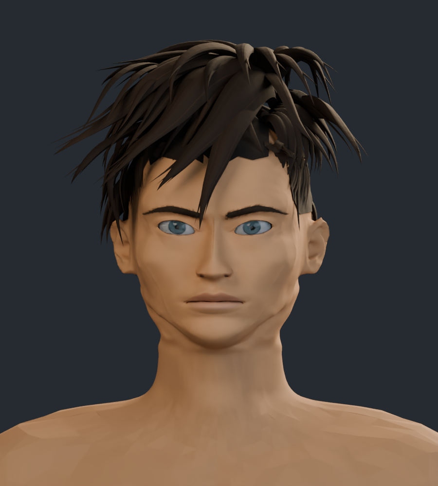
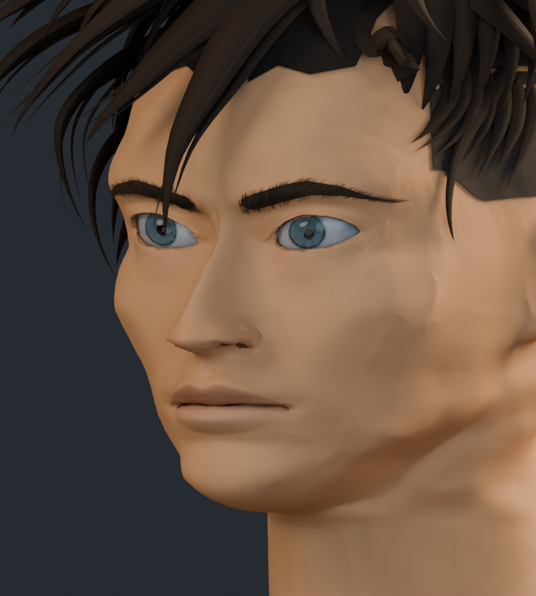
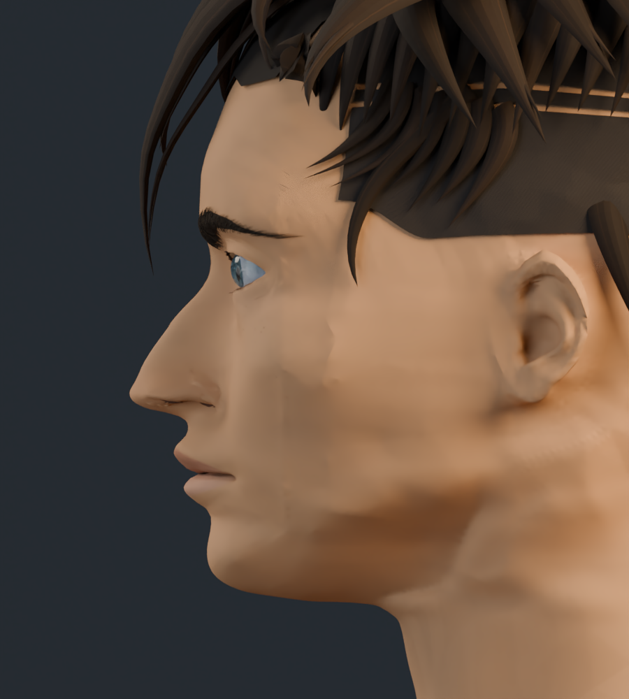
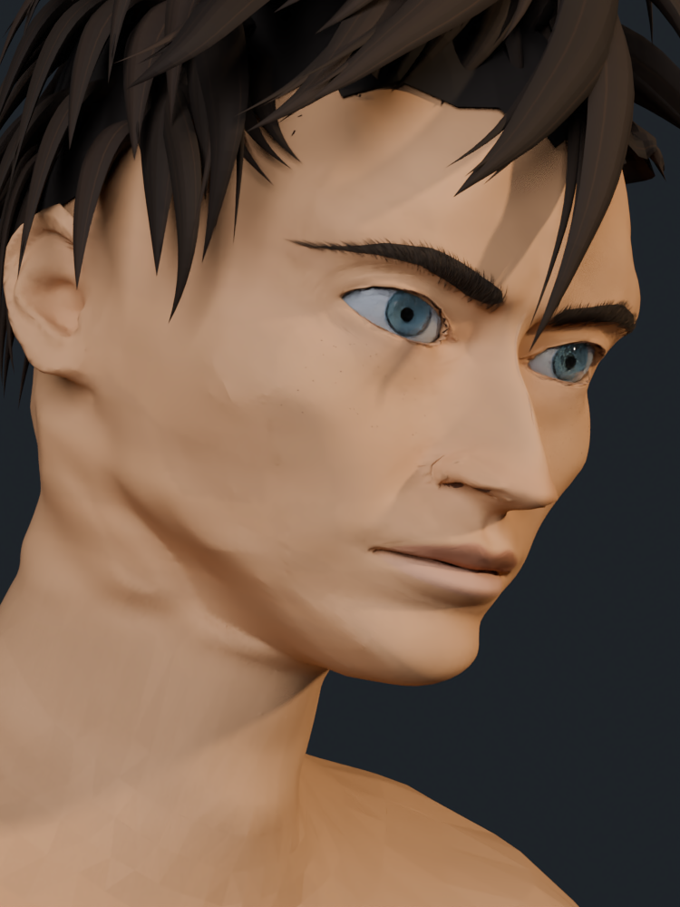
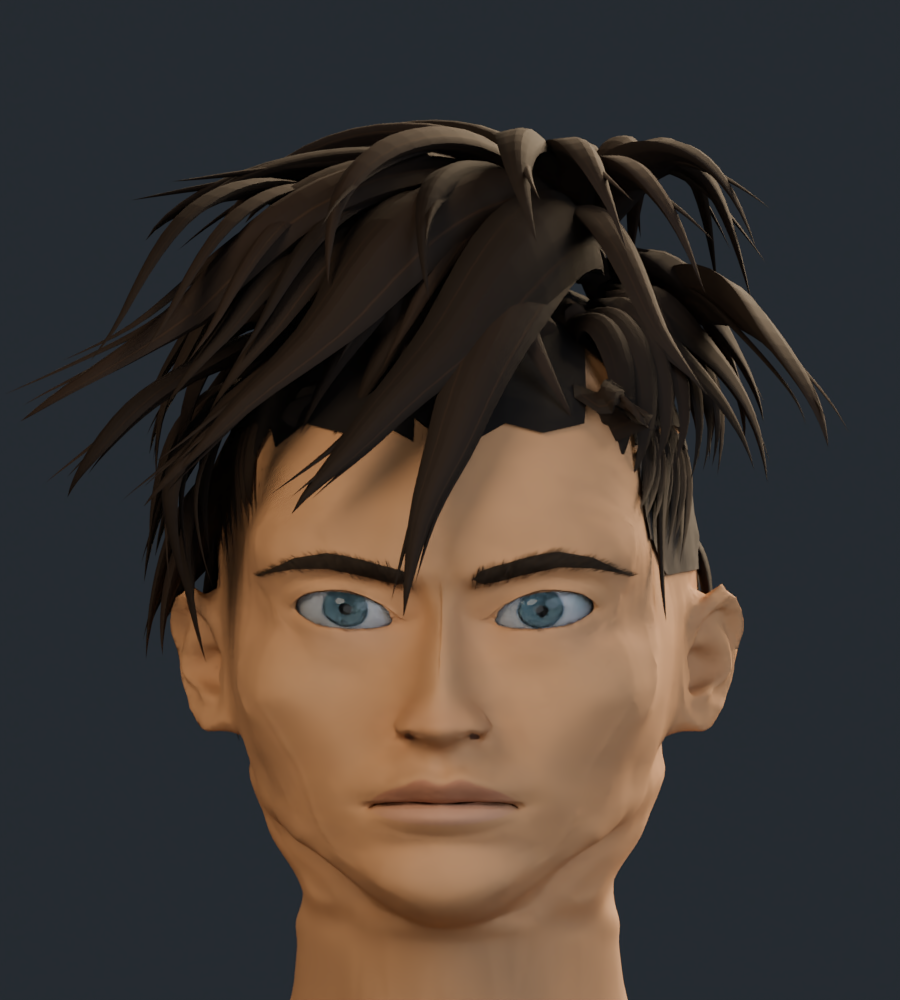

# Rostro y cuello v7

Revisión basada en las referencias frontal, lateral y posterior de cabeza y en el cuarto primer plano en tres cuartos. Se han revisado proporciones de ojos, nariz y boca, abertura de párpados, volumen nasal y de labios, pómulos, mentón, mandíbula y unión con el cuello.

Se conserva una malla maestra de mayor resolución para continuar el trabajo antes de reducir polígonos. El personaje completo tiene 236.406 vértices y 460.137 triángulos. La semejanza sigue siendo aproximada; permanecen pendientes ajustes finos de anatomía, pelo y acabado pintado.

## Cara y cuello

## Frente

## Tres cuartos

## Perfil

## Cuarto encuadre

Perspectiva, inclinación y luz cálida aproximadas a la cuarta referencia. Es un render del mismo modelo; no incluye la ilustración original.

## Cabeza completa

## Comparación con la v6

Misma cámara e iluminación de estudio.

| Anterior · v6 | Actual · v7 |
| --- | --- |
|  |  |

[Ver el estudio de formas con material neutro](estudio_formas/README.md) · [Galería anterior v6](../rostro_v6/README.md) · [Procedencia de los recursos](../LICENCIAS.md)
