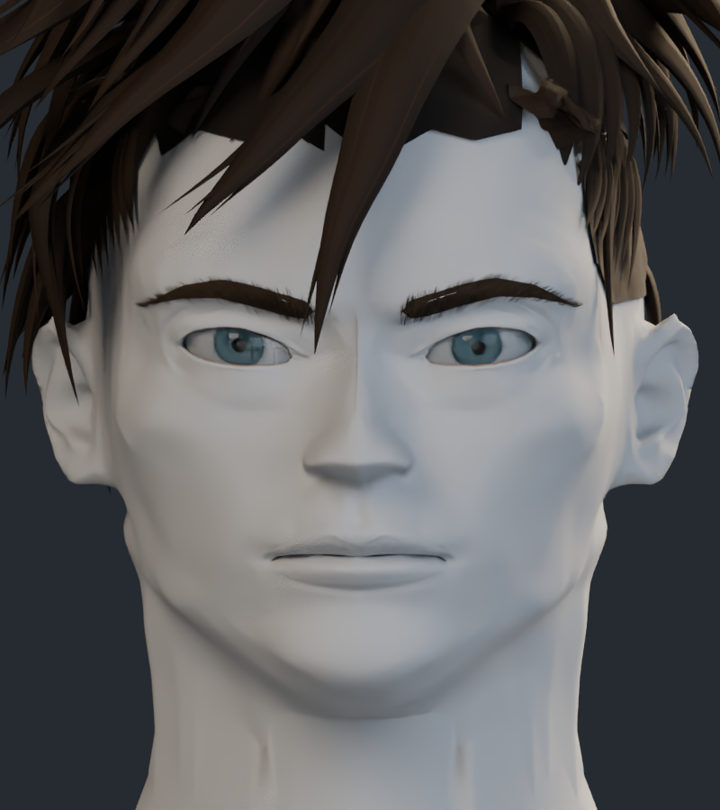
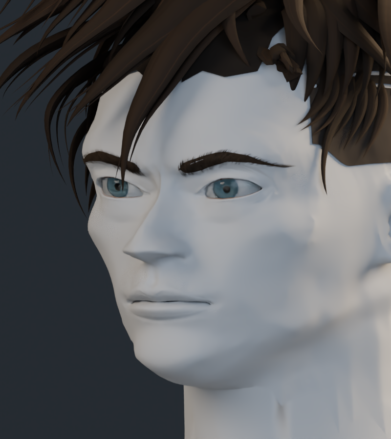
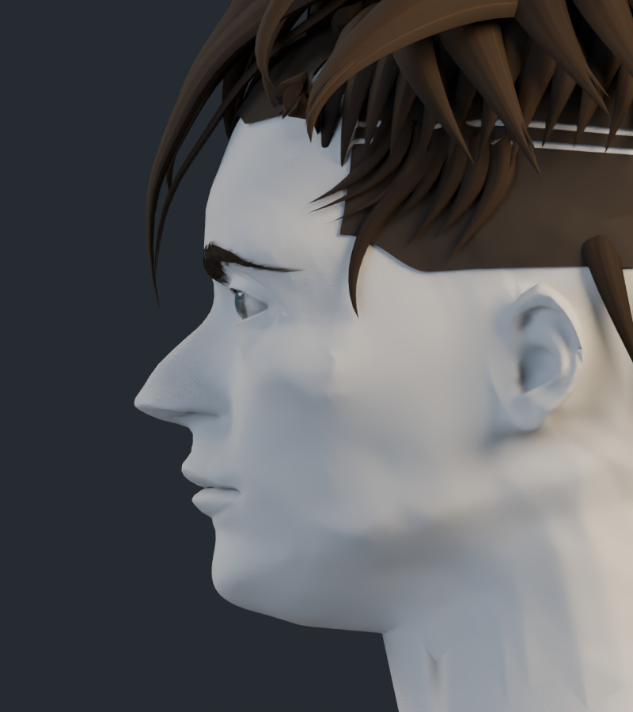
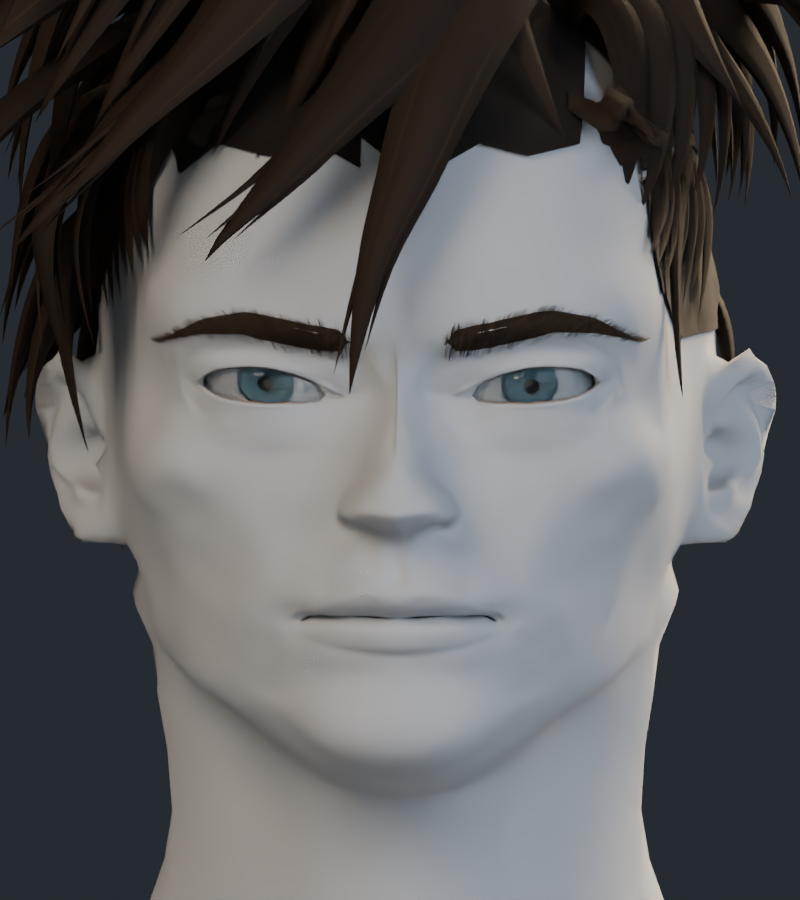

# V7 en curso: estudio de formas

Estas vistas usan material neutro para evaluar la geometría del rostro. Es una revisión de trabajo; todavía no se declara alcanzado el objetivo del 80 % de semejanza y acabado.

Se ha aumentado la resolución de la cabeza, corregido su continuidad y revisado pómulos, mandíbula, mentón, labios, nariz y la abertura de los ojos. La malla anatómica tiene 139.987 vértices; el cuerpo por debajo de la cabeza mantiene su geometría anterior. La reducción de polígonos queda para una fase posterior.

## Frente

## Tres cuartos

## Perfil

## Comparación de geometría con la v6

Misma cámara e iluminación, con material neutro en la piel.

| V6 | V7 en curso |
| --- | --- |
|  |  |
