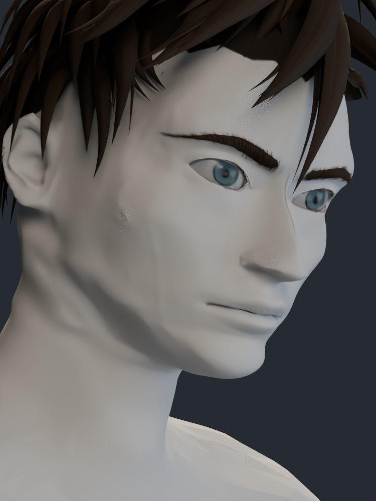

# V7: estudio de formas con material neutro

Vistas del modelo real para evaluar los volúmenes del rostro y del cuello. La anatomía maestra tiene 157.928 vértices y conserva una superficie cerrada, sin caras degeneradas. La forma sigue siendo una interpretación aproximada de las cuatro referencias del usuario.

## Frente

## Tres cuartos

## Perfil

## Encuadre de la cuarta referencia

Perspectiva e inclinación aproximadas para estudiar los volúmenes.

## Comparación frontal de geometría

Misma cámara e iluminación de estudio, con material neutro en la piel.

| V6 | V7 |
| --- | --- |
|  |  |

[Volver a las capturas con color](../README.md)
