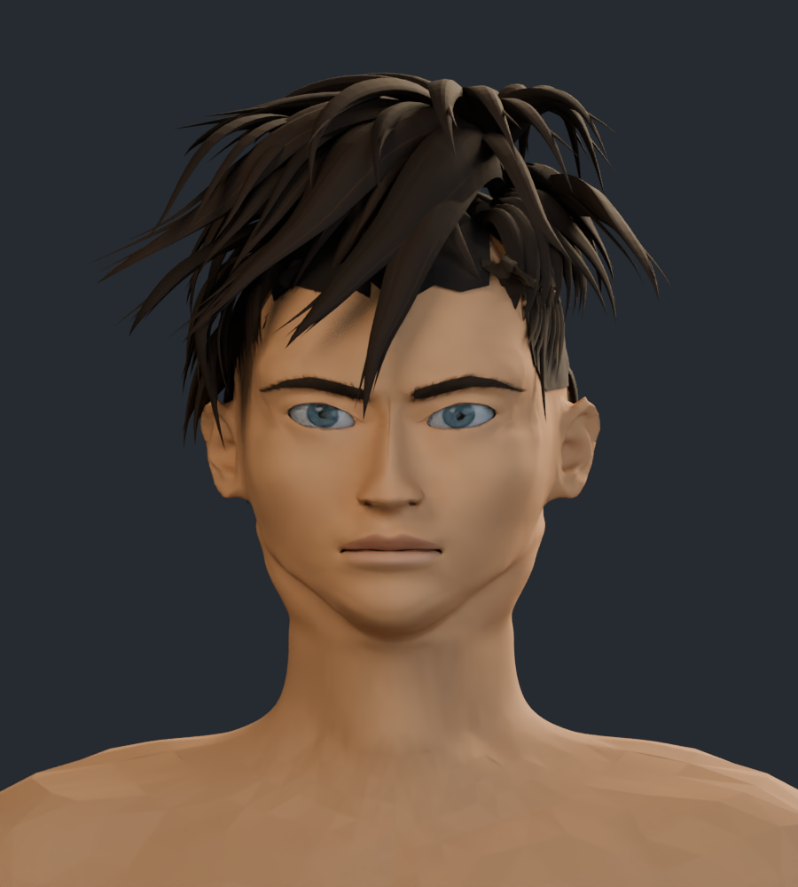
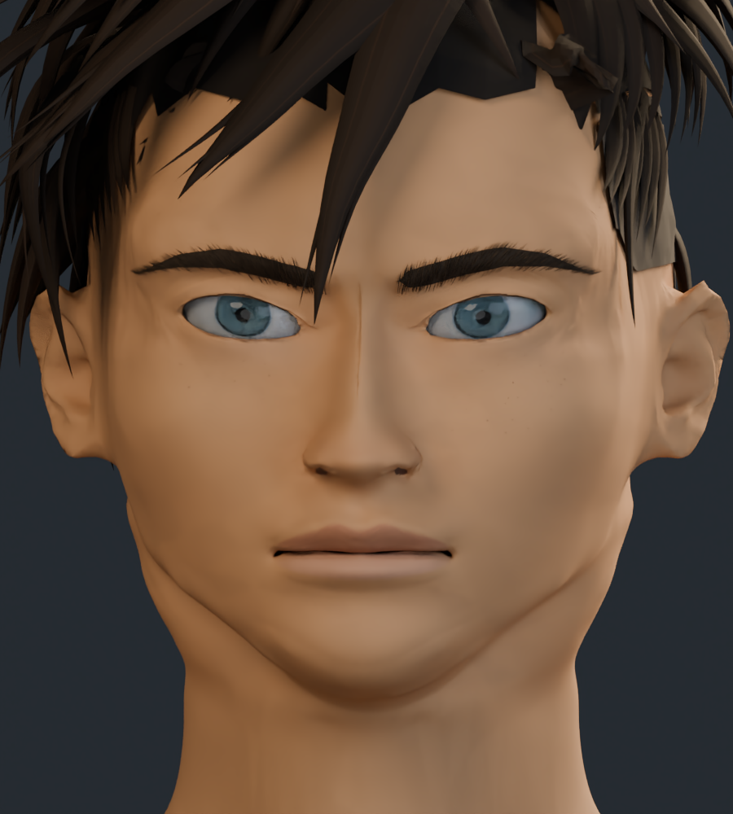
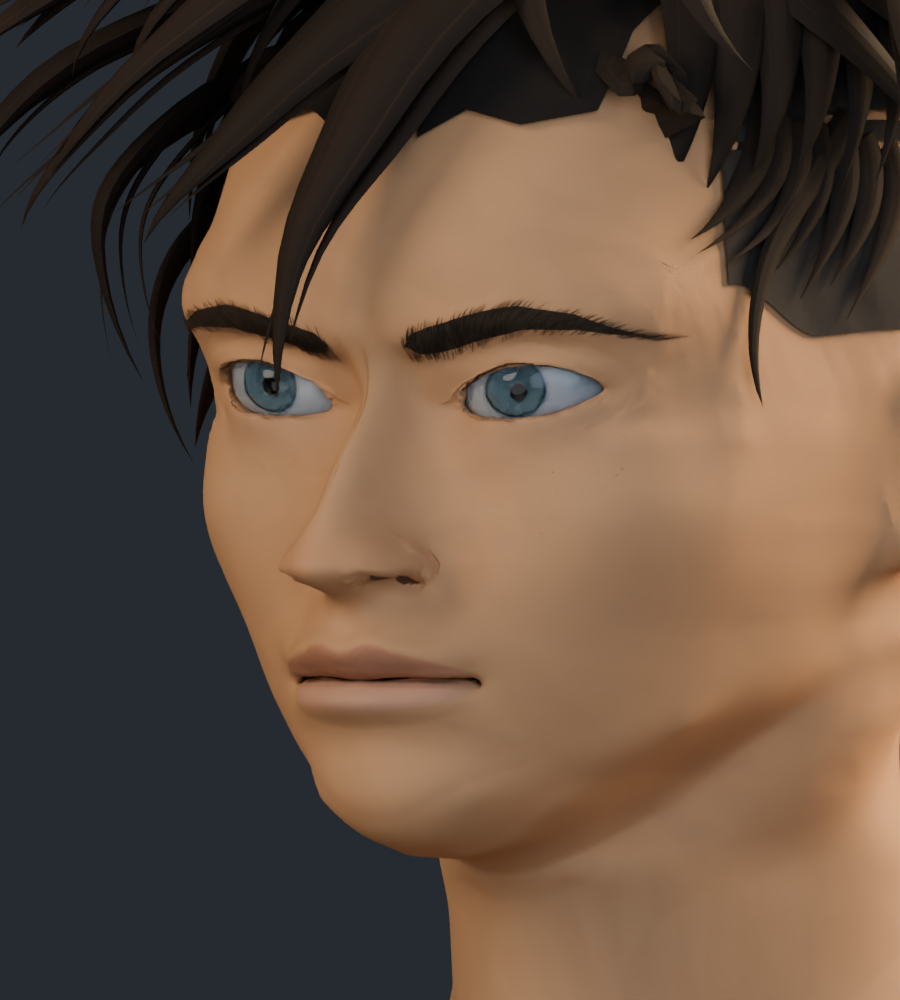
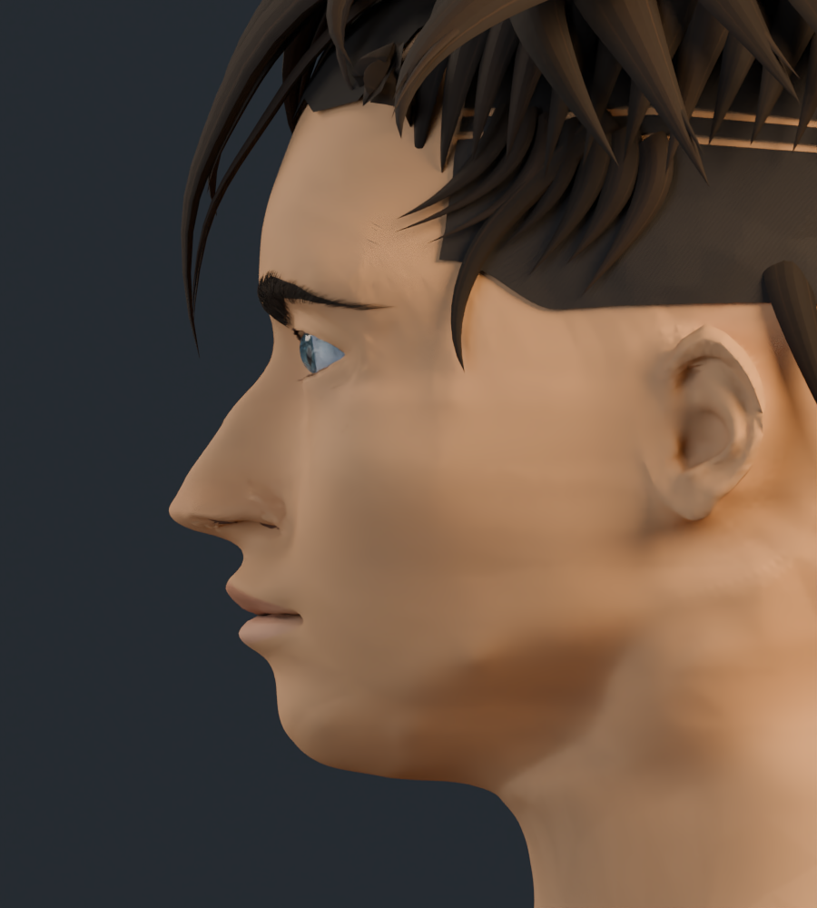
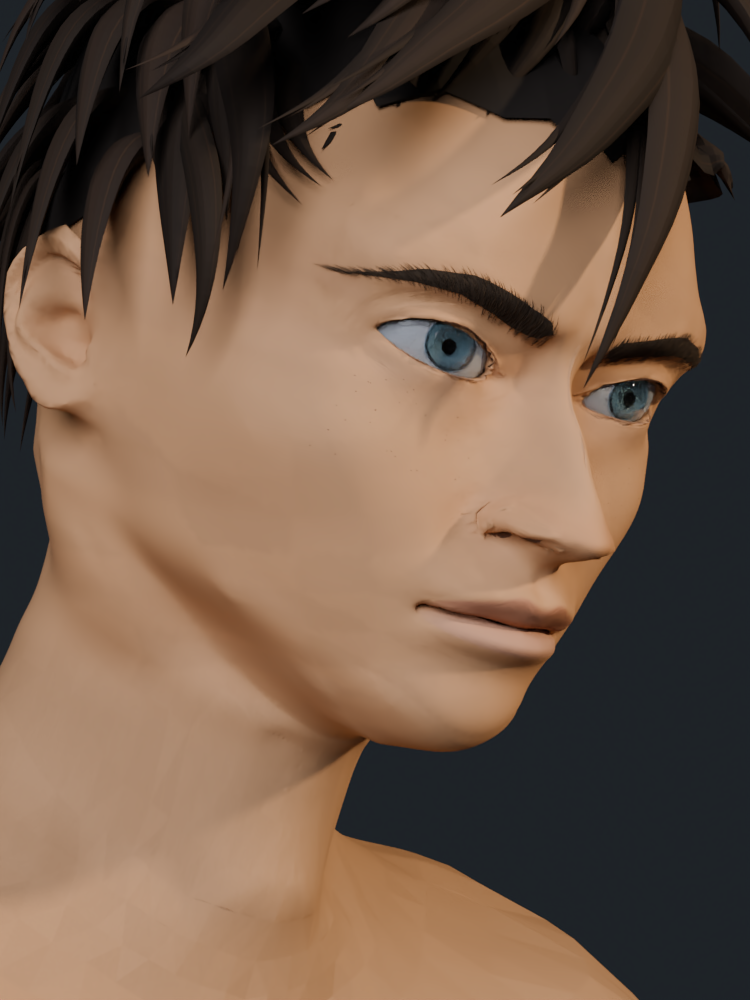
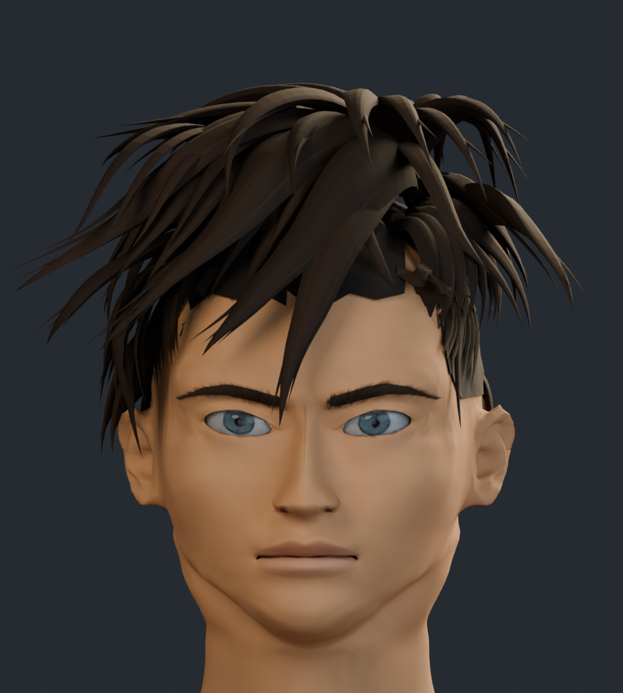
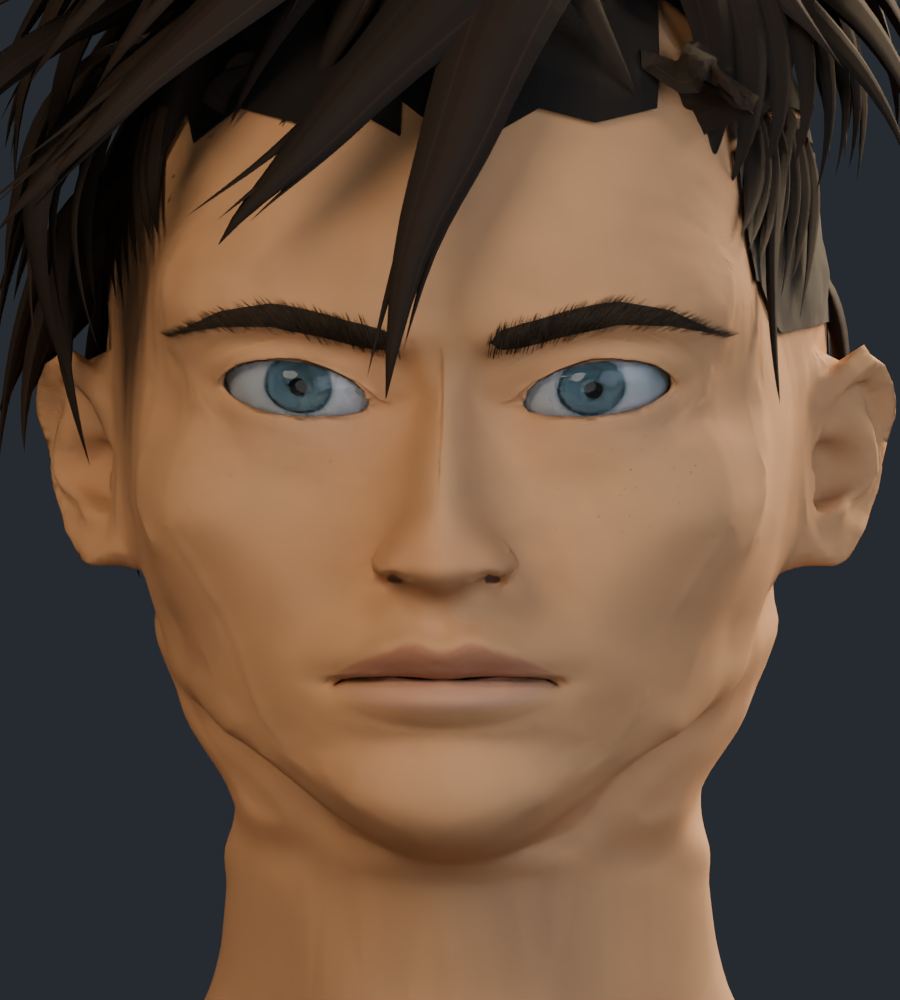

# Rostro y cuello v8

Revisión de formas sobre la v7, basada en las cuatro referencias del usuario. Se han reducido irregularidades en mejillas, mandíbula y cuello; se ha revisado el puente nasal, el arco del párpado superior, las cejas y las comisuras.

Se conserva la malla maestra de trabajo: 236.406 vértices y 460.137 triángulos en el personaje completo. La pintura permanece igual que en v7 para comparar las formas. La semejanza y el acabado final siguen pendientes de refinamiento.

## Cara y cuello

## Frente

## Tres cuartos

## Perfil

## Encuadre aproximado a la cuarta referencia

Perspectiva, inclinación y luz cálida. Render del mismo modelo 3D.

## Cabeza completa

## Comparación con v7

Misma cámara e iluminación de estudio.

| Anterior · v7 | Actual · v8 |
| --- | --- |
|  |  |

[Estudio con material neutro](estudio_formas/README.md) · [Galería v7](../rostro_v7/README.md) · [Procedencia de los recursos](../LICENCIAS.md)
