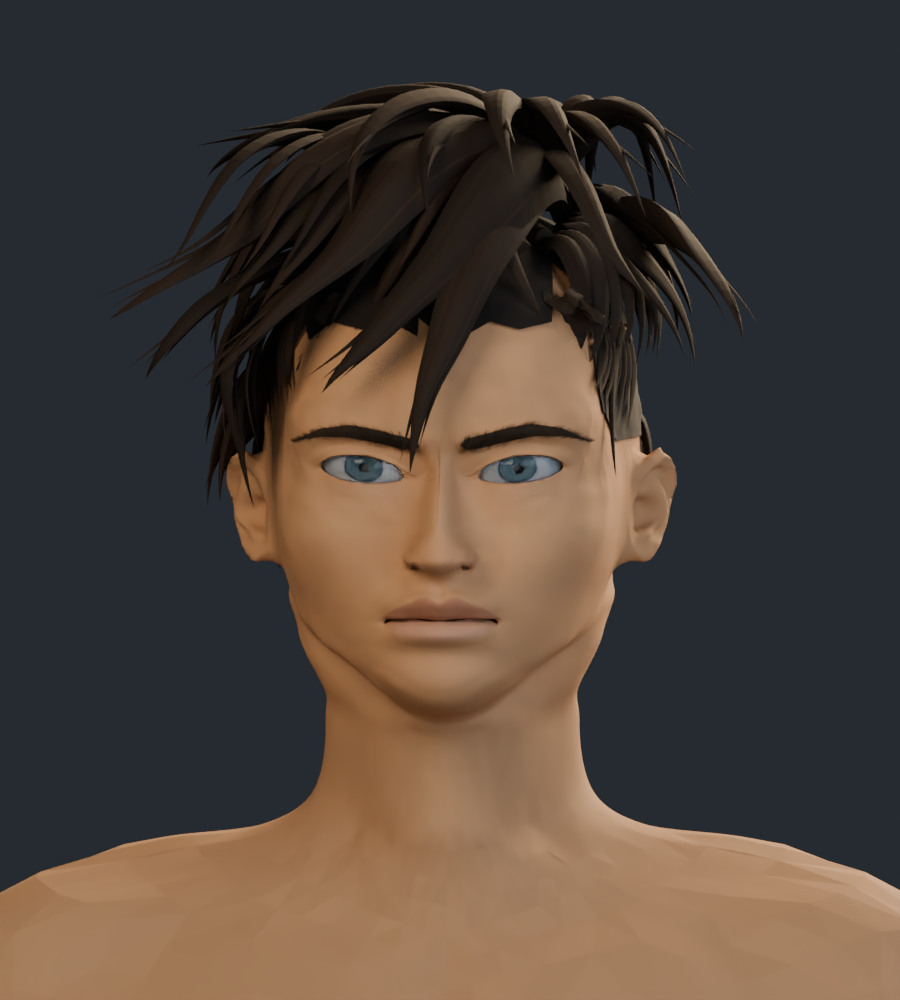
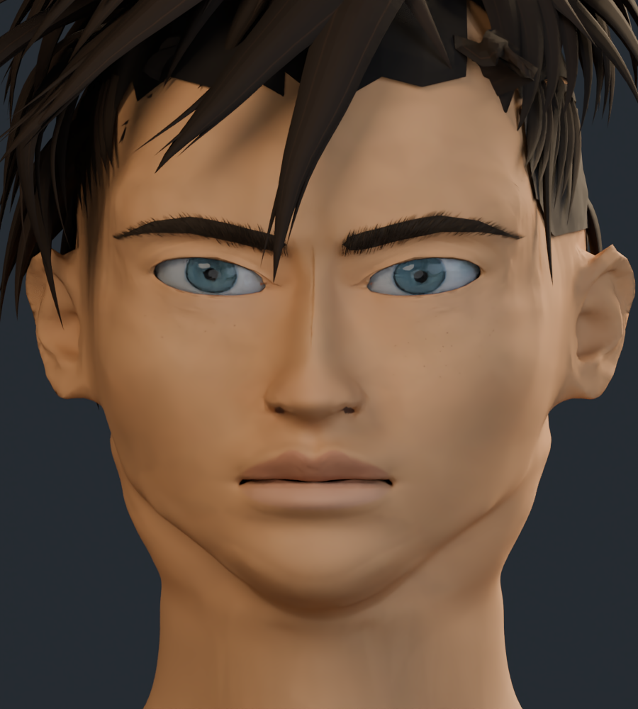
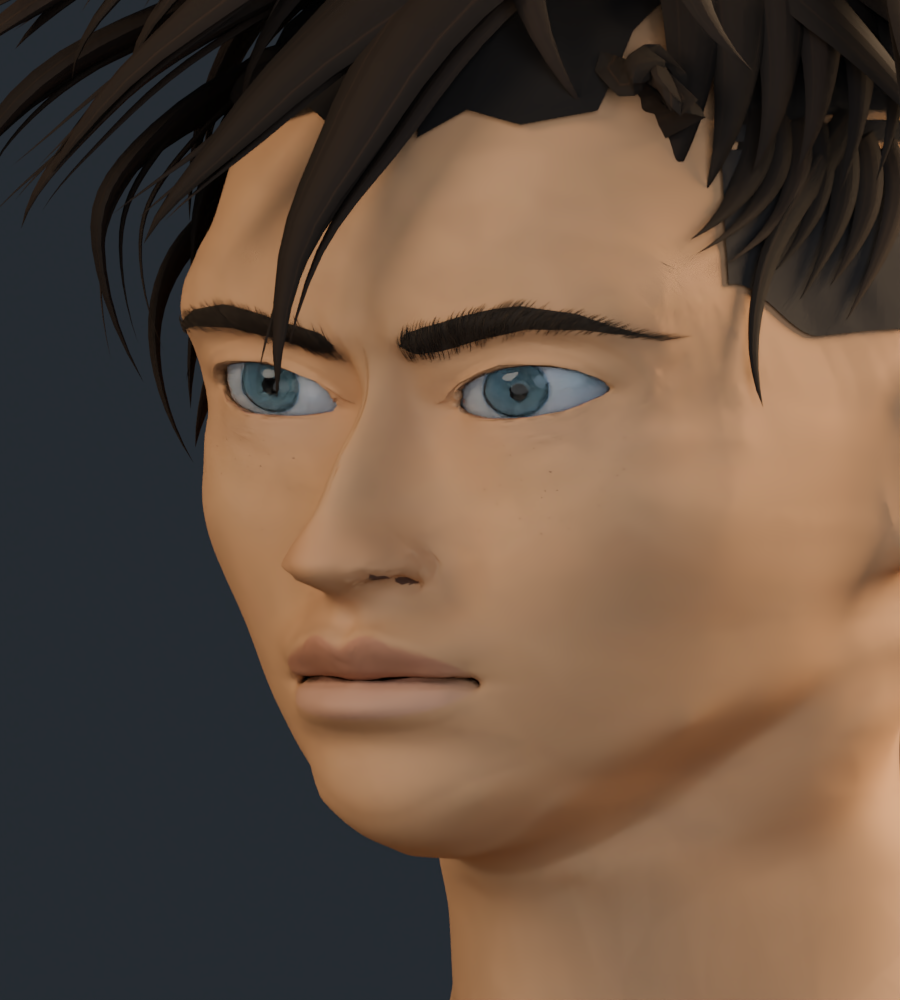
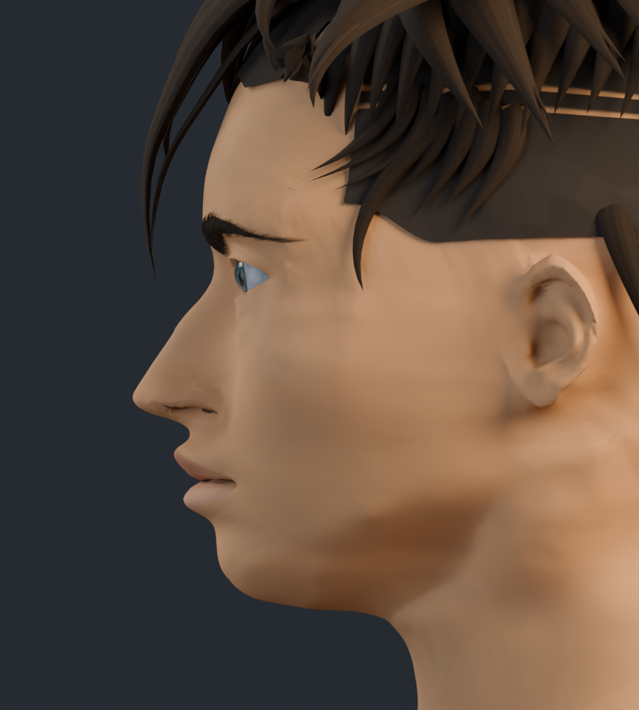
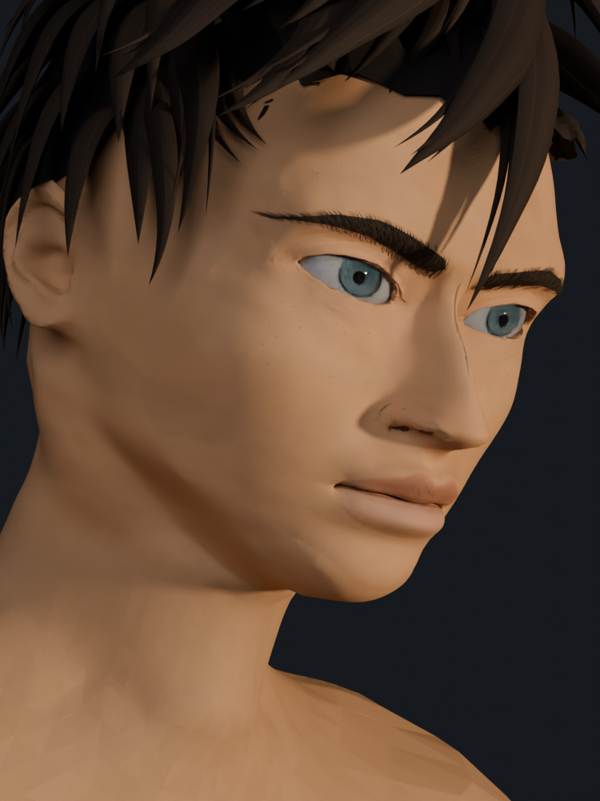
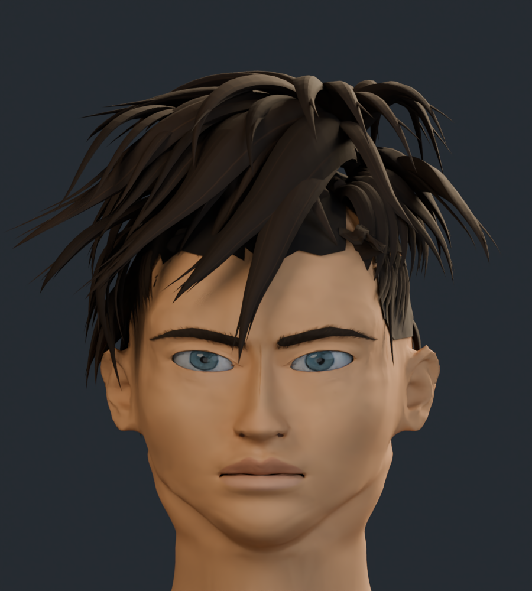
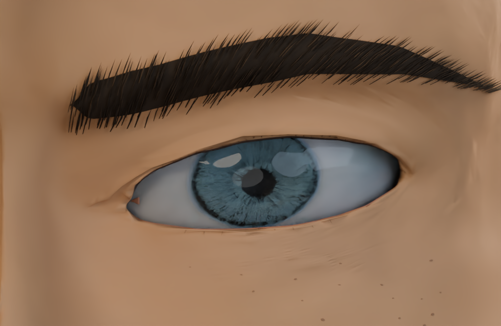
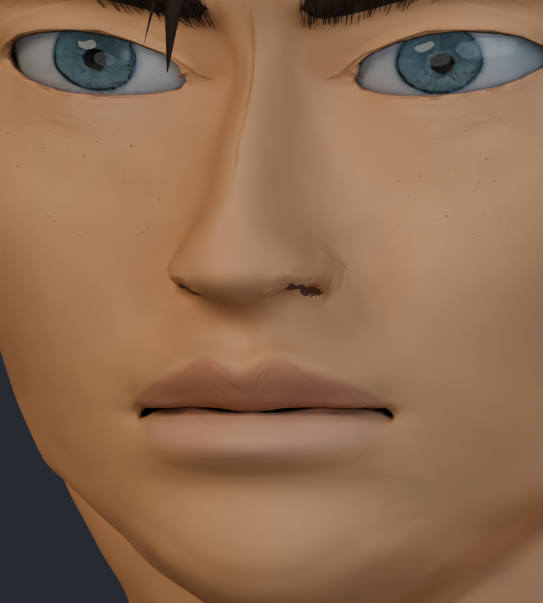

# Rostro y cuello v9

Revisión basada en las cuatro referencias del usuario: transición alar y punta nasal, labios con más altura y volumen, párpados reconstruidos y unión entre párpado inferior y pómulo más continua.

Se conserva la malla maestra de trabajo: 241.038 vértices y 469.113 triángulos en el personaje completo. Se añade pintura suave por planos, horneada a una nueva imagen de piel 4K. La semejanza sigue siendo aproximada; el cabello y el acabado fino continúan pendientes.

## Cara y cuello

## Frente

## Tres cuartos

## Perfil

## Encuadre aproximado a la cuarta referencia

Perspectiva e inclinación aproximadas a la cuarta referencia. Se ha ajustado la dirección de la luz cálida; la comparación frontal conserva la misma luz de estudio que v8.

## Cabeza completa

## Detalle de ojos y párpados

## Detalle de nariz y boca

## Comparación con v8

Misma cámara e iluminación de estudio.

| Anterior · v8 | Actual · v9 |
| --- | --- |
|  |  |

[Estudio con material neutro](estudio_formas/README.md) · [Galería v8](../rostro_v8/README.md) · [Procedencia de los recursos](../LICENCIAS.md)
