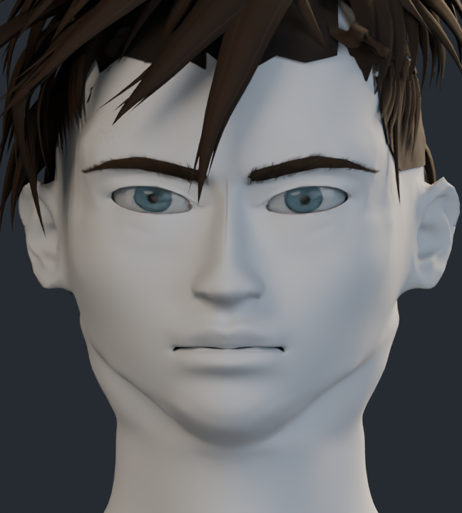
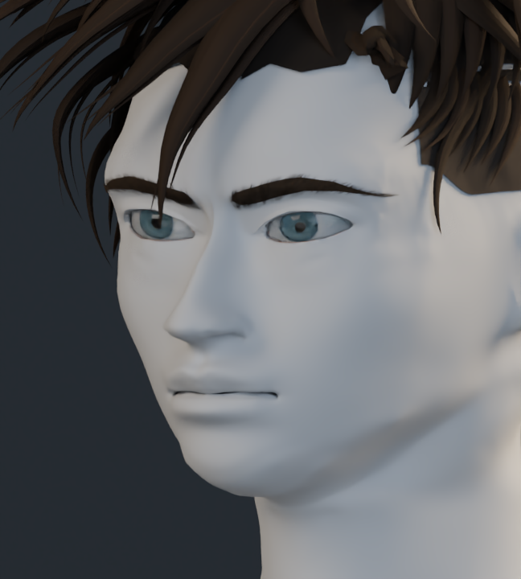
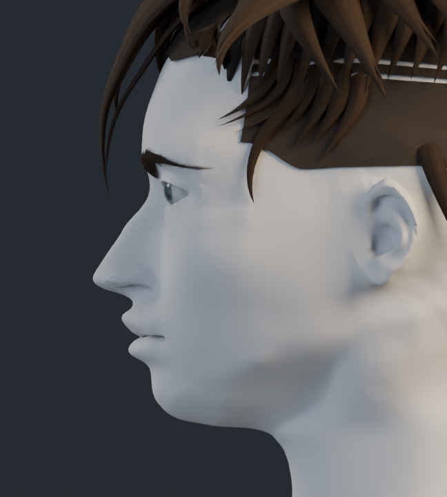
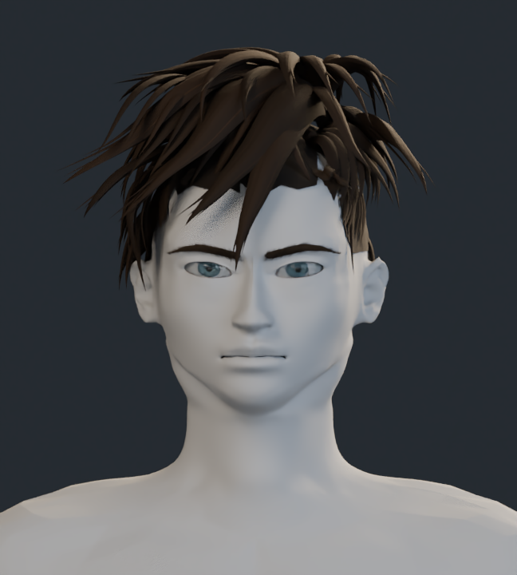

# Estudio de formas · v9

Mismo modelo, con material neutro en la anatomía para evaluar los volúmenes de rostro y cuello. La malla anatómica conserva 157.928 vértices, es cerrada y no tiene caras degeneradas ni triángulos invertidos respecto a v8. La semejanza requiere valoración visual; esas comprobaciones técnicas no certifican el parecido.

## Frente

## Tres cuartos

## Perfil

## Cabeza y cuello

[Volver a la galería con materiales y comparación](../README.md)
